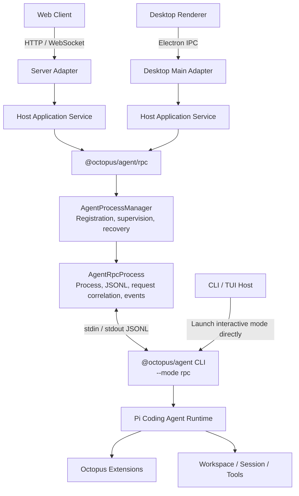

# Octopus

English | [简体中文](https://github.com/nebulaedata/dr-octopus/blob/main/README.dev.zh-CN.md)

Octopus is a local-first, workspace-scoped general-purpose agent system. It uses [Pi Agent](https://github.com/earendil-works/pi) as the foundation for its agent runtime and extension ecosystem. A modular monolith and event-driven state propagation provide consistent runtime semantics across CLI, Web, and Desktop hosts.

## Contributing and security

See the [contributing guide](https://github.com/nebulaedata/dr-octopus/blob/main/CONTRIBUTING.md) for development setup, code conventions, and the PR workflow. See the [security policy](https://github.com/nebulaedata/dr-octopus/blob/main/SECURITY.md) for deployment boundaries, credential protection, and private vulnerability reporting.

## Executor and browser-extension builds

### Executor acceptance builds

Executor targets Windows x64. Prepare Node 22.19+, pnpm 11+, MSVC/Windows SDK, fixed native headers, private resources and packaging tools using the [first-time setup procedure](docs/architecture/executor-delivery.md#首次环境与资源准备). Once prepared, run these commands from the repository root in PowerShell, proceeding only after each command succeeds:

```powershell
pnpm --filter @octopus/shared build
pnpm --filter @octopus/browser-extension build
pnpm --filter @octopus/executor build
pnpm --filter @octopus/executor package:acceptance
```

`--filter @octopus/executor` selects the Executor workspace package; `package:acceptance` runs its acceptance-packaging script using the existing Executor dist and both extension outputs. It does not rebuild or prepare missing resources. Each run creates `apps/executor/release/<version>-unsigned-<UUID>/` with an unsigned installer, ZIP, manifests and acceptance tools. Source or documentation changes do not update existing packages.

The Windows MCP command tool is powershell, using system Windows PowerShell 5.1; PortableGit is no longer assembled or bundled. Private Node/Python and search tools remain bundled. Linux/macOS have explicit branches and TODO comments only and remain unsupported. See [ADR-0084](docs/adr/0084-executor-system-shell.md) for the contract and cleanup scope.

Root `pnpm build` and `pnpm test` exclude Executor. Use `pnpm build:executor` / `pnpm test:executor` or focused package commands. `pnpm dev:executor` starts development: restart after Main/Preload/Runtime changes; Renderer supports HMR. Follow the [build and verification sequence](docs/architecture/executor-delivery.md#日常重新构建与打包) and the [Executor project rules](apps/executor/AGENTS.md).

### Browser-extension builds

For the extension alone, run the first two commands above. Its `build` script builds both WXT targets, then adds dependency licenses. Complete outputs are `apps/browser-extension/.output/chrome-mv3` and `.output/edge-mv3`; do not distribute a partial target or omit licenses.

Use the [extension ZIP procedure](apps/browser-extension/RELEASE.md#4-构建检查并生成提交-zip) to archive successful builds outside `.output`. After updating the extension, reload the complete directory in the browser; rebuild Executor packaging when distributing its bundled extension copies. Verification and delivery constraints belong in the [extension project rules](apps/browser-extension/AGENTS.md).

### Installation and public releases

User operations are documented in the [Executor installation guide](apps/executor/INSTALLATION.md) and [extension installation guide](apps/browser-extension/INSTALLATION.md). Resource provenance, artifact manifests, acceptance tools and offline release gates are maintained in the [delivery guide](docs/architecture/executor-delivery.md).

Configure sideload/store build identities using the [identity procedure](apps/browser-extension/RELEASE.md#33-配置身份并重新构建), then rebuild the affected application. Client identity policy excludes plugin mode and product version; compatible updates can ship independently. Repackage Executor only when distributing updated bundled plugin copies. Official identities come exclusively from browser-identity.json and are required in every build mode.

For public distribution, follow the [Windows signing SOP](apps/executor/RELEASE.md) and [Chrome/Edge store SOP](apps/browser-extension/RELEASE.md). The signing entrypoint still requires engineering work, and actual store identities and installation need verification; acceptance packaging does not produce a signed public release.

## Version releases

From the repository root, run `pnpm release:dry patch` to preview a release, or `pnpm release` to select a version interactively. The workflow then updates `release.config.json`, commits the change, creates a tag, and pushes the current branch. All working-tree changes must be committed, and the branch must have an upstream configured.

Build release artifacts with `pnpm release:build`. Run `pnpm release:publish` to select independent repository and Executor increments, commit both before the shared Tag, then publish npm and create the matching GitHub Release. This requires npm authentication and a `GITHUB_TOKEN` with repository Contents read/write permissions. The publish script loads the optional root `.env.publish`; existing process environment variables take precedence, so CI can use injected credentials directly. If GitHub publication fails, retry the current version with `pnpm release:publish --github-only`. See [CLI version releases](https://github.com/nebulaedata/dr-octopus/blob/main/apps/cli/README.md#版本发版) for commands, prereleases, and retries.

Web build caching is declared in the root `turbo.json`, including `release.config.json`, the Executor `package.json`, and `VITE_*` environment variables. Package overrides must preserve these inputs. Vite also writes the UI's release version to `dist/client/build-meta.json`; assembly checks this identity before creating the archive and rejects missing, malformed, or mismatched builds. Rebuild Web before retrying.

### Recovering from a failed publication

If you committed a fix after a failed publication and HEAD no longer matches the original version tag, ensure the working tree is clean, then run the following command to select a new version, commit and push its tag, and publish:

```powershell
pnpm release:publish --bump
```

With `--bump`, select a new version: for example, choose `patch → 0.0.10` when the current version is `0.0.9`. Do not enter `0.0.9` again. An unchanged version is rejected before files, commits, or pushes are modified.

To publish the original `0.0.9` when its local and remote tags already exist and point to the same commit, save and commit any working-tree changes, then publish from that tag:

```powershell
git switch --detach v0.0.9
pnpm release:publish
git switch -
```

This publishes the tagged code, excluding subsequent commits. After the publish command finishes, the last command returns to the previous branch.

If the current version is not yet published to npm and only the tag push was interrupted (for example, `Push v0.0.9 to origin before publishing`), retry `pnpm release:publish` with a clean working tree and the local tag still pointing to HEAD. The script pushes the missing current tag and verifies the remote result. If the remote tag points to another commit, it stops with a conflict instead of overwriting it. If npm succeeded and only the GitHub Release failed, use `pnpm release:publish --github-only`.

### Continue the current version or publish the next version

Commit the source and release configuration and keep the working tree clean, then run:

```powershell
pnpm release:publish
```

Commander handles CLI arguments. Interactive selection and confirmation use `@clack/prompts`: use arrow keys to select, Enter to confirm, and Ctrl+C to cancel. The script checks the configured version on npm and GitHub before showing the available actions:

| Current state                            | Available actions                                                       |
| ---------------------------------------- | ----------------------------------------------------------------------- |
| Not published to npm                     | Continue the current version, or publish the next version               |
| npm published, GitHub Release incomplete | Continue the current version (GitHub only), or publish the next version |
| Both npm and GitHub Release published    | Publish the next version only                                           |

Network, permission, and lookup failures stop the workflow; they never count as an unpublished version. An existing GitHub draft must be resolved before continuing.

You can also select an action explicitly:

```powershell
pnpm release:publish --resume       # Continue the current incomplete version
pnpm release:publish --bump         # Select and publish the next version
pnpm release:publish --github-only  # Complete GitHub after npm publication
```

With `--bump`, select both repository and Executor increments; the version preview is approved before changing files or committing. Use `--resume` for retries to keep both versions unchanged. Noninteractive new releases require `--increment`, `--executor-increment` and `--yes` or `--ci`; see [CI parameters and token requirements](apps/cli/README.md#非交互发布与-github-actions). CI retains logs and never waits for a prompt.

### Resume 0.0.9 from the current code after a Git push timeout

A push timeout can leave a local version commit and tag; the remote might also have accepted the push. This does not imply npm publication succeeded and does not require a rollback or another version bump.

Keep and commit the publication recovery fixes and current source. Ensure `release.config.json` still specifies `manifest.version: 0.0.9` and the working tree is clean, then run:

```powershell
pnpm release:publish --resume
```

When both npm and GitHub confirm that the version is unpublished, the script creates or recreates `v0.0.9` at the current HEAD, updates the remote tag, rebuilds, and publishes. There is no need to check out the old tag or delete tags manually. The remote update uses `--force-with-lease` to check the previously observed tag and replace it in one push, avoiding a deletion gap if another timeout occurs. A concurrent remote tag change stops the update instead of being overwritten.

If the push times out again, retry the same `--resume` command; it rechecks publication and tag states. Continuing the current version requires a fresh build and rejects `--skip-build` to avoid uploading stale artifacts with the same version number.

Once npm succeeds, continuation never republishes that npm version or recreates its tag; it only completes the GitHub Release. If GitHub succeeded but npm did not, the existing Release tag is also preserved. If HEAD differs from that tag, select the next version.

## Architecture highlights

- [System architecture overview](https://github.com/nebulaedata/dr-octopus/blob/main/docs/architecture/overview.md)
- [Component model](https://github.com/nebulaedata/dr-octopus/blob/main/docs/architecture/component-model.md)
- [Data flow](https://github.com/nebulaedata/dr-octopus/blob/main/docs/architecture/data-flow.md)
- [Technology choices, risks, and roadmap](https://github.com/nebulaedata/dr-octopus/blob/main/docs/architecture/technology-risks-roadmap.md)
- [Architecture Decision Records (ADRs)](https://github.com/nebulaedata/dr-octopus/blob/main/docs/adr/README.md)

## Architecture for integrating Pi Agent with hosts

Octopus uses four layers: host adapters, host application services, RPC infrastructure, and independent Agent processes. The CLI can launch Pi's interactive mode directly. Non-terminal hosts such as the Web Server and Desktop use `@octopus/agent/rpc` to drive the same CLI entrypoint in RPC mode, sharing the same Workspace, extension, and Agent runtime semantics.



### Components and process model

- **Host Adapter** is the system's external entrypoint. It translates HTTP, WebSocket, Electron IPC, or other host protocols into application commands and converts Agent events into messages the host can consume.
- **Host Application Service** owns host-side business state and policies, including identity, Workspace ownership, connection subscriptions, concurrency, quotas, and instance selection. It is the composition root between the host and RPC infrastructure.
- **`AgentProcessManager`** manages `AgentRpcProcess` instances by business key. It provides general process supervision, including registration, readiness checks, restart backoff, circuit breaking, and recovery.
- **`AgentRpcProcess`** starts the `@octopus/agent` CLI with `--mode rpc`. It handles strict JSONL, request/response correlation, event forwarding, timeouts, backpressure, and graceful shutdown.
- **The Pi Agent subprocess** is the authoritative owner of Agent Sessions, tool execution, and extension lifecycles. By default, each Workspace has its own process; the host decides whether to reuse, reclaim, or run processes concurrently.
- **CLI / TUI** can launch Pi's interactive mode directly through the same `@octopus/agent` CLI entrypoint without an RPC host.

### Bidirectional communication

Hosts send RPC commands with unique IDs, such as `prompt`, `abort`, `get_state`, and session operations. Responses indicate only whether a command was executed or accepted. Agents send streaming events without request IDs, including message deltas, tool execution, queue state, and `agent_settled`. Extension UI requests share the output stream with ordinary Agent events. The host renders them and sends UI responses back to the subprocess.

```text
Host command
    → Host Application Service
    → AgentRpcProcess.request/execute
    → stdin JSONL
    → Pi Agent

Pi response / event / Extension UI request
    → stdout JSONL
    → AgentRpcProcess
    → Host Application Service
    → HTTP response / WebSocket event / Electron IPC
```

### Integration lifecycle

1. The host resolves the business key and working directory from the user or Workspace.
2. The Host Application Service calls `AgentProcessManager.ensureReady(...)` to obtain the single healthy process for that key.
3. The manager starts `@octopus/agent --mode rpc` and checks protocol readiness with `get_state`.
4. The host subscribes to Agent events and Extension UI requests before sending commands so it does not miss fast events.
5. The host sends commands through `request(...)` or `execute(...)` and waits for responses by request ID. Streaming execution uses `agent_settled` as the authoritative completion signal.
6. After a session switch, the host synchronizes state again without retaining mutable objects from inside the subprocess.
7. During shutdown, the host stops accepting new requests, cancels active work, waits for the Agent to settle, and calls `stop(...)` or `stopAll()` to reclaim subprocesses.

## Agent RPC and host boundaries

`@octopus/agent/rpc` is the host-independent Agent RPC infrastructure layer. It enables hosts such as Server and Desktop to access the Agent through Pi RPC, but implements neither external protocols nor product business logic.

```text
Server / Desktop / other hosts
             ↓
Host Application Service
             ↓
@octopus/agent/rpc
             ↓
Pi RPC Agent subprocess
```

### RPC infrastructure responsibilities

- Start, stop, and supervise Agent RPC subprocesses.
- Handle JSONL encoding and decoding, request ID correlation, timeouts, backpressure, and protocol errors.
- Forward Agent events and Extension UI requests.
- Provide general mechanisms for readiness checks, graceful termination, failure recovery, restart backoff, and circuit breaking.
- Remain independent of hosts, with no dependency on HTTP, WebSocket, Electron IPC, users, or tenants.

### Host responsibilities

- Implement external adapters for HTTP, WebSocket, Electron IPC, and other protocols.
- Maintain mappings between users, tenants, Workspaces, connections, and Agent instances.
- Define authentication, authorization, quota, concurrency, queueing, cancellation, and lifecycle policies.
- Handle event broadcasting, slow consumers, reconnection, idempotency, and multi-instance deployments.
- Translate host requests into RPC commands and project Agent events into the host protocol.

Dependencies must always point from the host to `@octopus/agent/rpc`. The RPC infrastructure must not depend on hosts or absorb product-specific policies. See [ADR-0001: Use Pi RPC as the bridge between Agent and hosts](https://github.com/nebulaedata/dr-octopus/blob/main/docs/adr/0001-pi-rpc-host-architecture.md) for the decision.

## Database schema and migrations

Server uses Drizzle to manage SQLite. `apps/server/src/db/schema.ts` is the sole structural source for ordinary tables, columns, indexes, foreign keys, defaults, and constraints. Structures that Drizzle can express must be declared through its Schema API, rather than handwritten table-creation SQL in application startup code.

After changing the database structure, run:

```bash
pnpm --filter @octopus/server db:generate --name=<change-name>
pnpm --filter @octopus/server db:check
```

`apps/server/drizzle/` is database version history that must be committed, not an ignorable build artifact. Commit schema changes together with the generated migration, `meta/_journal.json`, and `meta/*_snapshot.json`. Drizzle Kit manages ordinary migration SQL and `meta/`; do not edit them manually. Do not rewrite migrations that have been committed or applied in a shared environment. Generate new migrations for subsequent changes.

Custom migrations are allowed only for native database capabilities that the current Drizzle SQLite Schema API cannot express. Create them with:

```bash
pnpm --filter @octopus/server db:generate --custom --name=<change-name>
```

Each custom migration must explain why the Drizzle Schema API cannot be used. The only current custom SQL covers SQLite FTS5 virtual tables and their synchronization triggers; ordinary tables, indexes, and constraints must not use custom SQL. On startup, Server uses Drizzle's official migrator to apply committed migrations that have not yet run.

### Why `drizzle.config.ts` has no `dbCredentials`

Official examples often include:

```ts
dbCredentials: {
  url: process.env.DB_FILE_NAME!,
}
```

This lets the following CLI commands connect to a real database:

- `drizzle-kit push`
- `drizzle-kit migrate`
- `drizzle-kit pull`
- `drizzle-kit studio`

This project uses:

```text
drizzle-kit generate
+
drizzle-orm migrate() during Server startup
```

Drizzle Kit therefore needs only `schema` and `out`, not the actual database location. Server derives its runtime database path from `SERVER_DATA_DIR` as `<SERVER_DATA_DIR>/octopus.db`. The default is `.dr-octopus/server/octopus.db` under the user's home directory.

If `dbCredentials` is added later for tools such as Drizzle Studio, it will specify only the database used by the Drizzle Kit CLI. It cannot replace Server's `SERVER_DATA_DIR` runtime path contract. Both paths must derive from the same configuration source so the CLI and Server do not operate on different database files.

## Agent Inline Extension architecture

Octopus integrates its built-in Agent extensions through Pi `InlineExtension`. The application explicitly assembles extensions through `extensionFactories` when starting Pi, rather than relying on automatic discovery in user or project directories. This approach suits capabilities that must ship with Octopus, reuse application services, or maintain consistent semantics across CLI, RPC, and other runtime modes.

See the [Agent Inline Extension development guide](https://github.com/nebulaedata/dr-octopus/blob/main/packages/agent/src/extensions/README.md) for directory conventions, layer boundaries, factory assembly, Pi surface selection, lifecycles, and testing requirements. Workspace is the current reference implementation; see [Workspace architecture](https://github.com/nebulaedata/dr-octopus/blob/main/docs/architecture/octopus-workspace.md) for its business boundaries.

## Local skill links

`.agents/skills` is the sole source for project skills and is tracked by Git. `.claude/skills` is a locally generated directory link. After the first checkout, or whenever the link is missing, run:

```bash
pnpm skills:link
```

Windows uses a directory junction; macOS and Linux use a directory symlink. If `.claude/skills` is already a real directory or points elsewhere, the script refuses to overwrite it and asks you to resolve it manually first.

## License

Original project code is licensed under the [MIT License](https://github.com/nebulaedata/dr-octopus/blob/main/LICENSE). Third-party code, binary tools, and assets retain their own licenses and rights; see [Third-party notices](https://github.com/nebulaedata/dr-octopus/blob/main/THIRD_PARTY_NOTICES.md).

## Executor file transfer

External agents connect directly to Executor MCP and use their existing local HTTP tools to stream files with task-bound temporary credentials. No additional client application is required. See [ADR-0079](docs/adr/0079-executor-file-transfer.md) and [Executor installation](apps/executor/INSTALLATION.md).
