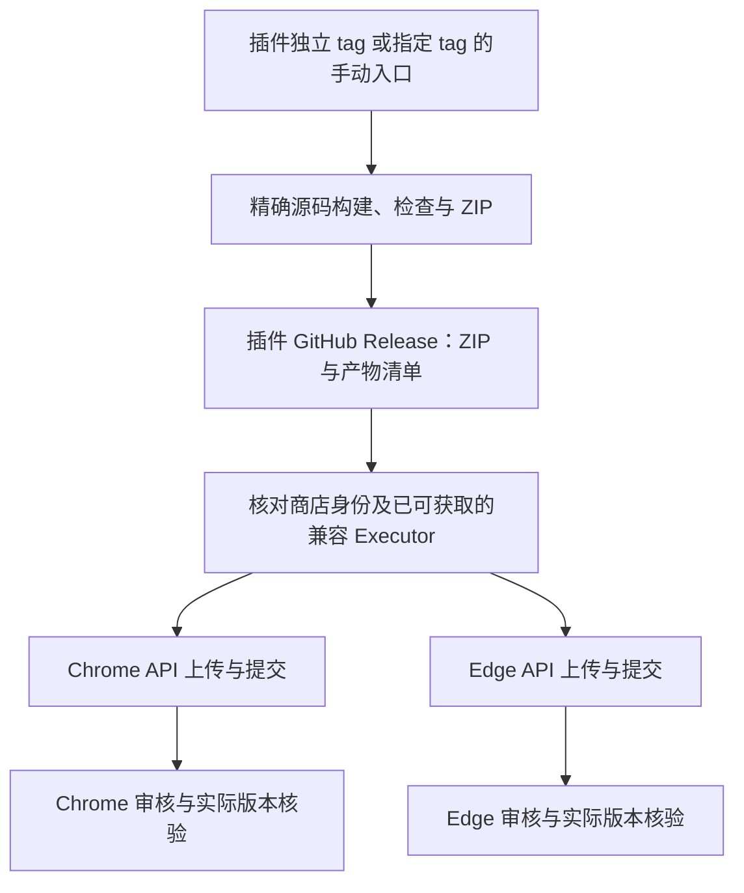

# Chrome / Edge 浏览器商店发布 SOP

适用：Octopus Browser Bridge 的 WXT/MV3 Chrome Web Store 与 Microsoft Edge Add-ons 发布。外部流程核对日期：2026-10-12；正式提交前按官方后台和政策复核。

构建准备见[交付指南](../../docs/architecture/executor-delivery.md)，用户操作见 [INSTALLATION.md](INSTALLATION.md)，配套桌面程序签名见[Executor 发布 SOP](../executor/RELEASE.md)。本手册放在应用内长期维护，不累计阶段报告。

## 1. 发布对象与现有能力

| 项目        | 当前状态                                          | 本次交付                                        |
| ----------- | ------------------------------------------------- | ----------------------------------------------- |
| 构建        | build 一次执行 Chrome/Edge 构建，再附带依赖许可证 | 两份完整 MV3 目录及独立 ZIP                     |
| 版本        | package.json 当前为 0.1.3                         | 根据已有商店提交记录选择更高发布版本            |
| 商店入口    | 当前尚未上架，客户端显示尚未上架                  | 两店审核通过后的真实链接                        |
| 扩展身份    | 当前侧载 ID 为 `oigkjlnafjdkoknajgeboknaoemkcbfj` | 两个商店实际 extension ID；侧载开发公钥独立保存 |
| Native Host | 按构建配置生成精确来源列表                        | 所有相关来源校验与注册迁移匹配已批准实际 ID     |
| 自动发布    | 商店支持 API；本仓库尚无上传/提交脚本             | 首发按后台流程完成，后续按第 9 节接入           |

商店上传的是包含 manifest.json 的 **扩展 ZIP**，不是 Executor EXE，不需要购买 Windows Authenticode 证书来给商店 ZIP 签名。桌面 Native Host 由配套 Executor 安装和管理，浏览器商店不会代装它。[Chrome 上传格式](https://developer.chrome.com/docs/webstore/prepare)、[Edge 扩展分发与 Native Host](https://learn.microsoft.com/en-us/microsoft-edge/extensions/developer-guide/native-messaging)

流程为：**准备账号及资料 → 构建首次草稿 ZIP → 获取并核对商店 ID → 完成 Native Host 适配及真实身份测试 → 构建最终 ZIP 与配套 Executor → 填写审核资料 → 提交审核 → 商店安装验收 → 后续同条目更新**。

## 2. 账号与提交资料准备

### 2.1 Chrome Web Store

已有开发者账号时跳过重复注册，核对账号权限、两步验证和联系信息；第 9 节的 Google Cloud/API 授权仍需单独配置。

1. 发布负责人用长期维护的 Google 账号进入 [Chrome Developer Dashboard](https://chrome.google.com/webstore/devconsole)。
2. 注册开发者、填写真实主体信息、接受实际协议，并按注册页面支付一次性注册费；金额以页面为准。当前官方支持地区包含中国。[账号注册](https://developer.chrome.com/docs/webstore/register)
3. 启用 Google 账号两步验证，验证联系邮箱、完善 publisher name 和通知配置，确保拒审/安全邮件有负责人处理。[两步验证要求](https://developer.chrome.com/docs/webstore/program-policies/two-step-verification)、[账号设置](https://developer.chrome.com/docs/webstore/set-up-account)
4. 团队确定账号所有者、可授权的发布成员与恢复方式。账号购买/协议和主体验证由实际权利人操作，不共享生产凭据到仓库。

### 2.2 Microsoft Edge Add-ons

已有开发者账号时跳过重复注册，确认 Edge 工作区和条目权限；Publish API 凭据与开发者账号注册分别准备。

1. 发布负责人按 [Edge 开发者注册](https://learn.microsoft.com/en-us/microsoft-edge/extensions/publish/create-dev-account)创建/关联 Microsoft account，并进入 [Partner Center](https://partner.microsoft.com/dashboard)。
2. 注册 Microsoft Edge program，按真实情况选组织或个人账号，完成主体、联系人和验证。当前 Edge 扩展 program 注册不收注册费，不把其他微软项目的开户费用套用到此流程。
3. 确认 Edge 工作区可用，账号状态完成验证；按团队权限管理发布成员并保护账号恢复信息。

### 2.3 公共商店资料

| 资料        | 准备内容                                                                                                                                             |
| ----------- | ---------------------------------------------------------------------------------------------------------------------------------------------------- |
| 名称/描述   | 与最终 manifest 一致；说明是用户控制的本机 Executor 浏览器连接扩展，依赖 Windows x64 Executor                                                        |
| 首页/支持   | 实际可访问的产品介绍、安装说明、支持邮箱或问题页面                                                                                                   |
| 隐私政策    | 实际公开 HTTPS URL，说明访问的数据、用途、接收方、本地保存/时长、用户选用智能体服务和撤销/删除方法                                                   |
| 截图        | 自有测试环境演示连接、暂停/恢复和浏览器工具，不放用户网页、Token、配置或证书资料                                                                     |
| Chrome 素材 | 准备 128×128 商店图标、1280×800 演示截图和 440×280 小宣传图；具体必填项以当前后台及[图片规范](https://developer.chrome.com/docs/webstore/images)为准 |
| Edge 素材   | 准备各语言的说明与正方形 logo，官方推荐 300×300、最小 128×128；其余素材以后台必填项为准                                                              |
| 审核说明    | Executor 下载链接/版本/发布者、无敏感数据的演示网页、完整操作步骤和测试限制                                                                          |
| 兼容性      | Windows/Chrome/Edge 范围、Native 协议、需要的最低 Executor 版本和逐版本验证结果                                                                      |

Chrome 的 listing 与 manifest 元数据分别维护；Edge 部分 manifest 字段直接用于 listing。按对应后台逐项填写，不靠 ZIP 自动生成全部资料。[Chrome listing](https://developer.chrome.com/docs/webstore/cws-dashboard-listing)、[Edge 提交页面](https://learn.microsoft.com/en-us/microsoft-edge/extensions/publish/publish-extension)

## 3. 先取得商店身份，再完成 Native Host 适配

### 3.1 获取并记录身份

1. 按第 4 节生成不含 manifest.key 的商店上传 ZIP；不能直接压缩侧载目录上传。Chrome 后台选 Add new item，上传 chrome ZIP 创建草稿，先不要公开发布。两店均已实际拒绝包含 key 的首次上传包。
2. 在 Package 中记录 Item ID，通过 View public key 取得公钥。开发侧载若要与该商店保持一致，使用后台提供的公钥并对照 chrome://extensions 的实际 ID。[Chrome key 与 ID 官方流程](https://developer.chrome.com/docs/extensions/reference/manifest/key)
3. Edge Partner Center 的 Edge 工作区选 Create new extension，上传 edge ZIP 创建条目，记录后台提供的 Native Messaging 所需 extension ID。若草稿阶段不能确认最终 ID，先使用适当的测试分发方式取得商店安装实例，并从 edge://extensions 核对实际 ID。
4. 不把 Partner Center 内部产品编号当作 extension ID。记录 Chrome、Edge 各自的商店条目、链接、实际 runtime/扩展详情 ID，分别核验。
5. 当前侧载 public key 只用于稳定开发身份，不能据此保证商店安装沿用当前 ID；Edge 官方明确提示发布 ID 可能与侧载不同。[Edge Native Messaging 身份](https://learn.microsoft.com/en-us/microsoft-edge/extensions/developer-guide/native-messaging)

Chrome/Edge 正式 ID 可能不同。只有实际 ID 已核对且完整来源校验通过，才可以交付公开配套 Executor；不能因为本机侧载连接成功就跳过这一步。

### 3.2 本仓库需要核对的工程点

身份属于构建配置，由本项目的 [browser-identity.json](browser-identity.json) 作为官方公开身份的唯一来源；共享协议不保存应用发行身份。两应用构建共用 [配置解析器](scripts/lib/browser-identity.mjs)，Executor 的 [产物生成与核验](../executor/scripts/lib/compile/browser-identity.mjs) 将同一快照编入启动器、Native Host、Runtime 和注册脚本。

Native Host 与 Runtime 继续校验真实调用 origin；注册 manifest 的 allowed_origins 与编译列表一致，Chrome/Edge 调用身份原样传递。只能使用已批准的确切 ID，不接受通配符或任意来源。[Chrome allowed_origins 规则](https://developer.chrome.com/docs/extensions/develop/concepts/native-messaging)

### 3.3 配置身份并重新构建

1. 所有官方身份只在 [browser-identity.json](browser-identity.json) 维护：sideload 保存固定公钥及对应 ID，stores 保存 Chrome/Edge 的实际商店扩展 ID。两个商店字段在所有构建模式下都必填，必须是 32 位小写 a–p，不能填 Product GUID。代码不读取商店 ID 环境变量，也不将缺失商店身份回退为侧载身份。

2. 根 .env 或 CI 只选择插件产物模式。唯一变量为 BROWSER_IDENTITY_PROFILE，优先级是进程/CI 环境变量 → 根 .env → sideload。缺少 .env 不影响三个官方身份解析；客户端构建完全不读取 .env。

   ```dotenv
   BROWSER_IDENTITY_PROFILE=sideload
   ```

3. 本地安装产物保持 sideload；制作商店提交产物时选择 store。sideload 携带固定公钥，store 不携带 manifest.key。两种模式的客户端使用相同的官方身份集合。身份变更在 JSON 中进行代码审查，不另建 .env/CI 身份覆盖或旧配置兼容分支。令牌、签名私钥和密码另行安全管理，不写入该公开 JSON。

4. 构建会校验完整身份配置、公钥与侧载 ID 的对应关系，并对允许来源排序去重。任一身份缺失或非法均立即失败，不生成缺少官方渠道的客户端。
5. 首次联合构建按 shared → browser-extension → executor 顺序。改变客户端允许的身份集合时重建客户端；切换 profile 或发布协议兼容的插件版本时只重建插件。客户端兼容改进也无需重建插件。修改 JSON 或插件模式不会改变已安装程序；运行时不读取构建配置。分发更新后的客户端内置插件副本时执行 package:acceptance，独立商店插件更新不要求重打客户端包。
6. 客户端 dist/browser-identity.json 保存 identity、protocolVersion 和四个消费者摘要；identity 指纹不含插件模式或产品版本。插件两份 .output/<browser>-mv3/browser-identity.json 保存 identity、profile、protocolVersion、extensionVersion。客户端自身校验不读取插件输出；打包额外验证各插件实际渠道身份在客户端允许列表中、协议相同、manifest 版本与其独立构建记录相同，以及侧载 key/商店无 key 规则。两端产品版本和完整策略指纹无需相等。任何校验失败停止，不手工修改生成记录。
   Executor 的 Turbo 任务只跟踪公开身份文件及解析器，不依赖根 .env 或身份环境变量。插件任务保留 .env 和 BROWSER_IDENTITY_PROFILE 以跟踪产物模式。切换插件模式时只需执行插件构建，无需调用客户端构建。

7. 注册脚本源码是模板，执行成功构建后生成的 dist/setup/register-browser-host.ps1。安装路径迁移仅识别同一产品契约下的当前完整精确来源集合；不兼容旧身份集合，未知、不完整、重复或缺失来源拒绝，旧卸载保留新安装注册。

配置/Native 回归支持两种 profile。Executor 使用侧载副本的真实浏览器集成在 sideload 构建下执行；store 产物省略侧载 key，不能用 Load unpacked 的随机身份替代真实商店安装。插件 test:popup 是 UI 专项，在 store 下只给独立测试副本设置开发 key，不证明商店来源就绪。

双 ID 的隔离测试证明构建与来源传递机制；实际商店身份和安装仍按第 7 节验收。

### 3.4 PageController 依赖维护

当前固定 @page-agent/page-controller@1.12.4，并通过根 patches/@page-agent__page-controller@1.12.4.patch 仅移除未使用的 executeJavascript 方法与类型声明；通过公开 API 启用动作期间的遮罩、彩屏和指针，快照通过公开生命周期与高亮清理 API 接入。每次动作结束释放 Controller/遮罩。扩展仅派发协议允许的有限方法，不暴露任意脚本执行能力；构建验证全部发布 JavaScript/源码映射不含该方法及 eval 调用，不通过日志过滤隐藏告警。

依赖修改遵守 [项目规范](AGENTS.md#第三方依赖修改原则)。本补丁是用户明确批准的产物裁剪例外：未调用的方法仍被打包并产生 EVAL 告警，仅关闭协议无法从产物移除，过滤日志也不改变产物；这不代表已发生商店拒审。补丁不修改遮罩/高亮。升级时检查上游是否已有不包含该方法的入口或版本，满足当前有限操作需求后移除补丁。

确有必要时，使用 pnpm patch <包名@版本> 在命令返回的独立目录中修改，再使用 pnpm patch-commit <目录> --patches-dir patches。提交补丁、workspace 配置与锁文件，并用 pnpm install --frozen-lockfile 验证一致性；禁止直接编辑 node_modules 或恢复自制补丁引擎。

## 4. 构建、检查并生成提交 ZIP

所有命令从仓库根目录的 PowerShell 执行。依赖安装及 Executor 资源准备沿用交付指南；每条命令成功后再继续。

1. 编辑 apps/browser-extension/package.json 的 version；商店上传的新版本应高于此前上传版本。WXT 生成的两份 manifest version 必须一致。[Chrome 版本与 ZIP 要求](https://developer.chrome.com/docs/webstore/prepare)
2. 使用项目 build，保留双目标与许可证流程，不单独使用一次 wxt build 替代完整构建：

   ```powershell
   pnpm --filter @octopus/shared build
   pnpm --filter @octopus/browser-extension build
   pnpm --filter @octopus/browser-extension lint
   pnpm --filter @octopus/browser-extension typecheck
   pnpm --filter @octopus/browser-extension test
   pnpm --filter @octopus/browser-extension test:popup
   ```

3. 查看最终 manifest：

   ```powershell
   Get-Content 'apps/browser-extension/.output/chrome-mv3/manifest.json'
   Get-Content 'apps/browser-extension/.output/edge-mv3/manifest.json'
   ```

   核对 MV3、版本、实际目标浏览器、popup、16/32/48/128 图标、权限及注入范围。当前权限来自源码的 nativeMessaging、storage、alarms、scripting 和 HTTP/HTTPS 网站访问；不要把 unused 权限或测试故障开关带入包。

4. 在 apps/browser-extension/release/ 下新建版本/UUID 目录保存本次两份 ZIP，避免下一次 WXT build 清理 .output 时丢失已提交产物。release 已由本项目 .gitignore 排除，不提交生成 ZIP；草稿目录可在版本后标记 store-draft。

   商店上传 manifest 不得含 key。以下流程复制当前完整成功构建，在归档副本去掉 key，并将构建身份记录留在源码构建目录而不混入上传包；不改 .output 的侧载产物。即使 store 构建已省略 key，也执行相同上传检查：

   ```powershell
   $extensionVersion = (Get-Content 'apps/browser-extension/package.json' -Raw | ConvertFrom-Json).version
   $storeOutput = Join-Path 'apps/browser-extension/release' ($extensionVersion + '-' + [guid]::NewGuid().ToString())
   New-Item -ItemType Directory -Path $storeOutput | Out-Null
   $chromeZip = Join-Path $storeOutput ('Octopus-Browser-Bridge-' + $extensionVersion + '-chrome.zip')
   $edgeZip = Join-Path $storeOutput ('Octopus-Browser-Bridge-' + $extensionVersion + '-edge.zip')
   foreach ($flavor in @('chrome', 'edge')) {
     $source = Join-Path 'apps/browser-extension/.output' ($flavor + '-mv3')
     $upload = Join-Path $storeOutput ('upload/' + $flavor)
     New-Item -ItemType Directory -Path $upload -Force | Out-Null
     Get-ChildItem -LiteralPath $source -Force |
       Where-Object { $_.Name -ne 'browser-identity.json' } |
       ForEach-Object { Copy-Item -LiteralPath $_.FullName -Destination $upload -Recurse }
     $manifestPath = Join-Path $upload 'manifest.json'
     $manifest = Get-Content -LiteralPath $manifestPath -Raw | ConvertFrom-Json
     $manifest.PSObject.Properties.Remove('key')
     [IO.File]::WriteAllText($manifestPath, ($manifest | ConvertTo-Json -Depth 30 -Compress), [Text.UTF8Encoding]::new($false))
     $zip = if ($flavor -eq 'chrome') { $chromeZip } else { $edgeZip }
     Compress-Archive -Path (Join-Path $upload '*') -DestinationPath $zip
   }
   ```

5. 在同一会话检查 ZIP 根目录与许可，生成摘要；该检查不会上传文件：

   ```powershell
   Add-Type -AssemblyName System.IO.Compression.FileSystem
   foreach ($zip in @($chromeZip, $edgeZip)) {
     $archive = [System.IO.Compression.ZipFile]::OpenRead($zip)
     try {
       if (!$archive.GetEntry('manifest.json')) { throw 'ZIP 根目录缺少 manifest.json。' }
       $reader = [IO.StreamReader]::new($archive.GetEntry('manifest.json').Open())
       try { $uploadedManifest = $reader.ReadToEnd() | ConvertFrom-Json } finally { $reader.Dispose() }
       if ('key' -in $uploadedManifest.PSObject.Properties.Name) { throw '商店 ZIP 的 manifest 不得包含 key。' }
       if ($archive.GetEntry('browser-identity.json')) { throw '构建身份记录不能混入上传 ZIP。' }
       if (!$archive.GetEntry('popup.html')) { throw 'ZIP 缺少 popup.html。' }
       if (!($archive.Entries | Where-Object { $_.FullName -like 'licenses/*' })) {
         throw 'ZIP 缺少依赖许可证。'
       }
       if ($archive.Entries | Where-Object { $_.FullName -match '\.(pfx|p12|pem)$|(^|/)\.env($|\.)' }) {
         throw 'ZIP 存在凭据/私钥文件风险，停止提交。'
       }
     } finally {
       $archive.Dispose()
     }
     Get-FileHash -LiteralPath $zip -Algorithm SHA256
   }
   ```

6. 用独立测试 Profile 加载对应完整产物，测试 popup、暂停持久化/恢复、真实 Host、网页操作和拒绝。实际商店安装身份仍需第 7 节验证；测试副本/侧载成功不替代商店来源成功。

## 5. 审核用权限与隐私说明

以下是按当前源码整理的说明提纲，发布负责人逐项核对实际行为后填写，不把提纲自动当作隐私承诺：

| 权限/范围           | 向审核人员说明的目的                                                            |
| ------------------- | ------------------------------------------------------------------------------- |
| nativeMessaging     | 与用户安装的本机 Executor Native Host 通信；商店安装扩展后仍需安装/启动配套程序 |
| storage             | 保存安装实例和连接/暂停偏好；解释哪些状态持久化及如何清除                       |
| alarms              | 有界连接维护/重连调度，用户暂停后不自动恢复                                     |
| scripting           | 按固定协议为缺少接收器的网页补注入包内脚本，不接受任意脚本执行                  |
| HTTP/HTTPS 网站范围 | 读取和操作用户授权的目标网页，说明跨站任务为何需要这些范围、权限拒绝如何处理    |

Chrome/Edge 要求单一清楚用途、必要权限和准确的数据声明。广泛网站权限需要充分理由；如果当前用途无需某项权限，先修改源码、验证并重建，不只在表单中声称没有使用。[Chrome 权限政策](https://developer.chrome.com/docs/webstore/program-policies/permissions)、[Chrome 隐私表单](https://developer.chrome.com/docs/webstore/cws-dashboard-privacy)

需要核对的数据包括页面 URL/文本/结构、网页工具结果/图像、表单输入和用户操作请求。按实际数据流说明扩展到本机 Executor，再到用户配置的 MCP/智能体客户端及可能的模型服务。分别声明存储位置、时长、删除与接收方，不能因为用了 Native Messaging 就自动勾选“不收集”或承诺数据始终不离开电脑。[用户数据与隐私政策要求](https://developer.chrome.com/docs/webstore/program-policies/user-data-faq)

MV3 的执行代码应随扩展打包，不远程下载并执行 JS/WASM；本项目保持有限工具，不提供任意脚本入口。对最终包/依赖审查后填写 remote code 项；自然语言指令/JSON 数据与可执行代码区分，不能把下载代码伪装成数据绕过审核。[Chrome remotely hosted code](https://developer.chrome.com/docs/extensions/develop/migrate/remote-hosted-code)

审核测试说明至少包含：

1. 在 Windows x64 普通用户下从实际 HTTPS 下载链接取得对应签名 Executor，附版本、预期发布者和 SHA-256。
2. 安装并打开 Executor，确认基础服务启动；安装审核渠道的对应扩展。
3. 在 Executor 连接页启用桥接，打开插件弹窗恢复/重连，确认实际实例连接及工具就绪。
4. 创建 browser 能力授权，复制到审核人员的专用 MCP 测试客户端；不公开生产 Bearer、用户模型密钥或签名凭据。
5. 在无敏感信息的测试网页通过 task_begin/browser_list/browser_open_tab/browser_snapshot 等公开工具验证真实链路；提供实际客户端与参数说明，避免只演示 UI 假数据。
6. 测试暂停/恢复、网站权限拒绝和授权撤销。明确关闭桥接只停止新派发，已派发动作可能完成或结果未知。
7. 说明当前只支持 Windows 本机 Host，Executor 必须已启动；Computer 能力保持当前门禁，商店审核不开放它。

需要审核专用账号时使用可撤销、最小权限的测试账号，并按后台专用测试字段安全提供；商店公开描述和截图中不包含凭据。

## 6. 分别提交两个商店

### 6.1 Chrome Web Store

1. 在原草稿 Item 的 Package 页面上传第 4 节最终 chrome ZIP，核对 version、Item ID 和 ZIP 摘要记录。
2. 填 Store listing 的语言、名称/说明、类别、真实截图、图标、首页/支持链接；manifest 错误要回源码修复并重新构建。
3. 填 Privacy practices 的单一用途、权限理由、remote code、数据使用及真实隐私 URL，与第 5 节和实际行为一致。
4. 配置分发地区/可见性，填写后台当前要求的审核测试资料。首次建议使用适当测试范围或审核通过后手动发布，先确认配套 Executor 可下载且身份适配完成。
5. 发布负责人检查最终包、表单、权限和依赖说明，再点击 Submit for review。审核通过后按后台发布，记录实际商店链接及状态；审核时长以实际后台为准。

Chrome 支持审核完成后手动发布；选择这个方式时按后台有效期限发布或重新提交。[Chrome 官方发布步骤](https://developer.chrome.com/docs/webstore/publish)

### 6.2 Microsoft Edge Add-ons

1. 在 Partner Center 原 Edge 条目的 Packages 上传最终 edge ZIP，核对版本与实际 extension ID。
2. 填 Availability 的可见性/地区，Properties 的网站/支持信息，Privacy 的用途、权限、代码和数据声明，以及各语言 Store listings。
3. 在 Notes for certification 填入配套 Executor 的获取与完整测试步骤，确保审核人员能执行核心功能。
4. 发布负责人检查后提交 certification，跟踪问题并保存审核反馈；后台显示 In the Store 后记录实际链接与版本。

Edge 的 Hidden 只改变被发现方式，不能当作权限控制。先确认实际可访问范围，再用于测试分发。[Edge 官方提交流程](https://learn.microsoft.com/en-us/microsoft-edge/extensions/publish/publish-extension)

两店分别上传、审核和维护，不把 Chrome 审核通过视为 Edge 已通过。审核拒绝时按实际原因修改，不删除必要安全边界来“让审核可以连接”。

## 7. 商店安装验收与协同发布

- [ ] 用独立普通 Chrome/Edge Profile 从对应商店安装；不以 Load unpacked 的实例替代。
- [ ] 记录商店链接、浏览器/扩展版本、实际 ID，与 Executor 精确来源允许列表一致。
- [ ] 使用与该插件兼容的签名 Executor，验证安装注册、真实握手、MCP browser 授权和网页工具。
- [ ] 验证页面权限不足、受保护页面、暂停持久化、手动恢复、撤销授权和 Executor 退出时的拒绝行为。
- [ ] 从已发布上一版本升级，确认 ID 不变、偏好与任务边界符合现有设计；分别验证侧载到商店迁移，不能假定两者共用原 storage。
- [ ] 核对已公开隐私说明、下载链接、版本说明与实际发布范围一致。
- [ ] 只在确认真实 URL 后更新客户端“尚未上架”入口、安装说明及兼容性信息，重建需要交付的 Executor。

扩展商店更新可能先于用户手动升级 Executor。对新旧组合建立兼容性矩阵；先分发能识别目标商店身份且已通过验收的 Executor，再扩大插件发布范围。已有生产用户场景下保留约定兼容范围，未知或不兼容组合明确拒绝，不能通过放宽 Native 身份来兼容。

发布记录最少包含：源码标识、Chrome/Edge ID 和版本、两个 ZIP SHA-256、对应 Executor 版本/productBuildId、隐私政策版本、审核记录、真实商店安装验收范围、批准人与时间。

## 8. 后续更新、拒审与回退

1. 更新原商店 Item，不重新创建条目来发布同一扩展；新包提高 version，保留开发公钥/实际商店身份，并重跑当前版本测试。
2. 上传后重新核对权限变化与隐私声明，按各店要求重新审核。代码改变应对应新 ZIP，不能只改商店描述。
3. 修复已发布错误时发布更高版本的修复包；不要把旧低版本 ZIP 当作自动回退机制。[Chrome 更新](https://developer.chrome.com/docs/webstore/update)、[Edge 更新](https://learn.microsoft.com/en-us/microsoft-edge/extensions/update/update-extension)
4. 必要时暂停新分发并按平台机制处理；不要把下架等同于所有已安装实例已经停止。涉及执行风险时明确指导用户暂停桥接、撤销授权并更新配套程序。
5. 账号/凭据事故时保护账号、撤销 CI 授权并按平台支持流程处理。不能用新账号/新 ID 绕过原审核或忽略安装迁移。

| 失败现象                     | 排查与处置                                                                       |
| ---------------------------- | -------------------------------------------------------------------------------- |
| ZIP 无效或 manifest 无法解析 | manifest.json 必须在根；上传编译产物而非整个源码目录，检查 JSON/版本/资源        |
| 侧载正常、商店连接被拒绝     | 核对真实 ID 与第 3 节全部来源检查，不只修改 allowed_origins                      |
| 缺少 Native Host             | 按安装说明安装/启动对应 Executor，核对其实际拥有的注册；扩展不会自动安装桌面程序 |
| 权限/隐私拒审                | 按真实行为与最小权限修改代码/声明及公开政策，重新构建提交                        |
| remote code 拒审             | 检查最终包及依赖是否远程加载执行代码，不用任意脚本或下载解释器绕过               |
| 两店批准时间不同             | 保留各自状态及兼容性矩阵，未通过的一侧不宣称已发布                               |
| 新插件与旧 Executor 不兼容   | 按已明确的版本支持范围拒绝并引导更新，不自动扩大能力或重放旧动作                 |

## 9. 自动发布方案与接入步骤

本节的发行策略已由用户确认，实现待接入，外部 API 核对日期：2026-10-12。账号注册完成不等于首发、API 授权或流水线已经完成；本仓库目前仍只有构建和测试入口。版本与触发方式的取舍见 [ADR-0078](../../docs/adr/0078-browser-extension-store-release.md)。

### 9.0 用户准备清单

已确认仓库为 nebulaedata/dr-octopus，两店开发者账号已有；不重复注册。用户要求先提供资料再开发发布脚本，按以下清单准备：

| 事项           | 用户操作与返回信息                                                                                                                              | 阶段                           |
| -------------- | ----------------------------------------------------------------------------------------------------------------------------------------------- | ------------------------------ |
| Chrome 条目    | 上传第 4 节的草稿 ZIP 创建 Item；提供 Publisher > Settings 的 Publisher ID、Item/实际 extension ID、当前状态及最新已上传/发布版本               | 开发前                         |
| Edge 条目      | 在 Partner Center 创建条目；分别提供 Product GUID、实际 32 位 extension ID、当前状态及最新已上传/发布版本                                       | 开发前                         |
| Chrome 身份    | 选择/创建 Google Cloud 项目，启用 Chrome Web Store API；创建服务账号并在商店 Account 绑定，返回项目 ID/编号和服务账号邮箱                       | 开发前                         |
| GitHub 权限    | 确认可管理仓库 Actions 与 Environments；默认使用 chrome-web-store、edge-addons 两个发布环境，告知组织限制或已有 runner 要求                     | 开发前                         |
| Chrome WIF     | 配置 GitHub OIDC 联合身份与服务账号模拟，限制本仓库、受控发行来源/发布环境；提供 provider 完整资源名，生产不创建 JSON 私钥                      | 联调前；未配置时开发前说明状态 |
| Edge 凭据      | Microsoft Edge > Publish API 启用 API key 模式，返回 Client ID、过期日期；API key 直接保存到 edge-addons 的 EDGE_API_KEY Secret，仅返回“已设置” | 联调前；未配置时开发前说明状态 |
| 首发与产品资料 | 后台补齐商店描述、隐私政策、截图、审核步骤；Edge 首次发布通过后台完成；提供兼容 Executor 版本和真实下载地址，签名/商店安装按第 7 节验收         | 自动提交启用前                 |

扩展 ID 未确认时不使用 Product GUID 或测试 ID 代替。草稿阶段不能确认实际 Edge ID 时标记待取得；开发与实际提交的前置条件分别记录，不能假定账号注册等于首次上架。商店密码、API key、访问令牌及私钥不通过聊天传递。

公开 ID 会同步到 browser-identity.json；第 9.4 节发布变量必须与构建身份匹配。可先返回已取得的公开信息和未完成项状态；WIF/API 凭据不需要等待脚本文件存在才能准备，实际权限和 API 联调在实现后验证。发布版本由两店最高已上传版本决定，不默认当前 0.1.3 可用于更新。

### 9.1 两个商店支持什么

| 能力                 | Chrome Web Store                                                      | Microsoft Edge Add-ons                                           |
| -------------------- | --------------------------------------------------------------------- | ---------------------------------------------------------------- |
| ZIP 上传、提交更新   | 支持 Chrome Web Store API v2                                          | 支持 Publish API 的 API key 模式（v1.1）                         |
| 初始条目与资料       | 先在后台创建条目并完成 Store listing / Privacy；API 上传面向已有 Item | 首次发布必须使用 Partner Center；更新已有发布条目才能用 API      |
| 状态查询             | fetchStatus 区分上传、提交与已发布 revision，带实际版本               | 查询上传/提交 operation；操作成功仍需核对审核和商店版本          |
| 审核后发布           | 默认审核通过后发布；STAGED_PUBLISH 可保留待发布状态                   | 不能按 Chrome 的 staged 参数实现；按 Edge 提交流程及后台状态处理 |
| 描述、截图、隐私资料 | 继续由后台维护，不把更新 ZIP 当成更新全部资料                         | API 不提供产品创建或 metadata 更新端点，使用后台                 |

官方能力：[Chrome API v2](https://developer.chrome.com/docs/webstore/api/reference/rest)、[Chrome API 前置条件](https://developer.chrome.com/docs/webstore/using-api)、[Edge 更新 API](https://learn.microsoft.com/en-us/microsoft-edge/extensions/update/api/using-addons-api)。自动化可以代替重复上传和提交，不能承诺免审核、固定审核时长或两店同时上架。

Chrome 调用 publish 时保留 skipReview=false，初期启用 blockOnWarnings=true。普通兼容更新使用 DEFAULT_PUBLISH；需等待配套发布时使用 STAGED_PUBLISH，确认 STAGED 后再执行经验证的正式发布步骤或后台发布。不要用重复 publish 代替查询。[publish 参数](https://developer.chrome.com/docs/webstore/api/reference/rest/v2/publishers.items/publish)

Edge 的 202 Accepted 是异步操作开始；提交 operation 的 Succeeded 可以仅表示成功创建 submission，不证明审核通过或商店已经提供新版本。[Edge 返回语义](https://learn.microsoft.com/en-us/microsoft-edge/extensions/update/api/addons-api-reference)

### 9.2 推荐版本与触发方式

插件保留独立版本，Chrome/Edge 同一轮发布使用相同 package.json / manifest version；主 CLI、Executor 与插件用兼容性记录关联，不强制同号。建议插件 tag 为 `browser-extension-v<version>`，例如 `browser-extension-v0.1.4`，仅作下一版本示例。

**跟随插件自己的 GitHub Release 自动提交，主产品 Release 按需要引用该插件版本。** Server/Web/CLI 单独发布不触发插件商店更新；插件修复也不需要重新发布 npm。插件未变化时不重复上传相同版本。



若未来某次主产品发行明确包含插件变更，可由主流程调用同一插件发布入口，传入精确插件 Release 和清单；不要建立第二套上传逻辑，也不从 main 或 latest 临时重建。

### 9.3 工作流分工及现有发布的接入点

以下文件名及参数均为计划，尚未创建可执行工作流：

| 计划工作流                                      | 入口                                                  | 责任                                                                                                          |
| ----------------------------------------------- | ----------------------------------------------------- | ------------------------------------------------------------------------------------------------------------- |
| .github/workflows/browser-extension-release.yml | 插件 tag push；workflow_dispatch 指定同一个已存在 tag | 检查 tag/version，构建测试，生成两份 ZIP 与 browser-release.json，创建插件 GitHub Release，最后调用商店工作流 |
| .github/workflows/browser-extension-store.yml   | workflow_call；workflow_dispatch 补发/查询            | 下载并验证精确 Release 产物；按 chrome / edge / both 选择目标，执行 upload / submit / status，保留独立回执    |

接入顺序与约束：

1. 提交、审查插件 version 变更后建立 tag；验证 tag、源码 SHA、package.json 和两份 manifest version 一致。稳定流程拒绝预发布、移动 tag 或错误组件 tag。
2. 使用冻结锁文件和当前已验证工具链。Windows runner 上准备真实 Chrome/Edge，运行第 4 节检查；当前 test:popup 使用 Windows 浏览器路径、可见浏览器和固定侧载 ID，接入商店身份后同步修正测试装配，不能跳过断言。它仍不替代第 7 节真实商店/Host 验收。
3. 构建 job 不持有商店凭据。只从两个完整输出目录生成一次 ZIP，记录版本、源码 SHA、两个 ZIP SHA-256、批准的商店身份、协议版本及已验证 Executor 版本/获取地址；拟定清单名 browser-release.json。
4. 先建立 GitHub 草稿 Release，上传并核验两个 ZIP 与清单，完成后发布，再调用商店 job；已存在的版本只复用经核验的产物，不覆盖资产。插件 Release 设置 `make_latest="false"`，保留主产品的 latest。[GitHub Release 参数](https://docs.github.com/en/rest/releases/releases#create-a-release)
5. 用 workflow_call 明确串联。Actions 自带 GITHUB_TOKEN 创建 Release 不会自动再触发 release 事件工作流，不能只依赖 release.published 完成后续提交。[GitHub 触发规则](https://docs.github.com/en/actions/how-tos/write-workflows/choose-when-workflows-run/trigger-a-workflow)
6. 当前 docker-release.yml 响应所有 published Release，只接受 `v<主产品版本>`。引入插件 Release 前，先在其 job 条件中过滤组件 tag，并保留主产品/手动入口行为，避免插件 Release 导致 Docker 无效运行。本方案尚未修改现有 Docker 工作流。
7. 首期商店入口手动触发，验证稳定后由插件 Release 流程调用。若增加人工创建 Release 的 published 入口，只接受插件前缀、拒绝 prerelease，并再次检查资产齐备及去重；published 事件也包含预发布，不能只靠事件类型筛选。[Release 事件](https://docs.github.com/en/actions/reference/workflows-and-actions/events-that-trigger-workflows#release)

提交代码保持内聚：构建/ZIP/清单归构建入口，上传与状态归各商店适配器，版本、摘要、兼容性和重跑判断归一个发布编排入口；不让浏览器 Worker、Native Host 或 Executor Runtime 依赖发布 API。商店身份的工程适配仍按第 3 节进行。

### 9.4 凭据与后台配置

#### Chrome：服务账号与短期令牌

1. 在 Google Cloud 项目启用 Chrome Web Store API，创建专用 service account；在 Chrome Developer Dashboard 绑定其 email。Google Cloud IAM 权限本身不授予商店发布权，必须完成该绑定；当前每个 publisher 只支持绑定一个服务账号。[Chrome service account](https://developer.chrome.com/docs/webstore/service-accounts)
2. 推荐 GitHub OIDC → Google Workload Identity Federation → 该服务账号的短期 OAuth access token。配置 provider、服务账号授权及信任条件，限制到本仓库 ID、批准的 ref 和发布环境，生成 token 时显式使用 https://www.googleapis.com/auth/chromewebstore scope。[Google WIF 设置](https://docs.cloud.google.com/iam/docs/workload-identity-federation-with-deployment-pipelines)
3. 使用已审查并固定 commit 的 google-github-actions/auth，选择服务账号、token_format=access_token 与上述 access_token_scopes；仅消费 token 时关闭凭据文件生成。只在认证 job 授予 id-token: write；发布前用 fetchStatus 做只读连通性检查。[认证组件配置](https://github.com/google-github-actions/auth)
4. 若暂不能完成 WIF，采用 service account JSON key 或账号 OAuth refresh token 作为明确的过渡方案，放受控 Secrets 并安排轮换；不要把个人账号交互登录塞入 runner。生产接入优先完成 WIF。

#### Edge：Client ID 与 API key

1. 首发完成后进入 Partner Center → Microsoft Edge → Publish API，启用 API key 模式，创建/记录 Client ID、API key 和后台 expiry。
2. 使用 `Authorization: ApiKey <key>` 与 `X-ClientID: <clientId>`。这是 v1.1 认证模式，但官方端点路径仍为 /v1/products/...；不要据此改成 /v1.1，也不采用旧 Client Secret/Auth Token URL 流程。[Edge 接入](https://learn.microsoft.com/en-us/microsoft-edge/extensions/update/api/using-addons-api)
3. API 请求的 product ID 是 Partner Center GUID，Native Messaging 的 extension ID 是实际浏览器扩展 ID，分别记录，不互换。
4. Microsoft 当前迁移说明给出的 API key 有效期为 72 天，实际以后台 expiry 为准；建议第 60 天前轮换并重新做受控上传自检，不能配置一次后长期不维护。[Microsoft 凭据维护说明](https://blogs.windows.com/msedgedev/2025/01/08/enhanced-security-for-extensions-with-publish-api-next-steps/)

建议的发布配置来源如下，属于待接入约定，不表示已有 Secret；实际扩展 ID 直接读取 browser-identity.json，不另设环境副本：

| 配置                                                | 放置位置                          | 用途                                   |
| --------------------------------------------------- | --------------------------------- | -------------------------------------- |
| CWS_PUBLISHER_ID                                    | Chrome 发布 Environment Variables | 发布者身份                             |
| GCP_WORKLOAD_IDENTITY_PROVIDER、GCP_SERVICE_ACCOUNT | Chrome 发布 Environment Variables | WIF 身份与服务账号                     |
| EDGE_PRODUCT_ID、EDGE_CLIENT_ID                     | Edge 发布 Environment Variables   | API 产品 GUID 及认证客户端             |
| stores.chromeExtensionId、stores.edgeExtensionId     | browser-identity.json             | 官方 Chrome/Edge 扩展目标，唯一来源     |
| EDGE_API_KEY                                        | Edge 发布 Environment Secret      | 发布 API 凭据                          |

Chrome/Edge 分别使用发布环境，允许独立授权和补发；保护规则是否设置审批由团队发行流程决定。仓库 fork/普通 PR 只构建测试，不能得到生产发布身份。凭据 job 使用已审查的发布逻辑，不能执行任意输入 ref 的脚本；构建 ZIP 后才认证，token、key 和凭据文件不进入 ZIP、回执或日志。

### 9.5 API 顺序、状态与失败重试

| 商店   | 上传                                                       | 上传完成检查                                                             | 提交                                                         | 查询                                 |
| ------ | ---------------------------------------------------------- | ------------------------------------------------------------------------ | ------------------------------------------------------------ | ------------------------------------ |
| Chrome | POST /upload/v2/publishers/{publisher}/items/{item}:upload | 根据返回状态使用 fetchStatus 检查完成/失败                               | POST /v2/publishers/{publisher}/items/{item}:publish         | GET 同一 Item 的 :fetchStatus        |
| Edge   | POST /v1/products/{product}/submissions/draft/package      | 读取 Location 的 operation ID，再 GET 对应 draft/package/operations/{id} | POST /v1/products/{product}/submissions，提供合法 JSON notes | GET 对应 submissions/operations/{id} |

发布入口逐步验证实际 JSON 状态，不只看 HTTP 200/202。上传失败不提交；上传完成后记录操作标识再提交。Chrome 核对 publishedItemRevisionStatus / submittedItemRevisionStatus 中的状态和 distributionChannels 的 crxVersion，不能把上一版 PUBLISHED 当作本次成功。[Chrome 状态字段](https://developer.chrome.com/docs/webstore/api/reference/rest/v2/publishers.items/fetchStatus)

每店独立记录：精确 Release/tag/SHA、版本、ZIP SHA-256、目标 ID、操作标识、提交时间、实际 API 状态及运行链接。回执采用每次运行的新文件，保存为可检索的 Actions artifact，并按留存策略归档；不假设临时 artifact 永久可用。日志/回执只保留公开标识和错误，不记录认证头。

- 每个商店 Item 使用独立 concurrency group，cancel-in-progress=false；Chrome/Edge job 互不取消，避免一店失败重新提交已成功的另一店。
- 重跑下载原 Release 的同一 ZIP，不重新 build。先读已有回执和平台状态：已上传同版则继续当前草稿；已提交/审核中则只查询；已上架相同版本则跳过。平台不提供 ZIP 摘要比对时，依赖已核验回执与受控单写者，不能声称已从商店验证相同字节。
- 429 按 Retry-After，查询型 5xx/网络错误有限退避。上传/提交请求结果未知时先恢复查询，不盲目重发；401/403、过期 key、身份/版本不匹配立即停止。
- 审核中的新版本不能被下一轮发布自动替换或撤回；Chrome 已有提交或 Edge 返回 InProgressSubmission 时保留当前提交。缺失回执、状态未知或同版不同 hash 时人工核对，不能覆盖。
- 上传轮询设有限预算，审核等待不持续占用 runner。先用手动 status 入口查询；今后需要低频状态任务时，只查询仍待处理的回执，不再次上传/提交。
- Chrome PENDING_REVIEW / STAGED / PUBLISHED 分别记录；Edge Succeeded 至多标记提交操作完成。只有对应实际版本可从商店获取且第 7 节验收通过，才标记该店“已上架并验收”。

Chrome 成功、Edge 失败时原 GitHub Release 和 Chrome 状态保留，仅以相同 tag/ZIP 补发 Edge；代码或权限修复需要更高插件版本。涉及协议或 Native 身份变化时，先提供且验证兼容 Executor，再提交可能审核后立即分发的插件。

### 9.6 建议实施顺序

1. **完成首次发行条件**：账号已有，继续取得两个实际商店 ID，完成第 3 节 Host 适配、签名 Executor 获取地址、隐私资料和真实身份测试；首次由后台完成两店流程。
2. **建立可重复产物**：实现独立插件 tag、构建 Release/清单和 Docker 事件过滤；验证 Windows popup 环境与版本，暂不向商店自动提交。
3. **接入受控上传**：Chrome 完成 service account/WIF，Edge 完成 API key；手动 upload 模式执行一轮真实草稿上传和回执恢复，核对后台，随后手动完成提交/验收。
4. **开启自动提交**：实现 submit/status、每店串行与独立补发，验证重跑不会重复提交；让插件 Release 流程显式调用。普通兼容更新审核后自动分发，敏感的协议/权限变化继续按实际发布条件控制。
5. **保持实际验证**：在发布说明中分别显示两店状态和已验证 Executor 组合。GitHub Release 发布、API 提交成功、审核通过、用户可安装及真实链路验收是不同事实。

接入完成的最低验证包括：错误 tag/version 拒绝、ZIP 摘要与目标 ID 拒绝、无凭据/过期凭据明确失败、上传超时后可恢复、重复运行只查询、在审时不覆盖、一店失败独立补发，以及一次真实商店安装与兼容 Executor 的完整往返。
