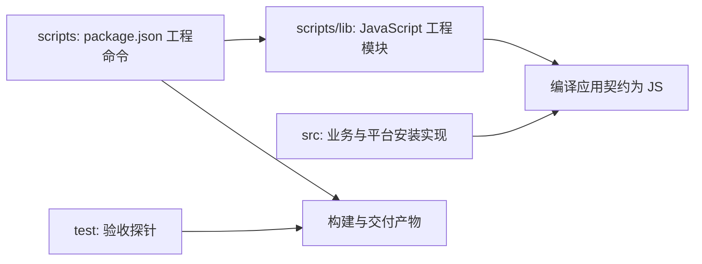

# ADR-0072：执行器开发目录与前端框架

## 状态

Accepted（2026-10-01）。用户确认执行器归属 apps/executor，apps/desktop 仅留作未来 Web 智能体客户端。Basic/Browser 已实施，Computer 生产与最终发行仍待验收，当前状态由 [验证矩阵](../architecture/executor-validation.md) 维护。

## 背景

产品提供 Basic、Browser 和本机 Computer 工具，由连接的智能体负责规划。需要独立构建、安装与离线运行，并复用仓库通用 UI/协议；后台执行不能依赖管理窗口生命周期。

用户已确认先在专属本地窗口验证桌面输入，再用专用 Windows 环境/真实硬件覆盖锁屏、多 DPI 等条件。首版 Bridge 采用私有 Node 与小型启动器，SEA 不进入当前实施范围。

## 决策：两个应用，Host 内聚

- @octopus/executor 持有 Main、Preload、Renderer、唯一 Utility Runtime、两个 Bridge、原生组件、私有后端与发行描述。
- @octopus/browser-extension 独立持有 WXT/MV3 Worker、页面控制与连接弹窗。
- 跨应用的纯 Browser 协议进入现有 packages/shared，不依赖 Node/Electron/DOM/Agent；扩展不反向导入 Executor。
- contracts 只放桌面跨进程 DTO/Schema，普通内部类型留在职责模块，不建立全局 types/constants 集散目录。
- 不新增单消费者的 packages/runtime、packages/contracts 或 Bridge workspace，不为目录统一提取 Host 专属能力。
- Agent Core 无需变更；共享 shadcn 源组件不直接改，应用通过包装/props/className 定制。

实际目录与依赖见 [Executor 架构](../architecture/executor.md#进程与依赖边界)，不再复制候选文件树或预建空目录。Renderer 按仓库规范组织 feature、API、Query 和按需共享状态。

## 决策：React 管理界面与独立执行资源

沿用 React/Vite、Tailwind、shadcn/ui、Lucide 与 TanStack Router/Query；实际版本和构建脚本以 package.json/lockfile 为准。服务状态由 Runtime 权威快照投影，组件局部状态不强制上移，非 React 资源不藏在 JSX 生命周期中。

Main 监管单 Runtime 与窗口/托盘，Preload 提供具名有限 API，Renderer 沙箱化。管理界面隐藏/重建不结束任务，完整退出由 Main 收束拥有的 Runtime/Job/Host。核心私有资源位于真实 ASAR 外目录，启动不依赖 Web 项目或系统工具链。

## 补充决策：工程入口与业务代码分离（2026-10-13）

scripts 中命令入口由 package.json 直接调用；Executor 按 compile、resources、package 分类，browser-extension 的两个独立入口直接放在 scripts 根目录，不为单个文件增加分类目录；工程辅助模块归 scripts/lib，也使用 JavaScript。构建、资源准备和打包由 node 直接执行，不依赖 tsx、ts-node 或 Node 的实验性 TS 支持。

工程层可以通过编译器读取 TypeScript 应用源码，但 Node 只导入生成的 JS 契约，不在工程层复制授权、任务或恢复规则。数据备份恢复归 src/maintenance；Windows 注册与安装钩子归 src/installation/windows；验收探针归 test/packaging。应用业务代码与开发测试保留 TypeScript 的既有工具链，生产交付仍为编译产物。

通用解压和归档清单合并为不启动 shell 的 JS 模块，校验路径、冲突、目标存在与大小边界。Windows 原生编译和安装不会因为换语言就自动跨平台：scripts/lib/platform.mjs 使用显式 if/else，仅实现 Windows x64，macOS/Linux 保留待适配错误。

取舍：增加显式编译契约的工程步骤与固定归档依赖，换取入口可直接运行、业务规则单一来源及清晰的平台边界。不保留旧 .ts/.ps1 工程入口兼容别名，CI、测试与开发文档同步迁移。验证状态由验证矩阵维护。

## 取舍与验证

两个应用维持构建/权限边界，代价是显式维护共享协议与产物一致性。原生组件独立构建不要求独立 workspace。以后有真实跨 Host 消费再考虑提取，不能凭假设建立抽象。

Basic 七工具自行实现，Pi 仅供参考。Browser 停止关闭新派发、允许在途动作完成，不设计许可世代或强停止确认；本地 Bash/Computer 的进程清理仍按独立契约。

结构选型不代表能力已验收。进程/IPC、真实后端、客户端、最终离线包与硬件分别检查，命令和门禁见 [交付](../architecture/executor-delivery.md)。
