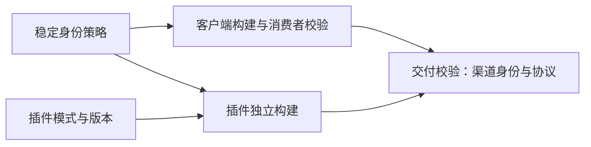

# ADR-0078: 浏览器插件独立版本与 GitHub Release 驱动的商店提交

## 状态

Accepted — 2026-10-12。用户已确认插件独立版本、独立 GitHub Release，并由该 Release 的产物自动提交 Chrome/Edge。商店工作流、凭据与真实提交尚未接入；先由用户提供发布准备资料，再开始脚本开发。

构建期身份配置子决策已实施；发行策略已确认，自动发布实现与商店安装验收分别记录。

## 背景与要求

Chrome Web Store 与 Edge 开发者账号已由用户确认注册。插件当前版本由 apps/browser-extension/package.json 管理，WXT 生成 Chrome/Edge 两个目标；现有根 pnpm release:publish 管理 CLI/npm 的 release.config.json 版本和 `v<version>` GitHub Release，并联动 Docker 构建。Executor 自有版本与 Windows 签名入口另行管理。

插件既有独立修复，也有与 Executor Native 身份/协议相关的协同更新。两店均提供上传和提交 API，但首发资料、审核与实际分发不能与 GitHub 事件组成一次原子操作。

要求：

- 只在插件发生发行变更时提交，不要求 Server/Web/CLI 或 npm 为插件修复升版。
- Chrome/Edge 使用同一插件版本和精确源码，保留各自 ZIP；重跑复用已验证字节。
- 可单店补发、恢复未知提交结果；审核中不自动覆盖或重放，记录实际成功范围。
- 发布身份限定到受控 CI；构建和发布凭据隔离，具备凭据轮换和可追溯回执。
- 兼容 Executor 先可获取，来源校验、产品签名及商店安装门禁继续有效。
- 审核等待不长期占用 runner；保留后台首发和异常处置入口，控制维护成本。

## 建议决策

### 独立组件版本，关联兼容性

使用 `browser-extension-v<version>` tag 和插件专属 GitHub Release；Chrome/Edge manifest version 一致，不与 CLI/npm 或 Executor 强制同号。主产品 Release 引用已验证插件版本；确需联合更新时显式调用同一插件发布入口。

GitHub Release 是产物归档和提交依据，发布到商店的两份 ZIP 来自该 Release 的同一已核验构建。清单记录版本、源码 SHA、ZIP 摘要、实际商店身份、协议及已验证 Executor 组合。提交后不从 main/latest 重建，不修改同版产物。

### 构建与提交分工，明确串联

拟定两个工作流：插件 release 负责构建、测试、清单和 GitHub Release；store 负责精确产物校验、各店 upload/submit/status，通过 workflow_call 和手动入口复用。

创建完整插件 Release 后显式调用 store 工作流。Actions GITHUB_TOKEN 创建 Release 不会再触发 release 事件工作流，不能依赖事件递归。若接受人工发布的 Release 事件，严格限制组件 tag、稳定版本、资产齐备和去重。[GitHub 触发规则](https://docs.github.com/en/actions/how-tos/write-workflows/choose-when-workflows-run/trigger-a-workflow)

实施前过滤现有 Docker 工作流中的插件 Release；插件 Release 不设置为仓库 latest。根 npm 发布和既有 `v<version>` 规则继续由对应发行流程拥有。

### 平台适配与身份

Chrome 使用 v2 API；首选 Dashboard 绑定的 service account 配合 GitHub OIDC/WIF 短期令牌。Edge 使用 API key 认证的新 Publish API，按后台期限轮换；首次创建/发布及 metadata 仍由 Partner Center 处理。[Chrome API](https://developer.chrome.com/docs/webstore/api/reference/rest)、[Chrome 服务账号](https://developer.chrome.com/docs/webstore/service-accounts)、[Edge API](https://learn.microsoft.com/en-us/microsoft-edge/extensions/update/api/using-addons-api)

API product/Item 标识与 Native Messaging 实际 extension ID 分别管理。发布适配器只属于插件构建/发布代码，不进入 Worker、PageController、Executor Runtime 或通用 Agent Core。

已实施的身份子决策：插件应用持有公开 browser-identity.json，作为侧载公钥/ID 与两个商店 ID 的唯一来源；构建解析器不接受身份环境覆盖，所有模式均要求完整身份，不保留缺失值回退。只有插件模式从进程/CI、根 .env 或默认 sideload 解析。客户端构建入口将稳定身份策略生成到 Native launcher、Host、Runtime 与注册脚本的精确来源列表；运行时不读取 .env。sideload 保留固定侧载公钥，任一模式缺少实际商店 ID 即失败，store 省略侧载 key。profile 只控制插件产物，客户端使用 JSON 中完整官方身份的并集；身份仍在构建期固定，不引入动态配对。产品未发布，不兼容旧身份集合，安装路径迁移仅接受当前完整来源集合。客户端策略指纹排除插件模式与产品版本；客户端构建记录单独绑定协议及消费者摘要。插件产物记录独立声明模式、产品版本和协议。打包按各渠道实际身份是否被客户端允许及协议是否一致验证，不再强制两端完整策略指纹一致；未知来源不扩大允许范围。详细配置只在应用[发布 SOP](../../apps/browser-extension/RELEASE.md#33-配置身份并重新构建)维护。

### 独立升级的已实施边界

客户端自身校验不读取插件目录或根 .env；其 Turbo 缓存跟踪官方身份 JSON，移除根 .env 和身份环境变量依赖。兼容的插件更新或 sideload/store 切换不改变客户端策略及生成模块，也不要求重建客户端；客户端兼容改进可复用既有插件产物。客户端交付仍携带插件，更新包内副本需要重新打包，但不要求重编译未变化的客户端。产物内记录的版本必须与其 manifest 一致，禁止用修改元数据伪造升级。

产品版本只用于诊断，协议版本保持精确匹配；不兼容协议需要协调发布，不以产品版本相等代替兼容性。注册表继续定位固定 Host，不绑定双方产品版本。连接替换生成新会话，旧请求不重放；不承诺升级零断线。未发布产品不保留旧元数据格式兼容。

取舍：保留客户端附带插件的完整交付校验；取消无关模式、版本和其他渠道配置对客户端重建的要求。没有引入动态身份配对或协议范围协商。真实商店审核、安装和跨发行版本组合仍需要发布验收，测试夹具不替代该证据。

### 异步审核，按店恢复

以每店目标串行提交，记录版本、摘要及平台操作回执，允许另一店独立成功。重跑先恢复状态；已提交/在审/已上架同版分别继续查询或跳过，未知状态停止核对，不盲目重发。

API 操作完成与用户可安装分别记录。尤其 Edge Succeeded 可以表示 submission 已创建；最终按真实商店版本和配套 Host 验收确认，不用 job 绿色表示整体验收。[Edge 返回语义](https://learn.microsoft.com/en-us/microsoft-edge/extensions/update/api/addons-api-reference)

首期后台完成发行与身份验收，再采用手动受控上传，最后开启 tag/Release 驱动的自动提交。Chrome 普通兼容更新采用审核后发布；需要延迟分发时使用 staged 流程。涉及 Executor 变化时先准备兼容产品，不承诺两店同时分发。

## 备选方案与取舍

| 方案                               | 优点                                             | 代价与适用性                                                                              |
| ---------------------------------- | ------------------------------------------------ | ----------------------------------------------------------------------------------------- |
| 跟随每次主产品 `v<version>` 发布   | 单个 Release 入口容易理解                        | 根 CLI 与插件版本已分离；无关发行导致重复提交，插件修复需等待主产品，审核失败牵连其他产物 |
| 全部手动后台发布                   | 首发准备少，异常直观                             | 重复上传、版本/ZIP 选择易出错，补发追溯依赖人工；保留为首发及异常入口                     |
| 插件 tag 直接构建并上传，无归档    | 流程短                                           | 中途失败难证明重跑字节一致，缺少明确产物依据；不作为推荐生产流程                          |
| 独立插件 Release，显式调用商店提交 | 版本边界清楚，可单店重试和追溯，联合发行仍可复用 | 增加两个工作流及少量平台适配；需维护 WIF、Edge key 与审核状态，采用本方案                 |

## 后果与实施边界

收益是组件发行解耦、确定产物和局部失败恢复。代价是两个平台 API 的维护、异步状态核对，以及独立 Release 的事件路由；首期不增加常驻发布服务、数据库或任意平台框架。

来源生成和双 ID 构建机制已接入，商店 ID 已由维护者提供并写入版本管理下的 browser-identity.json，默认插件产物仍为侧载；正式签名、商店安装、自动提交与干净发行仍有待办。账号注册和隔离身份回归不代表真实商店验收。Windows popup 环境、真实商店来源、兼容性和拒绝行为必须按实际范围验证。手工更改草稿或同版本重新构建会破坏回执依据，需要停止并核对，不自动覆盖。

详尽后台配置、API 顺序、凭据名称、恢复规则和实施验收仅在[插件发布 SOP 第 9 节](../../apps/browser-extension/RELEASE.md#9-自动发布方案与接入步骤)维护，本文维护架构选择与取舍。
