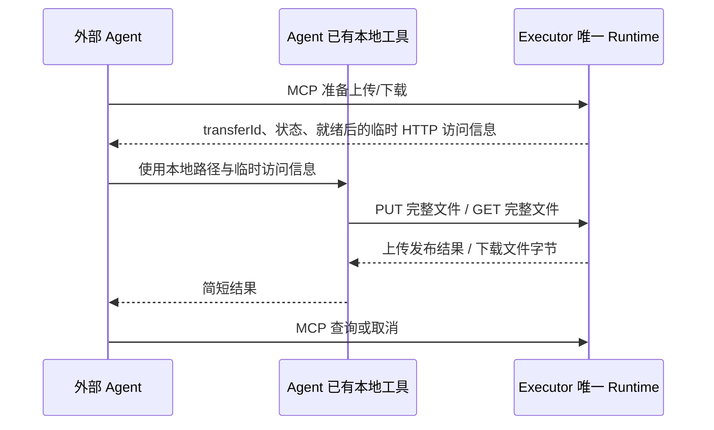

# ADR-0079: Agent 直连 Executor 与受控 HTTP 文件流

## 状态

Accepted — 2026-10-16。用户确认替代原独立客户端方案，先更新文档再实施。产品未发布，不兼容旧客户端、工具、字节协议或状态格式，不迁移旧传输任务；不删除已经发布的业务文件。实现与实际验证状态见 [Executor 验证记录](../architecture/executor-validation.md)。

## 背景与目标

任意外部 Agent 需要将其机器或容器中的办公文档、图片和大文件传到 Windows Executor，也可把 Executor 文件取回其本地环境。文件字节不进入模型上下文，不依赖 Octopus Server、附件系统、Agent Core 改动或专用客户端安装。

Agent 直接连接 Executor 已有 HTTP MCP。Agent 自身的本地工具必须能读取文件并发起 HTTP 上传，或接收 HTTP 下载到文件。仅有返回文本的 read/write 工具不足以保证这些能力。远端 Executor 的 Bash 无法读取另一个 Agent 容器的本地路径。

## 决策一：MCP 控制与普通文件流

普通工具保持 Agent → Executor MCP 直连。字节路由由 Executor 自身提供，与 MCP 共用监听地址、进程和端口；无需新增代理进程、Agent 文件服务器、专用 SDK 或对象存储。URL 拉取不在本期实现。

## 决策二：四个直接面向 Agent 的工具

| 工具                  | 参数                                                  | 行为                                           |
| --------------------- | ----------------------------------------------------- | ---------------------------------------------- |
| file_upload_prepare   | taskId、path、totalBytes、可选 sha256、idempotencyKey | 准备 Executor 目标；path 是 Executor 绝对路径  |
| file_download_prepare | taskId、path、idempotencyKey                          | 冻结 Executor 源文件并准备下载                 |
| file_transfer_status  | transferId                                            | 查询准备进度、就绪后的 HTTP 访问信息及持久结果 |
| file_transfer_cancel  | transferId                                            | 关闭新字节准入，排空工作并报告实际结果         |

准备可能异步完成。准备工具与状态工具仅在 ready 状态返回 content：method、绝对 url、Authorization 临时 Bearer、expiresAt；工具返回 pollAfterMs 指示查询间隔。HTTP 地址由已验证的监听入口生成，不信任模型传入地址或未经校验的 Host。

上传工具描述必须明确：仅当具备读取 Agent 本地文件并通过本地工具发送 HTTP 二进制文件的能力时调用；没有此能力不要调用，并说明原因。源路径属于 Agent，path 属于 Executor；使用已有本地工具直接发文件，不把完整正文/Base64 放入上下文。准备不等于完成，仅 completed 才能使用上传目标。下载工具相应要求本地 HTTP 保存能力，并说明下载不等于给用户发送附件。

Agent 使用 curl、已有 HTTP/文件工具等直接发起单次 PUT 或 GET。上传必须提供准确 Content-Length，支持零字节。无需客户端 offset、分块摘要、逐块调用或显式 complete。下载直接写入 Agent 的临时目标，Agent 本地工具负责校验、避免覆盖和最终发布；Executor 无法证明 Agent 本地文件已保存。

## 决策三：临时传输授权

MCP 继续使用设备授权凭据。字节请求只使用临时传输 Bearer，不接受长期设备 Bearer作为文件通道凭据。临时凭证绑定 Runtime 实例、授权拥有者、任务、传输、HTTP 方向、监听入口和截止时间，不能调用 MCP 或其他文件；不持久化、不写日志。重启后失效。

每次字节访问以及传输期间重新检查现有 TaskAuthority、授权撤销、任务寿命、方向和状态。上传要求 files.write，下载要求 files.read；两者均不要求 Executor shell.execute。Agent 的本地执行权限由其 Host 管理。连接的 Host/Origin 限制继续生效。

临时凭证属于敏感信息，但不会泄露长期设备授权。它可由就绪传输的准备/状态查询获取，传输结束、取消、任务停止或授权撤销后不再接受字节访问。一次传输同一时刻只能有一个字节请求。

## 决策四：流式处理与真实结果

上传流式写入同卷私有暂存文件，同时计算摘要并检查长度和任务权限；内存有界，不整文件缓冲。可选源摘要由 Agent 本地工具计算，Executor 校验，不能让模型读取文件来计算。全部接收、长度及摘要校验成功后，沿用原生身份核对和不覆盖发布；目标父目录必须已存在，目标存在即拒绝。

下载沿用受控源快照和摘要，一次 GET 流式发送。completed 对上传表示目标已发布，对下载仅表示 Executor 已完成发送，不证明 Agent 本地落盘或交付用户。返回 direction 和 destinationEffect，下载不声称改变 Executor 源文件。

状态为 preparing → ready → transferring → verifying → committing → completed；明确失败、取消、期限届满分别为 failed、cancelled、expired，提交事实不明为 unknown。状态查询不得延长任务寿命。未知发布保留证据并阻止盲目重放。

首版不保留旧断点续传。中断时本次传输终止，只有查清未发布后才使用新幂等键重新准备并完整传输。重复准备使用同键同参数返回同一传输；不同参数或不同工具复用键必须拒绝。响应丢失先查原 transferId，不直接重传。

任务停止、授权撤销、取消和退出必须关闭准入并中止受管网络流，排空落盘/提交。已开始发布须记录真实结果，不能声称取消撤回了已发布文件。进程重启只恢复结果和清理证据，不恢复任务或传输。

## 限额与资源归属

沿用 Executor 当前可配置上限：默认上传/下载单文件 2 GiB、临时总额度 8 GiB、磁盘余量 512 MiB；任务总寿命 30 分钟不延长。大小限制不是吞吐承诺。字节请求总期限受任务截止时间约束，空闲网络受有限超时约束，不能沿用 MCP 小请求的 10 秒总请求期限限制大文件。

进行中传输占用唯一任务，阻止其他副作用动作；允许查询、取消和停止。暂存文件、快照和未清理材料占用配额。终态普通结果保留 24 小时，有界幂等历史和未知结果证据不因查询过期自动消失。Agent 本地文件、容量和发布事实由其已有工具负责。

## 代码归属与旧方案移除

- apps/executor 拥有传输工具 schema、Runtime 传输、临时授权、HTTP 文件流与原生发布。没有第二个实际消费者的传输协议从 packages/shared 回归 Executor。
- 完全移除 apps/executor-client、代理工具、旧 transfer_create/complete 协议、客户端配置/构建/依赖及双工具目录展示；不保留适配或迁移层。
- 更新安装说明、复制给 Agent 的连接说明、状态页、根项目索引、构建图与锁文件。
- 不修改 packages/agent，不新增 Server 集成。
- 历史测试证据保留并标记为已替代方案，不当作新方案验收。旧 journal 不自动删除；不要求兼容加载旧格式，不通过清理旧数据来伪造验证成功。

## 实施与验收

先完成本文及架构/安装文档，再实现工具和文件流，移除客户端和旧协议，最后更新测试与验证记录。验证包括真实 MCP 工具发现、权限筛选、能力提示、临时凭证不可访问 MCP/其他传输/错误方向/另一监听入口、撤销与期限、状态隔离、完整流上传下载、零字节/二进制/中文路径、文件超限、摘要错误、目标竞争、取消/断线、提交回复丢失、未知结果和重启恢复。

验证必须包含通过系统 curl 上传真实文件、超过旧 4 MiB 边界的文件、两端摘要一致以及大文件内存不随文件大小线性增长。执行 build 后再串行运行原生测试，完成相关 lint/typecheck/test；真实跨机与 Linux Agent 如未执行必须明确记录。不得将旧客户端验证冒充新协议通过。
