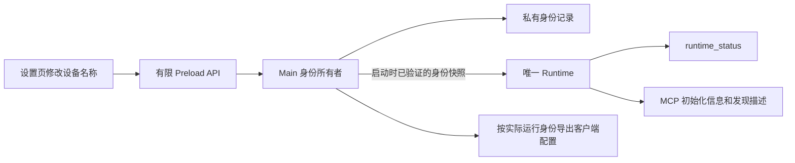

# ADR-0080：Executor 设备身份与 MCP 操作对象识别

- 状态：Implemented（用户已批准实施；源码与验证状态见第 11 节）
- 日期：2026-10-14
- 决策来源：用户指出执行体缺少对智能体可见的设备名称，要求先评估，再编写规划文档，确认后实施。

## 1. 问题与依据

当前 Executor 可以通过连接地址和 Bearer 凭据确定调用所属的 Runtime，但缺少可读、稳定、跨入口一致的设备身份。

| 当前实现                                                    | 已有信息                                                        | 缺口                                               |
| ----------------------------------------------------------- | --------------------------------------------------------------- | -------------------------------------------------- |
| `src/contracts/product.ts`、`src/runtime/mcp/mcp-server.ts` | 所有实例使用产品名 `octopus-executor`，初始化指令为通用操作说明 | 产品身份无法区分设备                               |
| `src/runtime/mcp/task-authority.ts` 的 `status()`           | 权限、授权 clientId、默认目录、任务和等待预算                   | 没有设备显示名或实例 ID                            |
| `src/contracts/access.ts`                                   | 每个授权拥有 label 和 clientId                                  | 标识客户端授权，不代表设备；同一设备可以有多个授权 |
| `src/main/client-configurations.ts`                         | 各入口导出固定 `mcpServers.octopus-executor`                    | 多设备配置合并可能覆盖同名连接                     |
| `src/bridge/stdio-config.ts`                                | 私有 stdio 配置按固定产品键严格读取                             | 不能直接把内部固定键整体替换成设备名               |

单台本机场景主要影响说明与操作报告；远程或多设备场景还会影响目标选择与连接管理。现有授权仍约束实际调用，缺少名称本身不证明存在跨设备自动派发漏洞。

智能体可以执行 shell 探测或依赖用户手工起的连接别名，但前者额外需要权限，后者没有由执行体提供的身份核对依据。解决目标是让智能体在执行前知道连接对应的设备，并准确表述操作对象。

## 2. 目标与范围

本期应完成以下能力：

1. 每个 Executor 数据实例拥有持久化的唯一 ID 和可修改的设备显示名。
2. 本机 HTTP、内网/VPN HTTP、stdio 暴露同一运行身份。
3. 身份出现在智能体可读取的 MCP 信息中，而不只出现在 Executor 界面。
4. 新导出配置可同时接入多个设备，改名不改变连接键和授权。
5. 设备名称保存、实际生效、客户端重新发现的时机明确，失败不静默重建身份。

实现归属 `apps/executor`。不修改 `packages/agent`，不编辑共享 shadcn 源组件；首期不引入设备注册中心、自动设备发现、跨设备调度或硬件指纹。不新增 Computer 权限，不改变生产门禁。

设备身份描述执行体实例，不充当认证凭据或机器真实性证明。第一期不增加 task_start 的目标设备参数，也不声称仅凭名称就能强制防止智能体选择错误连接。

## 3. 身份模型

| 字段         | 语义                                            | 创建与变化规则                                                               |
| ------------ | ----------------------------------------------- | ---------------------------------------------------------------------------- |
| `deviceId`   | 当前用户数据目录内的 Executor 实例身份，UUID v4 | 首次持久化生成；普通重启、升级、安装路径移动、设备改名、授权新增或撤销均保持 |
| `deviceName` | 用户和智能体使用的设备显示名                    | 首次取系统计算机名并保存；用户可修改；系统计算机名之后改变不自动覆盖         |

不同时维护“自动名”和“自定义名”两套状态。读取系统计算机名失败或名称不合规时，首次使用 `Executor-<deviceId 前 8 位>` 作为默认显示名，并允许用户修改。

名称规则：去除首尾空白，长度 1–64 个 Unicode 码点；允许中文、英文、数字和普通标点，拒绝换行、控制字符和双向文本控制字符。不将名称解释为路径、URL、配置键或指令；允许不同实例同名，以完整 deviceId 区分。

系统计算机名只用于默认值，不单独暴露用户名、SID、MAC 地址、机器 GUID 或序列号。不新增设备身份之外的系统探测。

### 3.1 生命周期与数据复制

- 同一用户数据目录在同一机器上恢复备份，身份保持。
- 清除产品数据或使用全新数据目录，视为新实例并生成新 ID。
- 同一物理机器的不同 Windows 用户数据实例具有不同 ID。
- 完整复制数据目录到另一台机器会复制身份；首期不自动探测硬件迁移。部署另一台设备时应初始化独立数据目录，不复制凭据和身份目录。
- 身份记录损坏、记录中途缺失、ID 在历史中改变时，拒绝启动 MCP 并保留原件，不生成替代 ID 掩盖错误。
- 在既有设置持久记录中保存身份已初始化的标记。标记存在但身份记录缺失时，拒绝启动；没有标记的旧安装才允许新增身份，不能仅凭存在授权就拒绝合法升级。清除全部产品数据仍按新实例处理。

## 4. 所有权与生效时机

Main 拥有设备身份的持久化与修改入口。建议新增内聚的 Main 身份模块和有限 DTO，沿用现有原生私有目录保护、严格 Schema、有界记录和顺序写入方式；不将身份塞进授权记录，不让多个授权各自生成设备名。

独立身份记录保存 schemaVersion、sequence、deviceId、deviceName；后续名称记录只能改变 deviceName，deviceId 不可变。新记录持久化完成后才报告保存成功；写入失败保持当前有效身份，不展示未提交内容。初始化必须先完成持久化，再开放 Runtime/MCP。产品恢复目录继续排除于 Basic 文件工具可访问范围。

首次初始化先写身份记录，再保存设置中的初始化标记；两步都成功才开放 MCP。若中途失败，保留已写身份，下次启动继续完成标记，不生成第二个 ID。旧设置记录允许缺少新增标记；标记一旦写入不可回退。该标记只检测普通数据缺失，不宣称能识别整套数据被人为回滚。



首期采用“保存后完整退出再启动生效”，复用现有连接设置的重启交互。原因是初始化指令可能被 MCP 客户端缓存，立即更改名称会使不同会话持有不同描述。

- 当前 Runtime 在整个生命周期内使用同一身份快照，包含新建和既有 MCP 会话。
- 设置页分别显示当前名称和已保存的待生效名称，明确提示重启；普通关闭到托盘不算重启。
- 保存名称不自动结束任务、不撤销授权、不主动断开连接。
- 完整重启后，初始化信息与 runtime_status 返回新名称；客户端需要重新连接或重新发现。
- 保存成功但重启前，配置预览与界面运行信息均按当前生效身份解释，不提前声称新名称已对外生效。

## 5. MCP 暴露契约

### 5.1 runtime_status 为身份读取依据

在现有返回值上增加结构化字段：

```json
{
  "device": {
    "deviceId": "89b7dada-bb9d-4b25-a1ef-ff6a3e8b189a",
    "deviceName": "张的办公电脑"
  }
}
```

示例只展示新增字段，现有权限、授权、目录、任务和预算字段继续保留。返回的是当前 Runtime 生效身份，与所用授权 label 无关；不要求 files.read 或 shell.execute 权限。

### 5.2 初始化和工具发现

- MCP `serverInfo.name` 继续使用固定产品名 `octopus-executor`，版本继续取产品版本。
- 初始化 instructions 加入明确的设备名称和 deviceId，并要求动作前读取 runtime_status 确认操作对象，多设备歧义时先澄清目标。
- 在 runtime_status 的工具描述中加入同一身份，使主要依赖工具发现的客户端也能得到线索。
- 名称按结构化数据序列化后嵌入说明，与固定行为指令隔离；不得把用户输入拼成可执行指令。
- 不依赖客户端一定会转交初始化 instructions。首期验收需要实际验证 Dr.Octopus 的 MCP adapter 是否将身份传入模型可见信息。
- 不修改 Basic、Browser、Computer 的工具输入，不在每次工具返回中重复设备信息。操作前读取与报告要求通过发现信息及初始化说明表达。

智能体报告建议使用“设备名称 + ID 短标识”，同名设备或需要精确核对时使用完整 ID。短标识仅便于展示，不作为唯一身份判断依据。

## 6. 导出配置与既有配置处理

### 6.1 外部连接键

新导出的客户端配置使用稳定键 `octo<去掉连字符的完整 deviceId>`，例如：

```json
{
  "mcpServers": {
    "octo89b7dadabb9d4b25a1efff6a3e8b189a": {
      "url": "http://127.0.0.1:19876/mcp",
      "headers": { "Authorization": "<授权凭据>" }
    }
  }
}
```

设备名允许中文与重名，不能作为配置键。完整 ID 避免短 ID 截断冲突；键仅使用 ASCII，并控制产品前缀长度。实施时核对 adapter 的工具前缀转换与最终工具名长度，必要调整产品前缀，但保留完整 ID；不得仅凭配置 JSON 合法就认为模型工具发现兼容。

同一实例的多个授权仍共享设备连接键：它们是不同权限凭据，不是不同设备。需要同一客户端同时接入多个授权时，由用户显式给外部连接起不同别名。

### 6.2 stdio 内部配置

外部客户端连接键和启动器私有配置格式分别处理：

- 外部导出的 stdio MCP 连接也使用设备连接键。
- 私有启动器配置继续保持当前 `octopus-executor` 固定键及严格解析，内部仍连接唯一回环 Runtime。
- 不因外部键变化改写已有私有配置文件，不放宽路径、ACL、凭据及启动器校验。

### 6.3 升级行为

- 没有身份记录的既有安装允许首次初始化身份，不重置授权、任务日志或已有连接设置；这是新增数据初始化，不恢复更早废弃的数据格式。
- 既有外部配置使用旧 `octopus-executor` 键仍可连接，设备身份通过新的 MCP 返回值取得。
- 新导出使用新键。界面或安装说明应提示用户替换旧条目，避免把同一设备以新旧两个连接同时接入。
- 不自动编辑第三方客户端配置，不自动合并多个授权；端口、地址或安装路径变化的既有重新复制规则继续适用。

## 7. 方案取舍与限制

| 方案                       | 收益                               | 问题与结论                                                           |
| -------------------------- | ---------------------------------- | -------------------------------------------------------------------- |
| 仅用系统计算机名           | 实现最少                           | 可重名、可变，也不能解决授权与设备身份混淆；不采用                   |
| 仅允许用户手工改客户端别名 | 无执行体数据变更                   | 执行体不能提供核对依据，各客户端命名容易不一致；作为用户覆盖方式保留 |
| 设备名直接充当 MCP 连接键  | 连接表面可读                       | 改名改变工具前缀，中文和特殊字符兼容性差，同名仍冲突；不采用         |
| 持久实例 ID + 可读设备名   | 跨入口统一、改名稳定、无需硬件探测 | 增加少量本地数据与初始化契约；本期推荐                               |
| 硬件指纹与中央注册中心     | 能进一步管理设备资产               | 权限、隐私、迁移和联网成本明显扩大；不属于本期                       |

名称只是用户输入的标签，可能具有误导性；不能把初始化文本视为强制安全策略。客户端不读取 instructions、缓存旧发现数据或用户复制整个数据目录时，仍可能有语义歧义。必须在验收报告中区分“身份已暴露”“模型实际可见”“强制目标校验”，本期只实现前两项。

## 8. 实施步骤（用户批准后执行）

1. 增加设备身份 DTO 和 Main 持久化模块，确认初始化、损坏拒绝、同 ID 名称更新及恢复目录保护。
2. 扩展有限设置 API、Runtime 启动身份快照及状态投影，保持 Main 单一写入所有权。
3. 增加设备名称设置和当前身份展示，按应用现有组件与查询模式实现待重启提示。
4. 在 runtime_status、初始化 instructions 和发现描述中暴露身份；更新外部配置键，保留 stdio 内部格式。
5. 完成身份生命周期、配置和 MCP 聚焦回归，再完成相关范围的构建、lint、typecheck、test 与界面验证。
6. 更新安装说明、当前架构与验证记录；ADR 状态依据实际完成情况更新，保留未验证限制。

预计涉及 `src/main`、`src/contracts`、`src/preload`、`src/runtime`、`src/renderer`、`test` 和所属文档。具体文件以实施时现有责任边界为准，不建立通用设备框架。如果实际模型可见性需要修改 Server，由实施者先读取 Server 的适用规范并说明范围；Agent Core 修改仍需另行明确确认。

## 9. 验收标准

| 场景                                    | 必须满足                                                                      |
| --------------------------------------- | ----------------------------------------------------------------------------- |
| 首次安装或合法既有安装首次升级          | 生成并持久化一个 ID 和默认名称，授权、任务和连接设置不重置                    |
| 重启、同机器升级或安装目录移动          | ID 和已保存名称不变                                                           |
| 同一设备不同授权及三种入口              | runtime_status 的 device 完全一致                                             |
| 保存改名后尚未重启                      | 当前 MCP 保持旧名称；界面明确待生效名称；任务不受主动中断                     |
| 完整重启并重新发现                      | 同一 ID，新名称；初始化、发现描述与状态一致                                   |
| 两个独立设备实例同名                    | ID 和导出连接键不同，能并存并按 ID 区分                                       |
| 名称为空、超长、带换行或控制字符        | 保存被拒绝，当前有效身份不变；中文与普通标点正确序列化                        |
| 写入失败或身份记录损坏、缺失、ID 改变   | 不确认未提交名称，不静默重建身份或覆盖原件                                    |
| 旧外部配置、新 HTTP 配置、新 stdio 配置 | 均可完成连接与身份读取；私有 stdio 校验保持严格                               |
| 无 Shell/文件权限的有效授权             | 能读取设备身份；不增加权限                                                    |
| Dr.Octopus 实际 MCP adapter             | 模型可见发现信息或状态中包含设备身份，最终工具名称合法可调用                  |
| 两设备模型集成场景                      | 专属测试设备或隔离 Runtime 中按指定目标读取无副作用信息，并准确报告名称及身份 |
| 设置界面                                | 浅色、深色、窄窗口、键盘操作、失败反馈与重启提示可用                          |

使用独立数据目录、专属授权和测试连接，不操作日常客户端配置。先构建 Executor，再运行聚焦回归和 `pnpm --filter @octopus/executor lint`、`typecheck`、`test`；相关 HTTP/stdio 和界面集成测试串行执行。若扩展 Server 范围，补充该范围相应检查。

文档阶段只校验 Markdown 格式、索引、链接和方案一致性，不执行设备控制或运行/发行验收。完成源码验证不代表现有发行包更新，也不改变 Computer 发布状态。

## 10. 批准事项

用户确认本规划后，按以下默认决定实施：持久实例 UUID、可修改且首次取计算机名的设备名称、保存后完整重启生效、MCP 状态与发现信息暴露身份、完整 ID 构成稳定外部连接键、旧连接保留可用与 stdio 内部格式不变。

用户已于 2026-10-14 确认本规划并授权实施。当前实现遵循上述决定，运行证据与剩余限制在第 11 节单独记录。

## 11. 实施与验证记录

2026-10-14 实施设备身份契约、Main 私有身份日志、初始化标记、Runtime 启动快照、设置页名称管理、MCP 初始化及发现描述、结构化状态和三入口配置导出。沿用有限 settings/access API，未增加通用 IPC 或跨设备调度。

最终外部配置键采用 `octo` 加完整 UUID。实际 adapter 会转义连字符，原 `octopus-` 前缀在最长工具名下存在超过 64 字符的风险；最终键在默认、short、mcp 前缀模式下均保留完整 UUID，最长现有工具名不超过 63 字符。

身份初始化标记和用户连接设置分别记录：新增 `preferencesSaved` 字段，旧记录缺少该字段时按已保存处理；仅写入初始化标记不会把随机测试监听端口或默认监听值当作用户设置。保存名称和连接设置涉及两个私有日志，不宣称跨日志原子提交；部分失败会明确报告并刷新界面读取已提交状态。

验证入口：`test/native/device-identity.test.mjs`、`test/native/client-configurations.test.mjs`、`test/native/connection-settings.test.mjs`、`test/native/mcp.test.mjs`、`test/integration/device-adapter.test.mjs`、`test/integration/device-identity.test.mjs`，以及既有 settings/MCP/network 集成测试。

原始失败保留：首次构建因运行中的开发版占用原生模块而 EBUSY，用户授权关闭该实例后重新构建；首轮聚焦回归发现初始化传入多余 saved 字段及动态键断言错误；首轮 GUI 集成 7 项启动超时，定位为随机测试端口 0 被身份标记初始化错误持久化。另有截图测试刷新后未重新选择设置页而定位超时，修正了测试导航。修正后按原范围和原期限复验，没有降低断言或扩大权限。

已通过完整 Executor 测试 202 项；最终监听标记修正及连接键调整后的相关聚焦回归 21 项均通过，浅深色及最小允许窗口截图已人工查看。最终构建、类型检查、变更范围 lint 与集成结果统一记录在 [验证状态](../architecture/executor-validation.md)。包级 lint 初次检查发现 `test/integration/browser-feedback.test.mjs:240` 缺少条件语句花括号；2026-10-14 用户要求修复后补齐花括号，包级 lint 与该文件格式检查均通过。

GUI 使用仓库 Playwright Electron 流程：当前没有列出的 Browser 插件技能（Browser plugin not available），应用也是原生 Electron 窗口。浅色、深色与窄窗口截图写入未跟踪的 `apps/executor/build/device-identity-*.png`，只使用临时产品数据。

双实例 adapter 测试使用两个独立临时数据目录和真实 MCP HTTP 服务，实际读取并调用安装的 `pi-mcp-adapter`，验证模型可见元数据和状态身份。未把同机隔离实例测试表述为两台物理机器、真实模型选择行为或所有第三方 MCP 客户端已验收。既有发行包尚未重新打包；Computer 生产门禁不变。

## 关联文档

- [Executor 架构与维护入口](../architecture/executor.md)
- [ADR-0075：stdio 复用回环 HTTP](0075-executor-stdio-loopback-http.md)
- [ADR-0077：设备级能力授权](0077-executor-device-authorization.md)
- [Executor 项目规则](../../apps/executor/AGENTS.md)
