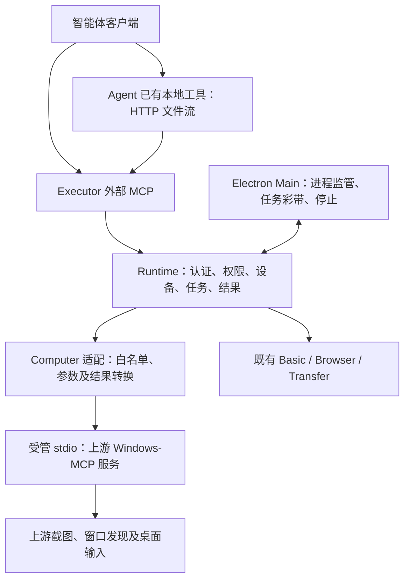

# ADR-0082：Executor 上游桌面后端迁移与连接体验优化

状态：Accepted，实施中（2026-10-16）。用户已授权上游重构，明确旧 Computer 无需兼容、统一桌面控制授权、UIA 为首期必要能力。后续决定与实现边界以 [新实施规范](../architecture/dr-octopus-windows-computer-use-mcp-architecture.md) 为准；下文原提议中的旧八工具兼容、双轨迁移及无彩带截图门禁已被替代。

日期：2026-10-15。

## 背景与事实

现有 ComputerBackend 启动私有 Python 的 product.server。vendor/computer/server.py 使用 Pillow 截图，desktop.py 使用 Win32 实现桌面操作；打包 windows-mcp wheel 不代表这条调用链已复用上游桌面实现。此前“使用 Windows-MCP”的说明没有准确反映实际执行路径。本次必须以实际入口、工具调用和运行证据为依据。

2026-10-15 核对上游 latest 指向 v0.8.8。其项目入口为 windows_mcp.**main**:main，支持 serve、stdio 和工具过滤；版本要求 Python >=3.14。上游已有控制提示、实体输入阻挡、用户接管和控制状态机制，不能直接与 Executor 的彩带及 Esc 生命周期叠加。该版本是候选基线，不代表已通过产品适配。

主要本地依据：

- ../../apps/executor/src/runtime/computer/computer-backend.ts
- ../../apps/executor/vendor/computer/server.py
- ../../apps/executor/vendor/computer/desktop.py
- ../architecture/executor-computer.md
- ../../apps/executor/src/main/client-configurations.ts

上游核对来源：

- https://github.com/CursorTouch/Windows-MCP/releases/tag/v0.8.8
- https://github.com/CursorTouch/Windows-MCP/blob/v0.8.8/pyproject.toml
- https://github.com/CursorTouch/Windows-MCP/blob/v0.8.8/src/windows_mcp/__main__.py
- https://github.com/CursorTouch/Windows-MCP/blob/v0.8.8/src/windows_mcp/tools/input.py
- https://github.com/CursorTouch/Windows-MCP/blob/v0.8.8/src/windows_mcp/tools/snapshot.py

## 目标与范围

1. 真正使用上游服务提供截图及桌面操作；Executor 管理产品权限、任务和生命周期。
2. 保留固定私有依赖和离线运行，升级可验证、可回退。
3. 保留稳定 mcpServers key，以设备名称帮助用户和智能体识别目标。
4. 新增“复制给智能体”连接文档，支持用户让智能体自行配置。
5. 权限摘要单行省略并通过 title 显示全文；增加顶部 tab 间距。
6. 截图时不包含任何本产品或上游控制提示遮挡，任务和停止能力继续有效。

文件传输、正式 settings.json 与 AppData 分工沿用 ADR-0079/0081。传输不要求模型理解文档、图片或文件字节，只需识别上传/下载方向并调用工具。此次仅回归验证，不重新设计存储或增加智能体侧额度到执行体设置。

## 提议的职责边界

Electron 通过现有 Runtime 和进程监管器启动固定私有 Python 的上游服务入口。具体参数经第一阶段核实后写入契约，不再以自有 server 冒充上游。内部只使用受管 stdio，上游不另开远程监听。外部连接继续经过 Executor 的认证与任务边界。

上游负责桌面引擎。Executor 适配层负责授权、工具白名单、参数校验、设备/任务绑定、结果转换和未知结果管理。窗口聚焦、坐标映射、文本输入等是否兼容必须有逐项证据；不能仅改工具名称后宣称等价。

优先运行未修改的上游服务。确需扩展时，必须列明缺失能力、必要原因、补丁范围、上游提交计划和回归测试。扩展只补集成边界，不复制整套截图/输入引擎。若为了兼容旧契约需要大幅改造上游，停止该路径并提交契约修订建议。

不对外增加任意 callTool/命令透传，不因上游提供额外能力自动扩大既有授权。上游工具过滤和 Executor 调用白名单双重约束；控制协议所需内部工具独立处理。

## 关键决定与待验证边界

### 工具契约

优先保留现有外部八个工具名，但不承诺全部语义无损映射。第一阶段产出以下矩阵：

| 现有能力           | 需要核对的内容                                                        |
| ------------------ | --------------------------------------------------------------------- |
| displays / windows | 上游元数据是否结构化、显示器与窗口身份是否稳定                        |
| observe            | Screenshot / Snapshot 的截图范围、尺寸、坐标系、附带 UIA 信息与副作用 |
| focus              | 精确窗口选择、聚焦与启动应用是否可分离                                |
| click              | 坐标/元素标签、屏幕缩放、按钮与次数                                   |
| type               | 坐标/焦点要求、clear、回车、剪贴板使用及部分输入返回                  |
| key / scroll       | 按键含义、修饰键释放、滚动方向和单位                                  |
| 所有操作           | 权限、控制权、超时、取消、输入中断与未知结果                          |

每项标注“直接适配 / 最小扩展 / 需要产品契约调整 / 暂不支持”。尤其不能把上游文本成功描述转成并未提供的精确输入计数；无法证明的结果应保留不确定性。

Executor 调用前检查不能替代后端实际输入时检查。现有窗口身份、观察时效和中途焦点保护不能静默削弱；确需调整的保证应在接入前单独说明。

截图范围必须明确：当前窗口可见区域与整屏截图是不同契约。评估指定显示器整屏截图，以满足“给办公室电脑截屏”，通过兼容扩展或新工具表达，不静默改变旧 observe 含义。只读截图还需核对是否触发上游控制权获取或实体输入阻挡。

### 控制权、彩带与停止

Executor 是产品任务状态的唯一来源；上游控制状态是桌面派发的必要条件。用户接管后暂停/终止桌面任务，禁止下一次调用自动夺回控制权。实体 Esc、托盘停止、上游接管事件应收敛到同一停止流程；断开 stdio 不等于确认输入结束。

显示层优先保留 Executor 的跨调用任务彩带；上游的控制权和接管逻辑必须继续有效。第一阶段验证上游是否存在受支持的提示窗口定制/抑制接口。若没有，提出最小显示集成补丁，不能通过关闭输入保护绕开可见确认。不能在未验证前承诺原样上游与现有彩带完全兼容。

截图生命周期：取得捕获独占权 → 暂停新输入派发 → 隐藏相关提示窗口并等待确认 → 上游捕获 → 无论成功失败都根据最新任务状态恢复 → 可见确认后允许后续输入。停止事件始终有效；旧回调不能重新显示已停止任务的彩带。

捕获独占权应有超时与异常恢复；后端卡住时及时恢复提示并终止该次捕获/后端，后续迟到图像不得作为有效结果。实际时限在实验后固定，不把整个长时间上游调用当作无限隐藏窗口。

上游自带覆盖层也必须纳入核查，包括截图、带图像的 Snapshot、自动附图等所有返回图像的路径。优先使用上游已有捕获协调能力，避免双重恢复和控制状态失配。

### 固定依赖与交付

候选基线为 v0.8.8，锁定精确版本、提交、Python、全部传递依赖、文件摘要和许可证。uv 可以作为开发/资源装配工具；最终安装包使用随包私有环境，普通启动不调用 uvx 在线安装或自动升级。

新版本通过入口/Schema、真实操作、停止、离线打包验收后才进入产品。运行状态报告实际后端类型、上游版本、适配契约版本与 ready 状态；版本标签不能替代实际调用证据。

旧后端只作为迁移前对照，在源码历史与独立产物中保留证据。迁移通过后从生产构建移除，不提供静默切回自研后端。回退使用明确版本的已验证安装包，不在同一任务中切引擎，不重放在途输入。

### 设备识别与自然语言调用

保留现有稳定 mcpServers key；设备重命名不改连接标识。界面展示设备名，重名时附短 ID，实际校验完整 deviceId。发现信息、工具描述和复制文档包含一致的设备名、完整 ID、连接 key 映射。

“给办公室电脑截屏”的路径是：理解目标名称和动作 → 查找候选连接 → runtime_status 验证完整设备身份、权限和就绪状态 → 调用合适截图工具。重名时明确选择，离线时不转到另一台电脑。工具描述提供中英文动作说明，但不能保证所有第三方 Host 采用这些说明。

当前适配器普通搜索的中文分词问题单独跟踪；本阶段不以添加中文关键词宣称问题已解决。验证中文指令到英文动作检索、连接过滤的真实流程。涉及 packages/agent 修改必须另行取得明确授权，不直接修改 node_modules。

设备名称属于展示数据，不拼接为可执行指令；生成文档和描述时安全编码，避免名称中的引号/换行破坏配置。

### 复制给智能体与 UI

在“配置客户端”保留复制配置、下载配置文件，新增“复制给智能体”。Main 复用当前配置生成器输出 Markdown 并直接写入剪贴板；Renderer 仅取得结果状态，不接收明文凭据。不增加通用剪贴板 IPC。

文档包括设备名/ID/key、所选连接方式、可用能力、实际配置、合并而非覆盖步骤、重新加载和 runtime_status 验证、重名/离线处理及包含凭据说明。区分本机 stdio、回环 HTTP 和内网/VPN HTTP；远端智能体不能使用执行体本地路径。

若需要跨环境上传下载，文档明确 Agent 必须具备本地 HTTP 文件发送/接收能力；通过 MCP 准备和查询，使用临时凭证发送完整文件流，不安装专用客户端。没有相应能力不要调用。尚未提供客户端类型时输出中立步骤，不编造客户端配置路径。

权限摘要使用单行省略、min-width: 0 和完整 title，保留状态与操作按钮宽度。顶部 tab 上间距拟增加约 8px，在现有标题栏/拖拽区/窗口控件约束内验证。

## 分阶段交付与验收

| 阶段              | 内容                                                               | 交付/进入下一阶段条件                                                     |
| ----------------- | ------------------------------------------------------------------ | ------------------------------------------------------------------------- |
| 0：方案确认       | 本 ADR、职责边界、风险和阶段顺序                                   | 用户确认后开始实验和实现；文档不作为兼容性已通过的证据                    |
| 1：上游可行性实验 | 固定上游真实启动、发现、截图、专属窗口输入；核对八工具映射及控制权 | 给出实际调用链、Schema、差异矩阵、启动耗时及补丁清单；重要语义调整先审阅  |
| 2：独立体验优化   | 稳定 key/设备说明、复制给智能体、权限省略、顶部间距                | 配置合并及重名案例、窄窗口、凭据边界测试通过；文案只宣传当时已验证能力    |
| 3：上游后端接入   | 受管入口、有限适配、握手、授权、版本状态、错误与停止               | 每个已开放工具有真实上游调用证据；失联/超时不重放，基础功能回归通过       |
| 4：截图与控制反馈 | 整合上游接管、Esc、彩带隐藏与恢复、所有图像路径                    | 连续截图无彩带，成功/失败/超时/停止均正确恢复；完成后才允许新后端生产切换 |
| 5：清理与发行     | 删除自有重复引擎与无用依赖；更新架构、用户文档、许可证及安装包     | 隔离环境、离线首启、升级/回退、真实硬件验证；未验证项明确标记             |

阶段 2 技术上独立，安排在后端正式切换前。阶段 3 与 4 共同构成生产切换条件；不能把后端已握手当成迁移完成。

真实测试覆盖：多屏/负原点/混合 DPI、用户接管、实体 Esc、焦点变化、锁屏/UAC、输入中后端退出、截图期间停止、连续截图、运行中授权撤销。GUI 测试只使用拥有的窗口并串行执行。硬件环境缺失时报告未验证，不用替身通过替代。

非桌面回归覆盖 HTTP/stdio 配置、Basic、Browser、Agent 本地工具双向文件流、磁盘额度、settings.json 路径与重启生效。按变更范围执行构建、lint、typecheck 与测试；文档阶段只做文档校验。

## 取舍与退出条件

采用上游会降低重复维护，但引入 UIA/COM、控制权协议和更完整依赖的启动及兼容成本。固定版本能避免无意漂移，不能代替回归验证。

不选择继续以自有引擎配上游依赖标签的路线；也不选择直接暴露全部上游能力。若第一阶段证明关键产品保证无法通过小范围适配达成，提交具体冲突和取舍，不自动增加第二套桌面实现或放宽保护。

上游迁移部分被接受且相关阶段验证后，再更新 ADR-0073 与现行 Computer 架构中被替代的条款，保留历史决定和验证证据。阶段 2 的实施不代表后端迁移已接受或完成。
