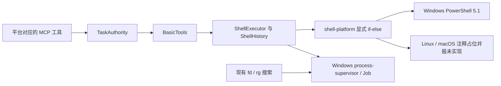

# ADR-0084：Executor 使用操作系统 Shell

状态：Implemented（2026-10-16，Windows）；完整构建、247 项回归及实际 Electron 检查通过。最终包和独立电脑验收分别见验证记录，不将未运行项视为通过。

## 背景与目标

Executor 仅实现 Windows x64。变更前 Basic 的 bash 工具通过自有 Windows Job supervisor 启动随包 PortableGit，后者完整复制进入构建和发行包。已检查的旧 unsigned 包中，该目录有 9,612 个文件、410,384,442 字节（约 391 MiB）。用户反馈远端安装需要约 3–5 分钟，最终可完成；该反馈没有分阶段计时，不能承诺删除 PortableGit 后的具体安装耗时。

目标是使用目标机器已有的原生 Shell，消除 PortableGit 的强制发行依赖，同时保留 Executor 的授权、统一任务、停止收束和持久结果契约。Pi 仅作实现参考，不新增 Pi 运行依赖，也不修改 packages/agent。

## 决定与范围

| 平台    | Shell 与 MCP 名称                            | 本轮范围                                                 |
| ------- | -------------------------------------------- | -------------------------------------------------------- |
| Windows | 系统 Windows PowerShell 5.1；powershell 工具 | 完整替换现有 bash，包括监管、契约、测试、构建与交付      |
| Linux   | 系统 Bash；bash 工具                         | 仅显式 if-else 分支、TODO 注释及未实现错误，不执行 Shell |
| macOS   | 系统 Bash；bash 工具                         | 仅显式 if-else 分支、TODO 注释及未实现错误，不执行 Shell |
| 其他    | 无                                           | 明确拒绝                                                 |

Windows 固定选择系统目录内的 WindowsPowerShell/v1.0/powershell.exe，不因机器安装了 PowerShell 7、Git Bash 或 WSL 改变解释器，不通过 PATH 查找解释器，不提供任意 shellPath 或调用方选择 Shell 的参数。执行前检查路径、普通文件及有界版本探针；缺失、不可执行或版本不符应报告具体不可用原因，不下载或切换其他 Shell。v1.0 是系统目录名，不代表使用 PowerShell 1.0。

Linux/macOS 后续实现时必须检查 Bash 的实际存在性与版本，不假设所有 Linux 镜像都有 Bash，也不以 macOS 默认登录 Shell 代替 Bash。声明分支不等于支持平台，构建、文件后端、凭据、Browser 和 Computer 等现有平台边界继续成立。

本轮 Windows MCP 不保留 bash 别名，不接受 Bash 脚本后自动转译。shell.execute 授权名称与能力边界不变。应用未发布，不保留旧工具路由、旧 PortableGit 资源或新旧 Shell 双运行路径；旧持久记录和用户文件仍不得自动删除、改写或重放。

## 结构与平台选择

继续由唯一 Runtime 装配，命令经原有 TaskAuthority、BasicTools 和输出历史流转。只在 runtime/basic 中增加一个内聚的 shell-platform.ts 负责平台选择和系统 Shell 身份，不引入适配器注册表、抽象基类或多层工厂。



下例说明分支结构；实际路径选择与有界版本探针由 shell-platform.ts 实现，非 Windows 分支保持未实现错误。

```typescript
if (platform === 'win32') {
  // 仅实现系统 Windows PowerShell 5.1，由 Windows Job 监管。
  return resolveWindowsPowerShell();
} else if (platform === 'linux') {
  // TODO：后续检测系统 Bash，并实现 Linux 进程树收束后再开放 bash。
  throw new Error('Executor Linux shell backend is not implemented.');
} else if (platform === 'darwin') {
  // TODO：后续检测系统 Bash，并实现 macOS 进程树收束后再开放 bash。
  throw new Error('Executor macOS shell backend is not implemented.');
} else {
  throw new Error('Unsupported Executor shell platform.');
}
```

运行期平台选择归应用源码；工程平台选择继续在 scripts/lib/platform.mjs，以明确注释保留 Linux/macOS 未实现错误。工程层不复制业务 Shell 选择实现，不创建空平台目录。

## Windows 执行与结果契约

### 命令传递与生命周期

保留 command 上限 16 KiB UTF-8、timeout 默认 120 秒/最大 600 秒，以及现有授权等待和停止封装预算。不能把完整命令直接改成 UTF-16LE Base64 的 -EncodedCommand：编码膨胀可能突破 Windows 命令行长度，不能因此悄悄缩小既有上限。

命令写入本次操作 UUID 目录内固定名称的 command.ps1，使用 CreateNew 写入 UTF-8 BOM，再以固定参数启动系统 PowerShell：-NoLogo -NoProfile -NonInteractive -ExecutionPolicy Bypass -File <私有脚本绝对路径>。命令正文不拼接到 C++ 命令行，不插值路径、反引号或用户命令。保留 BOM 是为 Windows PowerShell 5.1 正确读取中文脚本，不是修改用户文件编码。

ExecutionPolicy 参数仅作用于本次进程，不更改注册表或用户/机器执行策略；企业组策略或应用控制拒绝执行时正常失败，不修改策略、不提权、不改用另一解释器。该选项与当前 Pi PowerShell 工具启动方式一致，不能描述为安全沙箱。

脚本与工作 HOME/TEMP 由现有私有输出/操作目录拥有，在派发前落盘并记录准入；确认进程树退出后清理脚本及可丢弃材料。启动失败、取消、超时、输出超限、监管失联及重启恢复分别处理，不在子进程仍存活或结果未知时删除必要证据；不把原始命令写入控制 journal 或公开日志。

保留先 suspended 创建进程、设置 kill-on-close、加入 Job 再 resume 的顺序；超时、撤销、停止、父进程退出和管道丢失继续收束拥有的进程树。根进程退出但后台子进程未退出仍不得报告 quiescent。不改为仅 child.kill()，不提供脱管常驻进程。

### 环境、编码与错误

- 继续最小环境组装，不继承完整 process.env；过滤客户端凭据、Node loader、PowerShell 启动覆盖和其他敏感注入项。NoProfile 不等于隔离或禁止模块加载。
- Shell 可执行文件固定；业务子命令允许使用经过筛选的本机 PATH 项。拒绝空项和相对项，明确私有 Node/npm 与系统工具的顺序，不把当前目录或 PortableGit 注入 PATH。这样外部 git 等工具在机器已安装且路径可用时可以调用，但产品不保证它们存在。
- 显式设置系统模块搜索位置，保留私有 HOME/TEMP，验证系统模块可用，不依赖用户 profile。Node/npm 保持现有私有工具链与独立 npm 配置，不扩大为本轮移除 Node/Python。
- 启动前缀设置 Console 输入/输出与 $OutputEncoding 为 UTF-8；stdout/stderr 仍保留原始字节。原生程序仍可能输出本地代码页，预览按原有规则替换并标记，不假称所有外部程序都变成 UTF-8。PowerShell 5.1 的重定向/Out-File 等文件编码由命令自身决定，工具描述提醒显式选择编码。
- exitCode 返回实际 PowerShell 进程退出码，quiescent 不等于业务成功。-File 下原生程序非零退出不一定自动成为 PowerShell 退出码，调用原生命令需要检查并显式 exit $LASTEXITCODE；非终止错误也不能仅凭进程退出码为零认定成功。不以 stderr 非空、文本关键字或遗留 $LASTEXITCODE 猜测最终状态，不强行替换所有脚本的 ErrorActionPreference。
- 保留现有输出大小、预览、原始字节 URI、身份校验、版本分页和清理契约；监管完成帧与命令输出继续分离，输出不能伪造执行完成。

### MCP、身份与持久化

Windows 的七个 Basic 工具调整为 read、write、edit、powershell、grep、find、ls。同步更新工具 Schema、注册、权限筛选、destructiveHint、TaskAuthority 调度、超时计算、UI 工具目录、连接说明、传输提示词和发行清单，不能只改展示名。

runtime_status 增加安全的 shell 摘要：kind、version、available；工具描述写明 Windows PowerShell 5.1 语法、独立命令调用、编码与原生命令退出码注意事项。版本探针只在受控初始化执行一次，不在每次工具发现中反复启动进程。解释器不可用时不广告可执行的 powershell 工具；保持 read/write/search/Browser/Computer 等独立能力可用，并在状态中说明 Shell 不可用原因。

将 BashExecutor/BashHistory 及 bash 专属类型、错误码调整为 ShellExecutor/ShellHistory 和 shell 语义，Windows 对外仍用精确的 powershell 名称。持久化输入指纹必须包含工具/Shell 身份，不能把旧 Bash 操作键匹配到 PowerShell 命令。旧工具名、旧 journal 如不满足新 Schema，应明确拒绝并保留原件，不自动清空；新数据实例可直接使用，已有实例的冲突需停机备份后另行处理。对新格式继续验证同键查询、重启恢复和 unknown 不重放。

## 影响范围与清理清单

| 责任             | 计划变更                                                                                                                                                                                  |
| ---------------- | ----------------------------------------------------------------------------------------------------------------------------------------------------------------------------------------- |
| Runtime 命令执行 | 替换 runtime/basic/bash-executor.ts、bash-history.ts 的 Shell 归属，新增就近平台分支；更新 basic-inputs、basic-tools、runtime/index                                                       |
| 原生监管与搜索   | 将 native/bash-supervisor.cpp 及对应产物重命名为 process-supervisor；有限模式明确区分 PowerShell 与搜索。SearchProcess/SearchTools 只更新 supervisor 入口，fd/rg 不经 PowerShell          |
| MCP 与管理投影   | 更新 mcp-server、task-authority、runtime_status、目录和帮助文本；shell.execute 授权不变，不新增通用 IPC                                                                                   |
| 构建与清单       | 更新 native-build/build-native/build、application-api、emit-validation-schemas、package、package-runtime-manifest/runtime-manifest 及离线预检；删除 bundled Bash/Git 入口、版本与摘要要求 |
| 资源与 CI        | 删除 vendor/portable-git.json、assemble-portable-git.mjs、assemble:git 命令和 CI 装配步骤；新 dist/release 不再复制 PortableGit，移除仅由其产生的许可证记录                               |
| 文档与规则       | 更新 AGENTS、Basic、架构、INSTALLATION、交付、RELEASE、双语开发指南和实际验证状态；历史证据保留                                                                                           |
| 回归夹具         | Bash 执行/历史、Basic、MCP、stdio、私有 Node、搜索、项目目录、打包/离线验收，以及长等待/取消夹具改用对应 PowerShell 命令；不缩减断言或预算                                                |

搜索目前复用 bash-supervisor.exe 的私有 --search 模式，这是需要保留的独立能力，不能随 Bash 删除。原生 Job/帧协议不为改名另建一套后端。

只清理本次确认拥有的 PortableGit 生成目录及失效链接；先验证绝对路径和占用，不能递归删除整个 vendor/build/dist。旧 release 包、失败日志、用户任务记录、业务文件及未决恢复材料保留，新包使用新 UUID 目录。无 Agent Core 或共享 UI 源组件变更。

## 实施顺序与验收

1. **Windows 执行闭环**：先用隔离实例完成平台选择、实际 5.1 探针、私有脚本传递和 Job 模式替换，覆盖中文/空格/引号/反引号/换行及接近 16 KiB 的命令。不依赖系统已装 Git/Node/Python。
2. **工具与结果切换**：将 MCP 和 UI 的 bash 改为 powershell，补充 Shell 状态，收口权限、幂等指纹、输出历史和不可用分支。验证非零 exit、终止/非终止错误、原生命令退出码及显式传播；只让实际结果决定断言。
3. **回归与资源删除**：先通过新执行、历史、搜索、MCP/stdio、停止撤销及 Node/npm 聚焦回归，再移除 PortableGit 的源码装配、CI、打包元数据和拥有的生成残留。不保留旧工具兼容层。
4. **构建与交付**：原生构建与 DLL 测试串行；完整 build、lint、typecheck、包内 test 及相关集成通过后，使用正式 package:acceptance 生成新 EXE/ZIP，核对无 PortableGit/Bash/Git 发行条目、清单/预检/许可证一致和 ZIP 完整性。
5. **独立 Windows 验收**：系统无额外 Git、PowerShell 7、Node/Python，断网安装首启，通过 HTTP/stdio 发现 powershell 并执行中文命令，确认取消/超时无进程残留，搜索与文件传输继续正常。重新测量同机安装各阶段及总时长，与原 3–5 分钟用户反馈分开报告。

生命周期回归必须包含根进程派生子进程、后台残留拒绝、持续输出/输出上限、管道背压、停止/撤销、父进程退出、Job 清理失败、重复幂等键及重启查询。测试只用自建文件、独立数据与拥有的进程，不触及日常用户注册或批量结束系统进程。

平台分支分别测试 win32 选择系统 PowerShell、linux/darwin 的明确未实现错误和其他平台拒绝；这些是选择逻辑测试，不计作 Linux/macOS 实机支持。预检报告区分随包资源验证与目标机器系统 Shell 可用性，不能把开发机 PowerShell 的哈希/版本作为目标机固定资源校验。

## 取舍与实施评估

这是中等偏大的 Host 内部替换，主要复杂度在命令/输出语义、Job 监管、搜索复用和发行清单联动，而不是增加一个 PowerShell 启动命令。现有任务、权限、原生 Job 和输出历史可复用，工程风险可控制；需要完整构建及发行验证，不能仅用一次成功命令验收。

预期消除当前约 391 MiB、9,612 个散文件的 PortableGit 资源，准确新包差值与安装耗时须实测。代价是命令语言按平台不同、系统 PowerShell 补丁版本不同，Git/Unix 工具不再随包保证存在；工具发现与环境说明必须准确。系统 Shell 是命令执行的显式例外，不改变 Bridge/Computer 对固定私有 Node/Python 的依赖。

保留完整 PortableGit 会维持文件和安装成本；裁剪 MSYS/Bash 仍需维护额外 Windows Shell 运行环境；BusyBox 的 ash 不能完整承接 Bash；按机器优先选 pwsh/Git Bash 的动态回退会使同一 Windows 工具语义漂移。因此本轮采用固定系统 PowerShell，后续非 Windows 再实现系统 Bash。

## 参考与状态

- [Basic 当前实现](../architecture/executor-basic-tools.md)、[当前交付](../architecture/executor-delivery.md)及[验证记录](../architecture/executor-validation.md)。源码与旧包分别记录；旧 release 及原始失败保留，新包完成后记录独立身份，不覆盖旧产物。
- Microsoft Learn：about_PowerShell_exe（Windows PowerShell 5.1）、about_Character_Encoding、about_Execution_Policies；重点核对 -File/-EncodedCommand、退出码、UTF-8 BOM 和 Process/组策略优先级。
- Pi v0.85.1 的 shell.ts、powershell.ts 作为参考，实际 Executor 授权与生命周期由自有实现负责。
