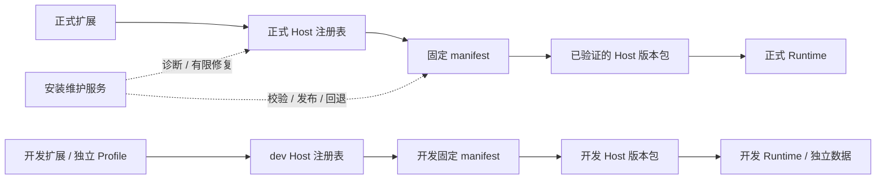

# ADR-0090：Browser Host 可调试、可修复的安装与连接生命周期

状态：Accepted（初稿 2026-11-02；2026-11-03 同步用户已确认的修订与实施授权）。设计已接受；核心代码已接入，正在按 PoC 执行验证，发行验收尚未完成。现行契约见 executor-browser.md，实测与剩余门禁见对应 PoC。

## 目标与问题证据

正常安装、兼容升级及短暂断线自动收敛；开发环境不干扰正式环境；失败能够定位到具体层、执行有限修复并验证结果。自动恢复仅恢复通信，绝不重放网页动作、恢复已暂停桥接或扩大授权。

2026-11-03 重构前基线：register-browser-host.ps1 将 Chrome/Edge 注册表指向安装目录内 bridge/native-host.json；旧目录删除后注册失效。迁移要求旧 manifest 存在且身份集合完全相同。非测试 Main 在 Runtime 就绪后自动配置，同一 Host 名覆盖开发和正式入口。browser-installation.ts 明确允许失败时留下部分注册变更；desktop-ipc.ts 的诊断只检查资源文件，自动配置错误被压缩为通用日志。这些事实来自重构前源码，不能靠增加重试解决。

## 决定一：固定注册位置，版本组件整体发布

保留 Native Messaging → 受认证回环 HTTP → 唯一 Runtime 的传输方式。新增统一安装维护服务，安装器、Main 自动检查、用户修复和开发命令调用同一套契约。Renderer 只消费结果，不持有任意路径、命令或注册表写入能力。

正式 Host 仍使用 com.octopus.executor.browser。HKCU 注册表长期指向固定的受管 manifest，不指向下载目录、源码 dist 或某个 Executor 安装版本。manifest 的 path 指向已经验证的某个不可变 Host 版本包内 launcher；升级时替换 manifest 文件，无需增加一个新的常驻服务或通用分发器。

决定布局：~/.dr-octopus/executor/browser-host/{registration,versions,state}。registration/native-host.json 是固定入口；`versions/<bundleId>-<deploymentId>/` 保持 launcher、native-host.cjs、私有 Node、原生依赖和许可的完整布局；state 保存当前/前一版本、安装来源、注册快照与事务日志。目录纳入现有业务根保护，维护状态不含 Runtime Bearer。可执行资源进入该目录是对现行存储约定的明确扩展，实施时同步 ADR-0083 及资源排除规则。

Host 随 Executor 打包、整体安装，没有独立的后台更新器。开发启动将构建产物发布到受管开发版本目录，清空 dist 不影响已发布 Host。解压版首次运行也复制完整 Host 组件，保留既有显式桥接启用规则；复制 Host 不等于授予浏览器操作权限。

同一通道只允许一个活动 Executor 安装所有者。可信且版本更高的正式解压版在启动时通过安装事务自动接管；同版本不同构建、降级或来源不能确认时要求明确确认。仅安装/更新事务或用户明确切换安装来源可以改变所有者；旧版本启动、旧卸载器、后台重试不能夺回入口。普通启动仅协调当前所有者期望的状态。多仓库开发使用独立 Profile 和构建时确定的工作区 Host 后缀，不能按启动先后争抢同一个 dev 入口。

安装所有权与活动组件分别记录：source/sourceVersion/installationBundleId 标识拥有维护权的安装，bundleId/directory 标识实际运行的组件。回退保留新安装的维护权；旧卸载不能因为活动包回到了旧版本就删除新所有者的入口。

## 决定二：升级是可恢复事务

1. 获取通道级跨进程锁，核对安装所有者和期望 generation，保存旧 manifest、注册值及事务状态；不同浏览器项分别记录。
2. 将完整版本包写入同卷暂存目录，校验随包可信构建清单、资源摘要、来源策略和协议范围，执行有界 Host 启动/Runtime 握手探针。探针不执行网页动作，也不冒充真实扩展。
3. 封存版本目录。用同卷替换发布完整 manifest，切换活动 generation。首次注册或修复注册表才写 HKCU；逐项读回验证。文件和两套注册表不假装具备跨资源原子性，以 journal 保证崩溃后继续或回退。
4. 升级在没有在途 Browser 操作时切换。若需中断，明确记录结果可能未知，不自动重放。旧 Host 进程固定使用启动时版本，新连接使用新版本。不得在运行中的目录内覆盖 Node、JS 或 DLL。
5. 验证分级：组件探针通过为“组件就绪”；真实扩展 nonce 往返成功为“浏览器已连接”。浏览器关闭、扩展暂停、桥接关闭时保留等待状态，不以未握手判定安装失败，也不冒称端到端成功。
6. 已证实新组件失败时恢复旧 manifest 与注册快照，前提是旧包仍可信且兼容当前 Runtime。无法安全回退时进入修复状态并保留证据，禁止反复来回切换。上次事务未完成时先恢复，再接受新事务。

只回退 Host 安装事务，不静默回滚用户数据、授权或整个 Executor。应用降级需要独立的数据兼容检查。保留至少前一可用包；无进程引用且不再用于回退时清理旧包，Windows 文件占用时延期清理。磁盘不足在发布前失败，旧包保持可用。

稳定 manifest 仍指向版本 launcher，因此没有额外 bootstrap 的自升级问题；运行中的旧进程不因 manifest 替换获得新代码。注册入口文件缺失、磁盘损坏仍可能发生，由维护服务处理，不承诺永不故障。

## 决定三：开发环境全链路隔离

dev 的 Host 名、manifest、业务根、Electron userData、单实例锁、Runtime 引导记录、日志和浏览器 Profile 均独立。通道由构建入口确定，扩展不能由网页或运行时参数任意选择 Host。默认官方扩展身份策略继续校验，使用隔离 Profile 避免相同侧载 ID 替换日常扩展；若另设 dev 身份，必须纳入明确的构建策略，不能放宽来源。

增强现有根命令 `pnpm dev:browser-extension`，不新增 `dev:browser`。默认编排完整链路，支持 `--extension-only` 仅启动插件；保留 `dev:executor`，复用同一工作区的开发实例与隔离配置。完整链路完成 shared 与两端契约构建、Host 版本发布/注册、Runtime 启动、WXT 启动、开发 Profile 装载和真实只读往返验证。终端输出实际 Host 名、Profile、Runtime、构建摘要、协议及失败层。构建失败禁止发布混合新旧产物；identity 元数据与 Worker 内嵌 buildId 来自同一次构建，不能以文件时间或旧 sidecar 推断运行版本。

UI 普通热更新继续使用现有机制；影响 Host 或协议的变更发布新组件并重连；完整产物校验在启动/相关变更时执行，不在每次页面热更新重建全部应用。停止开发会话只回收其进程和连接，保留可复用注册；删除工作区后由开发管理入口清理其孤立记录。

开发数据位于 `~/.dr-octopus/executor-dev/<workspace-key>/`，electron/project 保存业务与 Host 状态，browser/<browser> 保存浏览器 Profile。Renderer、Runtime 和 WXT 使用独立工作区端口范围；Runtime 固定回环，不受普通设置保存覆盖。开发 serve 强制已验证的侧载身份，正式商店构建仍独立；安装包内的本地加载副本必须是侧载构建。

停止会话不注销；显式 --cleanup-registration 可清理本工作区，--workspace-key 可选择已删除工作区的 key。只删除仍指向该开发目录的用户注册，保留数据及不同路径的注册，不扫描删除其他工作区。

## 决定四：明确协议兼容与发行顺序

产品尚未发布，没有生产用户数据。本次直接采用新的单一桥接协议，两端一起重建，不保留 v4 适配、版本协商降级或旧消息解析。区分 extensionVersion、executorVersion、hostBundleId 与 protocolVersion；握手报告实际构建信息，版本不匹配明确提示重建或更新，不能静默降级。Host/Runtime 同样校验协议。

不维护旧安装流程和旧维护状态转换器。本机残留注册采用一次性备份、确认归属、清理并重新配置，独立于产品长期逻辑；未知注册仍不能盲目覆盖。正式发布后的兼容窗口按实际用户版本另行设计，不在此次预建双协议兼容层。事务恢复与同一新协议下的组件回退仍然保留。

扩展兼容升级不重装 Host；Executor 更新自动发布所带完整 Host 包；安装维护服务发现本安装的 Host 缺失/落后时从可信随包资源恢复。必要版本不在本地时给出“需要更新 Executor”，不能把网络更新能力、下载或静默安装当作当前已有功能。企业策略阻止更新或扩展来源不受允许时明确报告，不绕过策略。

## 决定五：诊断、修复、验证使用同一事实模型

维护服务提供只读 inspect、有限 repair 及只读启动验证。发布前通过受管 launcher 做 nonce 往返；probe 不建立工具实例。Runtime 未运行或桥接关闭时，探针返回 waiting；允许发布组件，但实际连接仍以扩展握手为准。每个检查包含 checkId、状态（pass/fail/unknown/notApplicable）、期望/实际摘要、错误码、可执行修复及证据时间。修复接受诊断 revision 并在加锁后重读，避免按过时状态覆盖用户的新配置；重复执行幂等。注册表、文件、启动和真实握手分层，不再返回一个笼统 resourcesAvailable。

| 层       | 必须检查                                                         | 恢复责任                                            |
| -------- | ---------------------------------------------------------------- | --------------------------------------------------- |
| 注册发现 | Chrome/Edge 分别的有效注册、HKCU/HKLM 与适用注册表视图、策略阻断 | 修复已知自有 HKCU；其他配置显示冲突                 |
| Manifest | 存在、可解析、Host 名、stdio、来源集合、launcher 路径            | 从可信当前包重建                                    |
| 组件     | 完整包、构建摘要、私有运行时、启动错误和退出码                   | 重新部署或回退                                      |
| Runtime  | 是否运行、正确通道/业务根、引导与认证是否有效                    | 当前 Main 有界重启其受管 Runtime，保留关闭/暂停意图 |
| 协议     | 扩展、Host、Runtime 实际构建与协议版本                           | 校验单一协议，否则明确需要更新哪一端                |
| 浏览器   | 实际 Profile/扩展身份、握手、心跳、真实往返                      | 插件有界退避重连；暂停状态不恢复                    |
| 页面能力 | 网站权限、受保护页面、Controller 就绪                            | 给出具体权限/页面操作，不能反复注册 Host            |

诊断不能仅凭 native lastError 字符串确定注册根因；插件只报告能观察到的错误，Executor 才检查本机注册。扩展失去 Native 通道后无法自行修改 Windows 注册，显示“打开 Executor 修复”；不为了修复增加任意命令入口。Executor 未运行时显示等待启动，不承诺扩展能自动启动应用。

维护 launcher 的 Job 监管完整进程树，55 秒停止、60 秒外层截止；取消和退出会结束维护子进程。Main 通过完成事件刷新界面，不持续读取整个资源树。已启用 Browser、此前启动成功且 Computer 状态明确为空闲时，Main 每次生命周期最多恢复两次意外退出的 Runtime；主动停止、启动数据故障和未收束的桌面控制不自动启动。

自动检查触发于当前所有者启动、升级完成和有界的连接故障恢复，不持续轮询整个文件树；相同失败有冷却和重试预算。插件保留 alarm 支持的恢复，避免只依赖 Worker 内存定时器；以低频探测等待 Executor 回归，暂停取消探测。连续失败不弹窗轰炸；恢复中只显示状态，恢复成功清除当前告警但保留历史诊断。

| 情况                                     | 默认行为                           | 何时需要用户             |
| ---------------------------------------- | ---------------------------------- | ------------------------ |
| 已知自有注册缺失、包缺失或 manifest 损坏 | 从当前可信包自动修复并验证         | 自动修复失败             |
| Runtime 短暂重启/Host 意外退出           | 有界重连或受管恢复                 | 预算耗尽/持续失败        |
| 已确认旧安装来源的残留注册               | 一次性备份清理后配置新入口         | 无法确认归属             |
| 旧 manifest 消失且没有维护记录           | 显示旧路径和修复预览，保留注册备份 | 一次明确确认后只替换该项 |
| 未知注册、权限拒绝或企业策略             | 保留配置并明确错误                 | 用户/管理员处理          |
| 暂停、关闭桥接、撤销授权                 | 保持用户选择                       | 用户明确恢复/重新授权    |

一键修复完成后重新 inspect + verify，显示“已连接”或“组件已修复，等待浏览器/扩展连接”；失败保留原始错误、操作与回退结果。修复不要求用户使用 regedit、删除目录或重新授权已有效的设备能力。修复不成功时提供一个下一步和脱敏诊断导出。

日志使用统一 operationId 关联安装维护、Host 与 Runtime；扩展握手后补充 connectionId/buildId，握手前保留本地 attemptId、时间和浏览器错误，允许关联不完整。导出包含阶段、错误码、通道、版本、检查结果和修复历史，不包含令牌、网页正文或未脱敏用户路径。完整路径仅在本机高级诊断按需展示。日志轮转和诊断保留有明确上限。

## 迁移与交付闭环

首先交付维护服务与诊断事实模型，再交付固定入口/事务安装和 dev 隔离，随后接入自动恢复及 UI。不引入旧配置迁移器；开发机器的一次性清理先确认归属，只有旧路径而没有证据时明确确认，不把相似目录名当归属证明。旧卸载脚本只删仍指向自身的注册，不得删新固定入口。新的卸载需核对当前所有者并停用对应入口，保留用户数据；不能由旧安装卸载新所有者。

实现涉及 apps/executor、apps/browser-extension、packages/shared 的纯桥接契约与构建入口；不修改 packages/agent。现行 browserHostName 常量、默认数据目录、自动注册、原生固定资源定位等边界需成组修改，不能只改注册脚本。架构与应用规范同时更新；使用说明、开发命令及发行 SOP 各维护一份权威流程。

验收矩阵与实测状态见 [Host 生命周期验证计划](../poc/browser-host-lifecycle-validation.md)。

## 取舍与未实现事项

保留 Native Messaging 使插件继续经浏览器许可访问固定本机组件；直接改连 localhost 会引入新的发现、认证、来源和生命周期问题，不能消除安装及版本管理责任。仅放宽旧注册覆盖规则只能修复一次残留，不能处理升级竞争和半完成状态。

新增受管副本、事务日志和一个前版本需要磁盘与维护代码；采用固定 manifest 直接指向版本 launcher，避免再造常驻 broker 或独立自动更新产品。新协议两端需要真实组合测试，不能通过比较产品 semver 替代。失去所有本机可信资源、权限不足、未知注册与策略禁用需要用户介入，是明确失败出口。

本次已开始实现连接所有权分离、受管包维护、v5 握手和开发隔离；真实发行验收仍未完成。当前机器残留注册的即时修复与本设计落地是不同交付，不能用一次手工修复宣布长期问题解决。

## 连接界面

安装版和解压版均在启动时自动配置。正常连接不显示修复操作；自动恢复中显示进度；自动恢复失败后显示“修复浏览器连接”，未知归属显示确认预览。主区移除“检查连接”，高级诊断保留“重新检测”和脱敏导出。用户暂停不自动恢复。

引导文案：“启动执行器后会自动配置浏览器连接。连接异常时，可点击‘修复浏览器连接’重试。”组件就绪与真实连接必须分别呈现，不把复制文件或注册成功当作已经握手。

## 2026-11-03 当前分支实施复核

用户已取消并行开发与新建 worktree 的要求，改为在当前分支实施。原有模块职责边界继续适用，不再规定双分支所有权或串行合入流程。

复核基线为 067ff6c。扩展已经使用 BuiltinAgentService 统一整理/重放，SkillFileClient 复用 Native port；录制准入等待技能状态恢复。本次连接重构必须保留这些接线、离线录制与浏览器技能存储、面板所有权及未知副作用处理，不以旧工作流设计覆盖当前业务。

background.ts 保留业务装配和退役工作流清理，src/lib/native-bridge.ts 独立拥有 port、握手、重试/心跳、暂停、状态及旧回调防护。通过 execute/reset 和 receive/disconnect 的有限能力协作，getSession 返回捕获当前身份的发送能力，旧发送函数不能向替代连接发送。业务模块不直接管理连接状态。

复核时的基线：自动注册仍调用旧安装目录脚本，诊断仅检查五个文件。此次已替换为共同维护服务，保留 PowerShell 作为固定私有 Node 启动适配；实现进度与测试边界见 PoC，不能以源码接入代替发行验收。

实施顺序保持：先分离连接资源所有权并验证业务边界，再统一维护诊断及安装事务、接入开发隔离与实际构建握手，最后完成 UI 和真实浏览器验收。源码单测通过仅证明所覆盖边界，发行阻断场景仍见 PoC。
