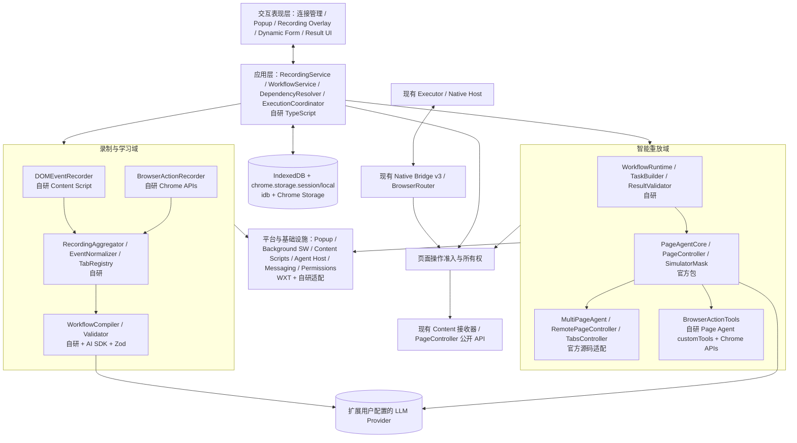
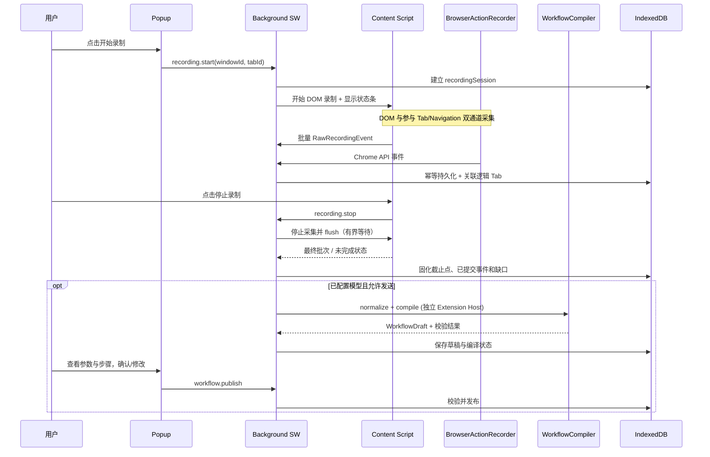
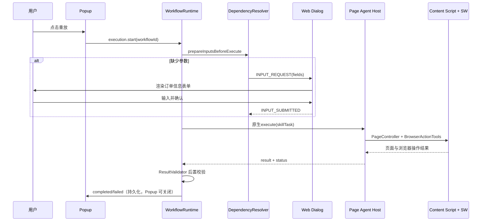

# Browser Extension Tab 录制与智能重放 — 项目融合设计

> **当前 Skill 方向（2026-10-31）：** 新增整理/重放以[统一 ToolLoopAgent 设计开发方案](browser-skill-unified-agent.md)和 [ADR-0089](../adr/0089-browser-skill-unified-agent.md)为权威。下文原工作流编译/发布、Page Agent Core、重放不提问等段落保留为阶段历史，不再作为新增 Skill 实施要求。已有连接、录制、PageController、权限与生命周期边界仍有效；实际已实现状态以验证矩阵为准。

> 状态（2026-10-31）：录制及第二阶段整理/编辑已实现，用户已确认第二阶段人工验收通过；智能重放尚未实施。新增[引导式整理](browser-workflow-guided-organization.md)已在用户明确指令后接入，运行验证边界见验证矩阵；下文原始设计与旧阶段说明需结合该专题的实施落点阅读。实际自动化覆盖见验证矩阵，不代表完整发行完成。
> 2026-10-31目标修订：用户要求有限工具Agent自主整理并通过ask_user_question澄清，生成可维护的本地Skill；新[闭环方案](browser-recording-skill-agent.md)与[ADR-0088](../adr/0088-browser-recording-skill-agent.md)均为Proposed。本轮不出视觉稿、不实施新架构。
> 目标读者：架构设计者、前端工程师、Codex/其他开发智能体  
> 产品形态：现有 Chrome/Edge WXT/MV3 扩展，在同一个扩展中新增录制、浮条、事件保存与查看功能，保留现有桥接功能；新增工作流不提供 Side Panel、聊天界面或 MCP 接口。

## 0. 执行摘要与确定的架构决策

Browser Bridge 指现有扩展通过 Native Messaging 连接本机 Executor、提供有限 Browser 工具的能力。录制与它同属 `apps/browser-extension`，但录制事件不经过 Native Host；Executor 离线或桥接暂停不阻止用户开始录制。停止录制后的模型编译与本地重放分阶段交付。

本文维护新增能力的详细设计；现有桥接协议见 [executor-browser.md](executor-browser.md)，长期规则见 [扩展 AGENTS.md](../../apps/browser-extension/AGENTS.md)，实际验证状态见 [executor-validation.md](../poc/executor-validation.md#浏览器录制与本地重放第一阶段验证中)。决策与取舍见 [ADR-0086](../adr/0086-browser-extension-recording-and-local-replay.md)。

- 用户手动演示一次业务流程；扩展在网页及可访问的浏览器级事件上录制；**规则归一化 + LLM 编译**为参数化、可审阅的 `workflow.json`。
- 新增工作流的本地重放使用 **Page Agent 作为网页智能执行引擎**；现有 Dr.Octopus Agent → Executor → Browser Bridge 路径保持独立。不建设第二套确定性 DOM 重放引擎；`Workflow Runtime` 负责业务阶段、输入依赖、授权、检查点、结果验证，不直接执行 DOM 操作。
- 浏览器级行为（Tab、Window、Navigation）由 Chrome Extension API 监听，执行侧通过 Page Agent 的 `customTools` 调用扩展的 BrowserActionTools。
- 插件的管理入口只有 Popup；录制状态、参数表单、确认和结果反馈在网页 Content Script 中显示；复用 PageController 的 `SimulatorMask` 呈现 AI 操作动画；**不使用 `@page-agent/ui`**。
- 为了让重放不依赖 Popup 生命周期，**执行期间创建独立、非活动的 Extension Agent Host 标签页**承载 Agent/编译任务；不提供可操作的聊天 UI，完成后自动销毁。该技术标签页在 Chrome 标签栏中可能可见，且可能被用户关闭/浏览器冻结；设计检查点与中断恢复，绝不假设永久存活。
- `chrome.storage.session` 保存当前会话、映射和协调元数据；IndexedDB 保存已规范化录制事件、工作流及审计/执行检查点。Background SW 不持有唯一真实状态。
- 模块来源分为：`[自研]`、`[官方直接使用]`、`[官方源码适配]`、`[第三方框架]`。
- 范围限定为**网页操作 + Chrome 扩展 API 可访问的浏览器操作**；不声称捕获或控制浏览器所有原生 UI，也不控制 Windows 桌面。

## 1. 产品范围与非目标

### 1.1 支持的产品能力

1. Popup 保留连接状态、暂停/恢复连接、重连及诊断，新增录制记录和工作流列表、开始/停止录制、审阅、执行、重命名与删除；不显示 AI 对话记录。
2. 用户在选定业务 Tab 进行点击、填写、选择、滚动、提交、导航；扩展结合参与 Tab 的创建/切换/关闭/移动事件记录操作流程。跨窗口创建、聚焦与关闭作为后续扩展能力，不属于一期承诺。
3. 录制时网页出现可拖动的轻量状态条：计时、步骤数量、暂停、停止；状态条**不阻断**网页交互。
4. 停止录制先保存录制结果。模型已配置且用户允许数据发送时，再启动 LLM 编译，识别目标、参数、依赖和成功条件，输出 `workflow.json` 草稿；必须审阅后发布。未配置或离线时仍可查看录制并稍后编译。
5. 点击“重放”后，先按阶段收集必填参数；必填输入在 execute 前补齐；运行中不接入问答，信息不足则结束本次运行。
6. Page Agent 以 `SimulatorMask` 展现智能执行，过程性动作使用 PageController，浏览器级动作使用 BrowserActionTools；完成后验证业务结果。
7. 单次只允许一个活跃的全浏览器工作流重放（避免标签页、焦点、遮罩和确认窗口冲突）。

### 1.2 明确不做

新增录制/重放 MCP 接口、Side Panel、聊天 UI、独立确定性网页重放引擎、任意 JS 自动执行功能、Chrome 原生菜单/设置/地址栏逐键监听、OS 系统文件对话框与桌面操作、浏览器密码管理器/扩展页面自动化、绕过网站访问控制。

### 1.3 浏览器系统操作的能力边界

| 用户动作                                      | 是否记录               | 数据/执行来源                                | 注意事项                                                      |
| --------------------------------------------- | ---------------------- | -------------------------------------------- | ------------------------------------------------------------- |
| 网页点击/输入/选择/滚动                       | 是                     | Content Script DOM 事件；PageController 执行 | 顶层文档及可访问 open shadow roots；frame 边界见 1.4          |
| 创建、关闭、激活、移动 Tab                    | 是                     | `chrome.tabs` 事件与方法                     | 事件可能由网页脚本触发；需归因                                |
| 打开 URL、刷新、历史前进/后退                 | 记录最终导航并尽力归因 | `chrome.webNavigation`，`chrome.tabs`        | 不能监听地址栏逐键输入，不能总能准确还原点击来源              |
| 窗口创建/激活/关闭                            | 后续扩展               | `chrome.windows`                             | 一期只处理所属窗口关闭/Tab 移出导致的中断，不承诺重放窗口操作 |
| Tab Group                                     | 可选拓展               | `chrome.tabGroups`                           | 第一版不作为业务核心依赖                                      |
| Chrome 菜单、下载保存对话框、DevTools、设置页 | 不承诺                 | 扩展权限不足                                 | 归一化为待人工处理的 unsupported step                         |
| 系统桌面/其他原生应用                         | 否                     | 无                                           | 明确不在产品能力内                                            |

> 关键区别：能观察到浏览器状态变化，不等于能确定用户具体点击了哪个 Chrome 原生控件。编译时保留 `confidence` 与事件来源，不能伪造动作事实。

### 1.4 Tab 范围与一期边界

- 这里的录制是操作事件录制，不是屏幕视频录制。开始时保存起始 `tabId/windowId`、逻辑 `tabRef`、允许站点和参与 Tab 集合。
- 默认只采集起始 Tab。开始时可明确启用“包含流程打开的新标签页”；仅在 `openerTabId` 属于参与集合、同一窗口且 URL 在允许站点内时纳入。缺少关联证据或站点不允许时，不自动采集；由用户在 Popup 明确纳入和授权后再监听。
- 切换到无关 Tab 只呈现录制范围外状态，不保存其 URL、标题和 DOM。所有事件先通过参与范围过滤，再脱敏和持久化。
- 起始 Tab 关闭时，有其他参与 Tab 则继续并显示起始页已关闭；全部参与 Tab 关闭则保存结果并结束。Tab 移出所属窗口或发生替换时停止该目标采集并标记缺口，不能把旧 tab ID 自动映射到替代页面；没有有效参与页则标为中断。
- 参与页跳转到未允许站点或受限页时，停止该页 DOM 采集，只保存脱敏的边界事件；继续前需明确纳入站点。窗口关闭、浏览器重启后保存中断记录，不自动恢复采集。
- 沿用顶层 ISOLATED 静态入口。顶层监听不会自动覆盖 iframe：一期遇到 frame 内流程标记不支持并提示人工补充，不声称完整捕获。同源 frame 的独立监听、身份及卸载另行验证后扩展；跨域/嵌套 frame 不在一期范围。现有 Browser 工具的单层同源 frame 能力不因此回退。

## 2. 总体逻辑架构



**依赖方向**：UI → 业务用例 → 受控浏览器/存储适配。仅跨上下文消息需要独立契约，不为每个实现类创建一对一 interface。页面执行复用当前 Controller 公开能力，录制直接监听用户事件，不通过 Controller 采集，也不启动执行遮罩。

### 2.1 当前实现与接入位置

| 当前位置                                                                                               | 已有职责                                 | 计划改动                                                       |
| ------------------------------------------------------------------------------------------------------ | ---------------------------------------- | -------------------------------------------------------------- |
| `entrypoints/background.ts`                                                                            | Native 握手、连接重试、Popup 命令        | 保留连接生命周期，装配录制协调、分来源消息路由和执行准入       |
| `entrypoints/content.ts`                                                                               | 单例消息接收、Controller、BFCache 清理   | 同入口接入录制监听/浮条；按所有者分派和清理                    |
| `entrypoints/popup/main.tsx`、`src/features/popup/`、`src/features/connection/`、`src/popup-bridge.ts` | 实时连接状态及有限连接命令               | 保留原契约，组合录制记录、工作流和运行状态；新增本地消息契约   |
| `src/browser-router.ts`                                                                                | Browser 工具、文档身份、补注入、截图路由 | 接入共同准入；仅按明确复用需求提取页面路由能力                 |
| `src/page-controller-adapter.ts`、`src/browser-screenshot.ts`                                          | Controller、快照/分页、动作及敏感截图    | 保持现有协议行为，扩展明确的所有者边界，禁止双 Controller 抢占 |
| `wxt.config.ts`、构建与许可脚本                                                                        | 双浏览器产物、身份与权限                 | 按阶段增加必要权限/入口/依赖许可，不重建插件骨架               |

新增录制、编译和重放业务均归扩展，不导入 Executor 实现，不修改 `packages/agent`。扩展私有协议留在本应用；只有实际跨 Host 的协议才进入 `packages/shared`。现有 Native v3 不因内部录制消息而升级或扩大工具白名单。

### 2.2 录制、Bridge 与本地重放的协调

Background 是页面操作准入的唯一协调者。录制会话、Native 连接和本地 run 分别拥有自己的状态，不能通过一个通用 reset 互相清理。执行来源使用判别身份：Bridge 为 `connectionId + taskId`，本地重放为 `runId + hostInstanceId`；页面引用还绑定 tab、document、controller 和 snapshot。不得伪造 Native connectionId 承载本地任务。

- 全扩展最多一个录制会话、一个本地重放，二者互斥。录制暂停仍保留参与范围，避免自动化改写待继续录制的页面。
- 同一 Tab 的 Controller 同时只归一个执行所有者。录制开始前检查参与页在途操作和 Controller 所有权；有冲突则拒绝开始，不抢占既有任务。新纳入 Tab 也必须经过同一检查。
- 录制期间拒绝参与页上的 Browser 操作，包括会改变遮罩的观察；不影响参与页的列表读取等操作可继续。截图默认会激活 Tab，因此不能简单归类为无副作用读取。
- 本地重放期间拒绝其他来源对其目标页的观察和操作。会切换焦点的截图、Tab 激活以及影响受保护窗口的操作也必须检查，不因目标 Tab 不同而绕过。无法证明不会影响活动流程时返回忙碌。
- Bridge 冲突沿用协议中已有的 `BROWSER_BUSY`；内部录制/重放返回带冲突来源的本地状态。拒绝不自动排队、重试或接管。此处只做扩展侧有限准入，不增加 Executor 任务许可世代、强停确认或通用调度系统。
- 停止立即关闭新派发，允许已发动作回包收尾。取消或超时不等于撤回，结果不明记录 `outcome_unknown` 并阻止该目标被新所有者抢占，直至在途结束或文档已明确失效；由用户确认和重新观察决定后续动作，不自动重放。
- Bridge 暂停/断线仅释放 Bridge 自己的资源；本地 run 取消仅释放匹配 run/host 的资源。旧释放回调不能删除新所有者状态。SW 恢复期间先暂停新动作准入，核对 Host、页面身份和未完成操作；不能仅凭 storage 中的锁认定可继续执行。无法确认时中断并要求重新观察，不重发未知动作。

三个 UI 操作分别命名为“暂停连接”“暂停录制”“停止重放”。Popup 不持有后台连接、录制器或 Agent 实例；任何控制都通过经身份验证的消息交由所属运行时执行。

## 3. 技术选型与源码复用边界

| 技术/组件                      | 建议           | 角色与边界                                                                 |
| ------------------------------ | -------------- | -------------------------------------------------------------------------- |
| WXT + MV3                      | [第三方框架]   | Popup、Background SW、Content Script、Agent Host 入口与构建                |
| React 19 + TypeScript          | [第三方框架]   | Popup 与网页交互层，保持独立于业务状态机                                   |
| shadcn/ui / Radix              | [第三方框架]   | 动态表单、Dialog；在 Content Script 的 Shadow Root 内需正确挂载 Portal     |
| `@page-agent/core`             | [官方直接使用] | AI 任务循环、`execute()`/`stop()`、受限工具适配与事件；不接 `onAskUser`        |
| `@page-agent/page-controller`  | [官方直接使用] | DOM 观察、网页操作、`SimulatorMask`；不直接重写其内部 DOM 引擎             |
| MultiPageAgent                 | [官方源码适配] | 官方扩展代码只移植跨 Tab 实现，去除 Side Panel 和 UI 耦合                  |
| RemotePageController（3 端）   | [官方源码适配] | Agent Host → SW → Content 的代理通信及错误传播                             |
| TabsController + 官方 TabTools | [官方源码适配] | 逻辑当前标签页、已有 open/switch/close 能力；补实际激活与作用域校验        |
| Vercel AI SDK                  | [第三方框架]   | 只用于 Workflow Compiler 的独立结构化 LLM 请求                             |
| Zod                            | [第三方框架]   | Workflow/消息/表单/LLM 输出 Schema 与细粒度业务一致性验证                  |
| idb                            | [第三方框架]   | 简化 IndexedDB 封装；业务 Repository 自研                                  |
| node:test / Playwright         | [现有工具链]   | `*.test.mjs` 状态机/协议测试，真实 Chrome/Edge 隔离扩展 E2E；不引入 Vitest |

官方扩展 `packages/extension` 是 `private: true` 的源码工作区；不要把 `@page-agent/ext` 当成稳定的外部运行时 SDK。可将其 MultiPageAgent、RemotePageController、TabsController 必要部分移植到本项目，保留原许可声明。当前项目只已固定 `@page-agent/page-controller@1.12.4`，并有移除 `executeJavascript` 的批准补丁；尚未接入 `@page-agent/core`。原设计的 API 与版本组合是实施核对候选，不代表本仓库验证通过；实施时锁定**实测兼容的版本及 commit**，不要不经验证自动升级。AI SDK、idb 与 Page Agent Core 仅在对应阶段引入，并更新锁文件和双目标依赖许可。

### 3.1 是否使用 Page Agent Custom UI？

**仅复用框架与UI解耦的模式，不直接使用其UI包。** 2026-10-31用户明确取消重放onAskUser及替代提问工具，运行前准备参数，随后只调用Page Agent Core原生execute。整理阶段的ask_user_question属于ToolLoopAgent会话，不进入重放侧；不再建设重放期InputRequestManager或动态问答桥接。

### 3.2 Page Agent 原生遮罩能否显示表单？

SimulatorMask只承担原生执行遮罩/反馈；参数填写在execute前完成。重放运行中不为表单暂停再恢复Agent。独立的运行控制UI仍需排除在页面观测之外，具体界面在完整方案确认后另行设计。

## 4. 功能模块详细设计（逐项标记来源）

### M01 — Popup 管理 UI [自研；WXT/React/shadcn/ui]

**职责**：保留实时连接管理与诊断，新增录制开关、录制事件查看、工作流列表/详情、参数审阅、执行入口、模型配置和运行状态。连接状态继续以 Worker 当前握手为准。

**页面**：

- 首页：连接状态入口、主按钮「开始录制」、最近录制/工作流及运行状态；
- 工作流详情：任务描述、步骤摘要、变量列表、站点范围、执行按钮、删除/编辑；
- 录制编译结果：参数勾选/更名/固定值选择、不可重放的步骤提醒、保存/重新编译；
- 设置：LLM 接口、模型、域名权限、隐私策略。

**接口**：`recording.start`、`recording.stop`、`workflow.list/get/save/delete`、`execution.start/stop/get`。**Popup 不保存执行器实例**，打开时从持久状态重建界面。

### M02 — Recording Overlay [自研；Content Script + React]

**职责**：网页右上角状态条：红色录制点、计时、已规范化步骤数、暂停/继续/停止；状态更新来源于 `RecordingService`。

**约束**：不能遮挡主要业务操作，支持拖动；忽略自己的 DOM 事件；页面刷新后按录制会话状态恢复；限制在已授权站点；插件管理的页面重放遮罩与录制提示**互斥**。

### M03 — DOMEventRecorder [自研；原生 DOM API]

**职责**：监听 `click`、`input/change`、`keydown`（可重放的语义按键）、`scroll`；采集 `composedPath()`、可访问 Shadow Root、表单 label、role、name、placeholder、testid、selector 候选、所在 frame/doc 与语义上下文。

**规范**：只监听录制会话允许的页面；`isTrusted` 作为用户事件辅助证据而非安全唯一凭据；中文输入监听 composition；输入 debounce/coalesce，最终值在 change/blur 提交；敏感字段直接不记录值；frame 支持按 1.4 的阶段边界，不把顶层注入等同于 frame 事件监听。

**输出**：`RawRecordingEvent`；**绝不**直接生成最终 Workflow。

### M04 — BrowserActionRecorder [自研；Chrome Tabs/Windows/webNavigation]

**职责**：监听 `tabs.onCreated/onActivated/onRemoved/onMoved`、所属窗口关闭事件、`webNavigation.onCommitted/onHistoryStateUpdated`，保存标签页、窗口、导航的事件事实及证据。

**规范**：监听器在 Background SW 顶层同步注册；只处理当前录制的 windowId 与参与的 tabs；排除插件自身 Agent Host、Popup/内部扩展页；区别用户操作、页面触发、Agent 触发及无法判定来源；地址栏只记录最终导航及导航来源 qualifier，不能记录逐键输入。

**输出**：`RawBrowserEvent`，与 M03 汇聚。

### M05 — TabRegistry + RecordingAggregator [自研]

**职责**：

- 将短暂的 `tabId/windowId/frameId/documentId` 映射为 `tabRef/windowRef/frameRef`；
- 对多来源事件分配 `eventId/sessionId/seq/timestamp/causationId/source`；
- 关联「DOM 点击 → 新 Tab → 导航」，避免双重记录；
- 分辨脚本引起的间接动作、重定向、后台站点刷新；无法归因保留 `unknown`；
- 接收多上下文批量事件并 ACK、去重、幂等持久化。

**输出**：统一 `NormalizedEvent[]`。不由 LLM 解决消息去重和顺序；LLM 只推理语义。

### M06 — EventNormalizer [自研]

**职责**：输入操作合并、滚动节流、重复导航压缩、Tab 生命周期归并、候选定位器标准化；同一动作可能包含多个底层事件，以因果链而非时间排序单独判定是否为独立步骤。

**产出**：`RecordedAction[]`；每个 action 关联原始 `sourceEventIds`，保留证据与追踪能力。

### M07 — WorkflowCompiler [自研 + Vercel AI SDK + LLM]

**职责**：停止录制后，基于归一化事实构建 `WorkflowDraft`：名称、目的、步骤意图、参数定义、变量使用点、依赖、页面查询结果、成功判据、风险等级。

**处理链路**：

1. `EventNormalizer` 获取稳定动作，不让模型处理无意义高频输入；
2. `PrivacyFilter` 对源端已脱敏数据再次检查，删除、替换密码、验证码、身份信息、带 token 的 URL；不能将原始秘密先落盘再清洗；
3. 使用锁定版本 AI SDK 生成版本化语义注解；模型只引用短动作ID，程序装配动作、顺序、来源及确认门禁（ADR-0087）；
4. 校验变量定义和引用、动作来源证据、合法域名、跨 Tab 引用、敏感操作；
5. 失败保存受限诊断，只在用户明确重试时新建任务；缺失语义保留事实并标记待核对，不自动重试；
6. 在 Popup 展示识别的动态参数，用户确认、纠正后才发布工作流。

**规则**：LLM 不得无证据凭空创建浏览器动作；对不清楚的原生 UI 操作输出 `manual_step` 及说明；不能把录制值默认写为所有未来的固定值。

### M08 — WorkflowValidator [自研 + Zod]

**结构验证**：Zod schema、`schemaVersion`、合法 action enum、`stepId` 唯一、`tabRef` 合法、输入变量引用存在。

**业务验证**：录制缺口和低置信度推断必须经审阅，不得静默发布；敏感字段不持久化、不可执行动作被标注、站点作用域不扩大、步骤依赖无环（业务阶段 DAG）、风险操作有确认门禁、成功条件非空/可执行性。

**产出**：`ValidationResult {errors,warnings}`；存在 error 不允许发布为 `ready`。

### M09 — WorkflowService + Repository [自研 + idb]

**职责**：草稿/已发布工作流 CRUD、版本号、审阅记录、站点白名单、导出/导入 JSON、对 Schema 版本升级迁移；`workflowId + revision` 构成执行快照引用。

**数据隔离**：所有工作流本地存储；不把 API Key、用户敏感输入和浏览器 cookie 混入 workflow JSON。

### M10 — ExecutionCoordinator [自研]

**职责**：创建 `runId`、验证版本、确认权限、全局执行锁、启动 Agent Host、暂停/停止、接收状态事件、保存检查点、管理超时及会话中断。

**状态**：`preparing → waiting_input ↔ running → waiting_confirmation ↔ running → validating → completed/failed/interrupted/cancelled`。

**互斥**：遵循 2.2 的共同准入规则；同一时刻仅允许一个 active replay，录制与重放互斥；Popup 重开时读取已存在 run。取消/输入回复不得排在等待它们的长任务后方。

### M11 — RunInputResolver [自研，运行前]

**职责**：依据技能参数定义准备本次输入，执行字段类型、必填和敏感输入检查；未满足时不调用execute。只负责运行前输入，不建设阶段依赖图或运行中额外提问工具。未知业务字段不得猜测，执行中遇到该情况结束为未完成/失败。

### M12 — 运行前输入与运行状态 [自研；React + shadcn/ui]

**职责**：运行前参数/权限准备，以及停止、进度和结果投影。不接入重放中onAskUser、request_user_input或动态表单回调。登录/验证码等需要人工处理时先结束本次运行，用户处理后可明确新建run。

**禁止**：将输入注入HTML或动态eval，将控制UI加入页面Agent的业务DOM。

### M13 — BrowserSkillRunner + TaskBuilder [自研薄适配]

**职责**：读取Skill快照及完整本次输入，装配一次Page Agent Core原生execute(task)。不做阶段性模型问答、不自建执行循环；页面动作复用现有Controller/跨Tab适配及Worker准入。执行结束后记录结果，不承诺恢复被销毁的Core执行栈；重新运行须明确发起新run。

### M14 — PageAgentAdapter [自研薄适配 + 官方核心包]

**职责**：创建/销毁Core实例，调用原生execute/stop，投影statuschange/activity/historychange等有用事件，不设置onAskUser。实际公开接口与工具列表须按锁定版本验证。

**安全配置**：保留工具白名单与原有站点/操作授权边界；不注册execute_javascript或其他任意脚本能力。删除问答能力不等于扩大执行权限。

### M15 — MultiPageAgent / RemotePageController / TabsController [官方源码适配]

**职责**：参考官方跨 Tab 设计，适配 Agent Host → 当前 SW 路由 → 当前 Content 接收器；复用 PageController 公开操作，不整套复制官方扩展，不另建并行 Controller、补注入器或页面接收器。保持 Page Agent Core 源码不变；具体公开接口兼容性是 Phase 3 的验证门禁。

**改造点**：

- 移除 Side Panel/Chat 依赖，改由 Agent Host 运行；
- 初始 `tabRef` 由用户选择当前合格 Tab 或明确创建起始 URL 映射，不复用录制时过期的真实 tab ID；
- 将逻辑 tabRef 映射到运行中的 Chrome tabId；
- 扩展 `switchToTab` 时必要的实际 Chrome Tab 激活（官方内部切换逻辑 ID 不一定会切换可见标签）；
- SW 消息转发添加 runId、权限验证、目标 tab 校验和取消标记；
- 内建遮罩状态只在当前业务 Tab 可用，切换和导航后重新建立 Content Script 与 mask；
- 移除原扩展侧栏 UI、MCP Hub、外部连接等非必要内容。

### M16 — BrowserActionTools [自研 + Page Agent customTools]

**职责**：在已有官方 open/switch/close Tab tools 之上，按实际需要补充 `navigate_tab`、`reload_tab`、`go_back`、`go_forward`、`focus_window`、创建/关闭窗口等后续能力。第一版按 1.4 限制范围，工具实现经 Background SW 的共同准入再调用 Chrome APIs，不将这些新增本地工具自动暴露给 Native Bridge。

**校验**：合法 URL `http/https` + Workflow 允许域名、目标逻辑 tabRef、受控 windowId、最大 Tab 数，特殊权限提示；工具派发前响应取消，派发后按在途结果规则处理，不承诺底层动作可撤销。新打开的标签页不扩大授权范围。

> 此模块是 Page Agent 的扩展工具集合，不是另一套确定性网页执行器。`customTools` 的 schema、执行与取消签名以实施时锁定的官方版本为准，不能仅凭原设计示例假设兼容。

### M17 — ResultValidator [自研]

**职责**：针对业务阶段的后置条件检查当前页面/Tab 的可观测状态（可见控件、URL、业务文本、结果是否与订单号匹配）；必要时委托 Page Agent 读取结果，但不将模型文字“成功”本身当作业务成功。

**约束**：对于新增、删除、提交类有副作用的动作，恢复/重试前先验证是否已提交，不能默认重复执行。

### M18 — Platform / Storage / Permissions [自研适配 + WXT/Chrome/idb]

**职责**：注册 MV3 监听器、跨上下文消息、站点授权、Agent Host 生命周期、IndexedDB Repository、Chrome Storage Session、升级迁移、错误监测与清理。

**消息通信**：Popup ↔ SW，Content ↔ SW，Agent Host ↔ SW，SW ↔ Content。涉及高频录制可批量发送并 ACK；必须有消息 schema 校验与幂等标识。

## 5. 数据契约（编译与重放唯一交界）

以下类型和 JSON 是语义示例，不是可直接执行的完整 schema。实施需按事件/action 判别收敛字段，用 Zod 校验来源、允许枚举及状态；不把任意 string/Record 当可执行操作。录制会话另需包含允许站点、参与 Tab/文档身份、关联新 Tab 策略、状态、截止序号、完整性与缺口；工作流需声明逻辑 Tab 及其起始/派生关系，不能仅校验一个未声明的 tabRef 字符串。

### 5.1 录制事件

```ts
type EventOrigin = 'user' | 'page' | 'agent' | 'browser' | 'unknown';
type RawRecordingEvent = {
  eventId: string;
  sessionId: string;
  timestamp: number;
  producerId: string;
  producerSeq: number;
  tabRef?: string;
  windowRef?: string;
  frameRef?: string;
  documentId?: string;
  kind: 'dom' | 'browser';
  action: string;
  origin: EventOrigin;
  evidence: Record<string, unknown>; // 先脱敏再持久化
  causationId?: string;
};
```

### 5.2 Workflow 语义契约

```ts
type Workflow = {
  schemaVersion: 1;
  id: string;
  revision: number;
  name: string;
  description?: string;
  siteScopes: string[];
  startUrl: string;
  inputs: WorkflowInput[];
  steps: WorkflowStep[];
  successCriteria: WorkflowAssertion[];
};

type WorkflowInput = {
  name: string;
  label: string;
  type: 'string' | 'number' | 'boolean' | 'date' | 'select';
  required: boolean;
  source: 'user' | 'context' | 'step_output';
  usedBy: string[];
  options?: string[];
  sensitive?: boolean;
};

type WorkflowStep = {
  id: string;
  kind: 'web' | 'browser' | 'extract' | 'branch' | 'manual';
  action: string;
  intent: string;
  tabRef?: string;
  target?: Record<string, unknown>; // 语义定位，不保存 page-controller idx
  inputRefs?: string[];
  outputKey?: string;
  sourceEventIds: string[];
  inference?: { reason: string; reviewed: boolean }; // 无直接事件证据时必须由用户明确确认
  confirmation?: 'none' | 'required';
  assertion?: WorkflowAssertion;
};

type WorkflowAssertion = {
  type: 'url' | 'element_visible' | 'text_matches' | 'data_matches';
  description: string;
  expected?: string;
};
```

`sourceEventIds` 确保基于录制事实的步骤可追溯。用户在页面上阅读信息本身通常不会触发可可靠识别的 DOM 录制事件；此类 `extract` 步骤只能作为**明确标注的推断建议**，需要用户审阅后才能发布（`inference.reviewed=true`）。`PageController` 的 `highlightIndex` 只在当前 DOM 树中有意义，**不持久化作为主要定位方式**。编译时保留 role/text/label/testid/语义描述及上下文。

### 5.3 示例 `workflow.json`（脱敏示意）

```json
{
  "schemaVersion": 1,
  "id": "order-query",
  "revision": 1,
  "name": "查询订单信息",
  "description": "按订单号查询详情并读取订单状态",
  "siteScopes": ["https://orders.example.com/*"],
  "startUrl": "https://orders.example.com/orders",
  "inputs": [
    {
      "name": "orderNo",
      "label": "订单号",
      "type": "string",
      "required": true,
      "source": "user",
      "usedBy": ["fill-order-no"]
    }
  ],
  "steps": [
    {
      "id": "goto",
      "kind": "web",
      "action": "navigate",
      "intent": "进入订单列表",
      "tabRef": "main",
      "sourceEventIds": ["ev-1"],
      "target": { "url": "https://orders.example.com/orders" }
    },
    {
      "id": "fill-order-no",
      "kind": "web",
      "action": "fill",
      "intent": "填入用户提供的订单号",
      "tabRef": "main",
      "sourceEventIds": ["ev-2"],
      "inputRefs": ["orderNo"],
      "target": { "label": "订单号", "role": "textbox" }
    },
    {
      "id": "search",
      "kind": "web",
      "action": "click",
      "intent": "查询订单",
      "tabRef": "main",
      "sourceEventIds": ["ev-3"],
      "target": { "name": "查询", "role": "button" }
    },
    {
      "id": "read",
      "kind": "extract",
      "action": "read",
      "intent": "读取订单状态",
      "tabRef": "main",
      "sourceEventIds": [],
      "inference": { "reason": "查询操作后的结果读取意图由模型推断，非直接用户事件", "reviewed": true },
      "outputKey": "orderStatus"
    }
  ],
  "successCriteria": [{ "type": "text_matches", "description": "查询结果应与输入订单号对应并显示订单状态" }]
}
```

`extract` 是本产品的**语义要求**，由 TaskBuilder 映射成 Page Agent 任务，并非 Page Agent 内置的同名 DOM Tool。

### 5.4 运行会话与输入请求

```ts
type RunStatus =
  | 'preparing'
  | 'waiting_input'
  | 'running'
  | 'waiting_confirmation'
  | 'validating'
  | 'completed'
  | 'failed'
  | 'cancelled'
  | 'interrupted';

type ExecutionRun = {
  runId: string;
  workflowId: string;
  workflowRevision: number;
  status: RunStatus;
  currentPhase: number;
  logicalTabs: Record<string, number>;
  checkpointId?: string;
  updatedAt: number;
};

type InputRequest = {
  requestId: string;
  runId: string;
  phaseId: string;
  title: string;
  fields: Array<{
    name: string;
    label: string;
    type: 'text' | 'number' | 'date' | 'select' | 'checkbox';
    required: boolean;
    options?: string[];
  }>;
};
```

用户输入数据仅放运行期的受限内存/会话存储；含 PII/凭据的值默认不进入日志、Workflow 和 LLM 编译输入；敏感输入在结束时清理。

## 6. 业务链路与状态机

### 6.1 录制→学习→审阅



**记录条件**：必须有明确的录制会话、开始窗口和权限；空录制不可编译；停止后未配置模型或无网络时保存录制结果和待编译状态；编译失败保存错误并允许稍后重试。已提交事件可恢复，未收到 ACK 的尾批次可能缺失，必须显式记录完整性状态。

### 6.2 重放与动态参数



**重要**：Page Agent 不直接获得“无条件执行所有网页动作”的授权。TaskBuilder 下发完整本次目标、允许站点/Tab、失败行为；确认门禁在危险工具执行前由扩展侧检查，不仅依靠提示词。

### 6.3 执行状态机

- `preparing`：校验工作流 revision、站点权限、启动 Agent Host、获取初始 tabRef。
- `waiting_input`：仅运行前必填输入缺失；补齐前不调用execute。运行开始后不进入问答等待状态。
- `running`：Page Agent Core执行本次原生execute任务；动态进度同步网页状态条。
- `waiting_confirmation`：高风险动作触发独立确认；取消则结束或跳过（按流程规则）。
- `validating`：结果校验；落盘成功检查点。
- `completed/failed/cancelled/interrupted`：记录终态，按所有者清理 mask/Host/临时输入；未确认在途结果的目标不能随 UI 终态直接解除冲突保护，按 2.2 处理。

## 7. Agent Host 生命周期：架构关键点

### 7.1 编译/重放运行载体与录制分离

Popup 关闭和目标页面全量导航不能结束后台任务。SW 的生命周期受扩展活动与 Native 连接影响，不能用固定空闲时间推断其必然终止，也不能假设永久存活。本方案为编译/重放选择独立运行文档，持久状态仍可从 SW/Host 意外退出恢复；纯录制不创建 Agent Host。

### 7.2 融合方案选型

- 需要编译或重放时由 SW 创建 `chrome-extension://<id>/agent-host.html` 的**非活动 Tab**；不显示聊天 UI。
- Host 运行 WorkflowCompiler（需要时）或 MultiPageAgent；通过 SW 路由目标页面工具与状态，避免页面刷新导致 Agent 本体一起卸载。
- SW 负责 Host 注册、单实例校验与消息协调；Host 维护自己的内存 Agent 实例，经 SW 提交业务检查点到 IndexedDB。
- 完成或取消：Host 停止新派发 → 等待可确认的在途收尾或记录未知结果 → SW 保存终态并释放 Host Tab。未知页面操作仍按 2.2 保留冲突保护，关闭 Host 不代表动作撤回。`hostTabId` 必须从录制与重放的普通业务 tab 列表中排除。
- 可以设置 `autoDiscardable:false` 降低后台被自动丢弃可能性，但仍不能保证不会冻结/崩溃，必须监听销毁、重新加载、超时及心跳断联。
- 不采用 Offscreen Document 作为通用后台 Agent：该 API 只允许符合其规定用途的隐藏 DOM 文档，且只提供 `chrome.runtime` 扩展 API；不能当任意长期后台页使用。

### 7.3 中断与恢复策略

第一阶段在页面命令与批次提交时复核权限；权限移除、冻结/丢弃通知触发参与页可用性检查，不可用页退出采集范围，不自动解冻或重新加入。浏览器事件与 DOM 批次统一受全局存储预算约束；写盘失败不能提前推进已提交计数。收尾锁在所有成功/失败出口释放，存储恢复后可再次停止保存。真实与受控验证边界见验证矩阵。

- 如果 SW 重启：同步恢复监听，读取会话索引与 DB 权威记录；验证 Host 实例及页面身份后恢复协调。Host 在失去协调连接时停止新派发；未知在途结果按 2.2 处理，不能直接恢复动作。录制重新核对参与页，记录未确认批次缺口。
- 如果目标 Tab 导航：优先使用现有静态 Content 入口。仅无副作用探测确认缺少接收器且再次检查权限后，才补注入一次固定脚本；建立新 document/controller 身份，旧引用失效，不因动作失败自动注入或重放。
- 如果 Host 被关闭/丢弃：当前 `execute()` 无法无损继续；`Run` 转 `interrupted`，该次run结束，不提供原Core执行恢复；用户确认当前页面及未知结果后，如需再次运行则新建run并调用原生execute，不自动重放副作用。
- 如果浏览器整体重启：`chrome.storage.session` 可能清空；从 DB 找未终止 run 和 recording 并标记中断，不自动恢复采集；**不会在无用户确认时自动重放提交类动作**。

## 8. 消息协议与存储

### 8.1 扩展内部消息标准

下列为契约字段示意，实施时用按消息类型区分的 Zod schema 验证，不能直接把任意 `channel + type + payload` 组合当可执行协议。内部版本 1 与 Native Bridge v3 分离；现有 Native 单包 256 KiB、快照分页/截图限制保持不变。

```ts
type MessageEnvelope<T> = {
  version: 1;
  id: string; // 用于 ACK/重复投递去重
  channel: 'recording' | 'workflow' | 'execution' | 'input' | 'page_control';
  type: string;
  sessionId?: string;
  runId?: string;
  hostInstanceId?: string; // Host 消息还需匹配注册的 tab 和文档身份
  timestamp: number;
  payload: T;
};
```

严禁信任 Content Script 自报的真实 tabId/权限；由 Background 检查 `sender.tab.id`、documentId、session 允许范围。消息版本固定并使用 Zod 验证；录制事件使用 `eventId` 幂等存储、ACK、失败重试。所有 Host / Content / Popup 消息来源检查，不开放任意网站直接向扩展执行工具发送命令。

### 8.2 消息身份、批次与停止收尾

控制回包和缺口报告失败按 sessionId 与页面 generation 校验，旧成功、旧失败均不能修改新录制。hello 请求还使用递增修订号保证只应用最新回复；无会话身份的终态通知先重新握手再决定清理。

`recorder.hello` 返回 `{ session, lastBatch }`：lastBatch 只来自接收侧已绑定文档的提交进度。全量导航和 BFCache 恢复后都先握手同步，不能将页面缓存中的旧批次号直接用于当前路由。Content 的本地 generation 隔离恢复前的迟到回包、重试和 pagehide 收尾；不能仅以浮条可见认定恢复成功，必须验证新输入可继续提交。

- Popup 命令仅接受本扩展 `popup.html`；Agent Host 校验扩展 ID、注册 Host Tab、实际文档身份、hostInstanceId 和 run/job；Content 只接受其参与会话内的事件或有限输入回复，不允许发起任意页面工具。网页 DOM 和 `postMessage` 不能作为授权依据。
- SW 持有录制写入与全局 seq 分配责任；Content 批次携带 sessionId、producer/document 身份、本地序号和 eventId。以 `(sessionId, eventId)` 幂等写入；事件与提交进度在同一 IndexedDB 事务完成后才 ACK。全局 seq 表示接收顺序，因果关系仍由来源序号、导航及 causationId 表达。
- 初始预算：单批序列化不超过 64 KiB、最多 100 个事件，单生产者最多 4 个未确认批次，最多重投 3 次。实施通过集中常量与边界测试落实；输入/滚动先合并，超大事件裁剪非必要上下文并标记，不能截断 JSON。预算耗尽暂停该页采集并显示缺口，不静默丢弃也不无限积压。
- `recording.stop` 返回录制结果 ID，不等待模型编译。会话进入 `stopping`，禁止新参与页和新交互，要求各生产者 flush；最多等待 3 秒后固化已提交数据与每页截止序号。未响应页面标记缺口；停止固化后的迟到事件拒绝，不写入下一会话。
- DOM 的 pagehide 发送仅为尽力提交，不承诺可靠送达。浏览器异常退出、源页面销毁或存储失败均需呈现 `partial`；录制状态为 `recording / paused / stopping / stopped / interrupted`，编译状态独立为 `not_requested / pending / running / failed / ready`，停止成功不等于编译成功。
- `input.submit/cancel` 与确认回复校验 run、phase、request、承载页面和有效期限，重复回复幂等，旧回复不解除新等待；用户输入和取消通道不被长时间执行队列阻塞。

### 8.3 持久化

| 存储                           | 建议字段/数据                                       | 理由                         |
| ------------------------------ | --------------------------------------------------- | ---------------------------- |
| IndexedDB `recording_sessions` | 录制会话、起止时间、状态、授权范围                  | 浏览器/Worker 重启仍保留证据 |
| IndexedDB `recording_events`   | 脱敏 Raw/Normalized Event、eventId                  | 保留编译来源与失败复盘       |
| IndexedDB `workflows`          | Draft/Published 的 JSON + revision                  | 可更新/导出                  |
| IndexedDB `execution_runs`     | Run 状态、观测、脱敏日志                    | 中断记录与审计               |
| `chrome.storage.session`       | 活跃 run/recording ID、临时 Tab 映射、Host 连接信息 | SW 重启后恢复协调            |
| `chrome.storage.local`         | 非敏感设置、模型配置元数据、网站权限偏好            | 用户持久设置                 |

DB 是录制结果、工作流和运行检查点的权威来源，storage.session 仅作活动索引；不修改现有 `paused`、`installationId`、`bridgeStatus` 等 Bridge 键语义。SW 负责写入状态，Host 经消息提交编译结果/检查点，不与 SW 竞争更新同一记录。

模型配置归扩展，不能借用 Native Host 凭据、Runtime Bearer 或隐式读取 Executor 的模型密钥。用户显式点击保存配置时，后台在写入前将 chrome.storage.local 的访问级别设为 TRUSTED_CONTEXTS，并将密钥单独存于 workflowCredentials，按提供商和规范化 endpoint（含协议、端口、base path）绑定。未输入新密钥时保留当前接口的已有密钥，清除是独立明确操作；读改写串行，失败不得报告已保存/已清除。初始最多保存 100 个接口，每个密钥最多 4,096 字符。不写入 sync、工作流、导出或日志，不宣称本地存储等同于系统密钥库加密。Popup 只读取是否已保存并提供更换/清除入口，不回填已存明文；Content 不接收密钥且不能读取受限 local 存储。

编译仍通过经来源和身份校验的消息将当前输入或该接口已存密钥交给注册 Agent Host，任务结束清理运行期引用。目录拉取和连接测试改为独立、绑定设置页 Port 的后台短请求，不创建编译 Host 或 workflowJob，也不覆盖最近整理任务；Port 只接受本扩展 Popup。配置改变、离开设置页或关闭 Popup 取消所属请求，失去协调不自动重试。测试使用当前配置完成一次最小模型调用（最多 32 输出 token、30 秒超时），有效文本响应才算成功；结果通过顶部 Alert toast 原地反馈，测试不保存配置。错误只投影鉴权、接口/模型不存在、限流、超时或不可用等安全类别，提供商原始正文不回显。

整理入口先读取本地配置与当前 endpoint 的发送授权，不增加连接测试请求。已配置且已授权时直接向注册 Host 提交同一录制；未配置进入设置，首次未授权则展示轻量确认并绑定所显示的配置快照。授权以规范化 endpoint 为键单独保存在 workflowConsents，值 1 代表当前脱敏契约，最多 100 个接口；不同协议/端口/base path 不共享授权。首次确认或设置中明确勾选保存才授予，设置取消勾选并保存可撤销。后台在每次整理前重新核对，不能仅依赖 Popup 缓存；持久化授权失败不创建 Host。开始整理不隐式覆盖保存配置，授权也不允许自动采集/编译。旧的单次 consent 标志没有持久记录时不推定为已记住授权。

Host 只返回安全错误类别：MODEL_AUTH、MODEL_NOT_FOUND、MODEL_CONFIGURATION 进入配置修复；MODEL_RATE_LIMIT、MODEL_UNAVAILABLE、TIMEOUT 和 INVALID_OUTPUT 留在任务页。自动进入设置仅处理用户正在查看的失败任务且每个任务不循环跳转，不抢占其它编辑页面；修复保留 recordingId 并提供保存并重试，任务也保存可选的录制名称作本地上下文。用户显式重试重新检查当前配置和授权，不自动重试或额外测试模型。

模型目录显式点击后请求配置 base URL 下的 /models，15 秒超时、不重试、不跟随重定向、不发送 Cookie，响应最多 1 MiB / 2,000 个模型；候选只留在当前页面内存。连接测试和编译复用同一有界提供商传输配置，但测试不读取录制证据、不进入编译任务或审阅流程。旧任务记录可按原语义查看，新测试不再生成整理进度页。

校验失败使用有界诊断契约贯通编译器、Host、Worker 和任务页：最多 20 项，路径最多 12 段，仅白名单结构字段与有界数组位置，错误码/类型/结束原因均为受限枚举。业务动态标识尽量转换为数组位置，未知名称不输出；不携带字段值、密钥、头、原始模型正文或 SDK cause。诊断随 workflowJob 保存，重开后可查看并复制；没有历史诊断时明确提示无法恢复，存储错误不伪装成模型输出错误。

2026-10-30 决定撤下旧录制修复能力：整理失败只提供具体校验诊断与显式重试，不提供通用修复按钮或 workflow.repair 命令，不再生成修复副本。保留既有记录及历史来源元数据，不在读取时自动迁移。未来若有真实历史数据迁移需求，按明确数据版本另行设计。

初始存储预算为每会话 20,000 个事件或 20 MiB、录制事件累计 100 MiB；达到任一上限停止采集并保存明确原因，不能靠静默淘汰活跃数据继续。默认脱敏录制事件保留 30 天，清理在任务开始/结束及既有唤醒机会执行，不依赖定时器精确准时。已发布工作流保留必要脱敏来源证据摘要；原事件过期后标明只剩摘要。删除录制删除其事件，保留已发布工作流的摘要；删除工作流删除其审阅/运行记录，活跃任务先停止收尾再删。导出不含密钥、运行期敏感输入或未清洗 DOM。正常运行仍使用正式 schema，不引入旧格式双读双写兼容层；上述修复仅为用户明确触发的独立副本迁移。

### 8.4 记录浏览与游标分页（已确认）

- Popup 的连接 Tab 排第一并默认展示；录制首页仅显示最新 5 条已停止或已中断的记录，通过「查看全部」进入完整列表。
- `recorder.list` 使用独立的 `query + cursor` 请求；每批最多 20 条，只返回列表摘要，不传输事件正文或整份运行上下文。结果包含 `items` 与 `nextCursor`，没有下一批时游标为 null。
- 游标绑定规范化搜索词和最后一条记录的 `startedAt + id`，使用 IndexedDB 复合索引按倒序排他读取；相同时间戳由 ID 决定稳定顺序。新插入的更晚记录不插入已展开的旧游标链，删除游标所指记录也不使后续范围失效。
- 搜索覆盖完整存储范围，不仅过滤当前加载内容；变更搜索词重置游标。旧请求回包不得覆盖新搜索，失败保留已加载结果并可原位置重试。
- ExtensionPopup 固定品牌栏与 Tab；各业务页面使用应用级 PopupPage 组合固定 NavigationBar/工具区、正文 ScrollArea 与底部操作区。外层 body 不滚动，所有滚动恢复绑定实际 viewport；空数据用 Empty，加载/错误各有独立状态，可点击记录行具有鼠标与键盘反馈。
- 完整列表手动「加载更多」，不使用自动无限滚动或数字页码。进入详情后返回保留已加载列表、搜索词与滚动位置；同一 Popup 内重命名/删除同步投影到列表，不清空整个浏览上下文。
- `recorder.detail` 按已提交事件序号每批读取 50 条，继续使用稳定序号游标；业务步骤数与保留的原始事件数分别表达，不因关联事件折叠丢失证据。
- 当前存储使用 `octopus-recordings` 数据库的 `sessions` 与 `events` 表，版本 2 增加时间/ID 索引；升级保留已有会话与事件，不通过清空数据迁就新查询。

## 9. 权限与隐私设计

### 9.1 在现有 Manifest 上增量调整

| 权限/入口                                                      | 融合方案                                                                          |
| -------------------------------------------------------------- | --------------------------------------------------------------------------------- |
| `nativeMessaging`、`storage`、`alarms`、`scripting`            | 保留已有桥接、存储和固定脚本能力                                                  |
| `host_permissions: ["<all_urls>"]`                             | 保留当前截图需求；内容脚本与工具仍仅处理授权 HTTP/HTTPS 页面                      |
| `webNavigation`                                                | 为录制导航事实按阶段新增；仅在活动会话范围内处理与保存事件                        |
| `tabs`、`activeTab`                                            | 不照搬原示例；按所需元数据及现有 host permission 核对实际必要性，不无依据预先申请 |
| `debugger`、`cookies`、`externally_connectable`、`userScripts` | 不新增，不开放任意脚本或网页命令入口                                              |
| Popup、Content、Agent Host                                     | 沿用现有 WXT 入口位置，新增 Host 仅供编译/重放；Chrome/Edge 均需验证              |

扩展安装权限不等于用户同意录制所有页面。开始录制和重放时单独确认站点及 Tab 范围；跨站点不会因已有 `<all_urls>` 而自动扩大任务范围。权限被收回、受限页、隐身页等按现有准入边界拒绝并提示。停止后解绑 DOM 监听；SW 顶层浏览器监听保留以满足生命周期注册要求，但无活动会话时不采集、不保存。

### 9.2 LLM 数据保护

- 源端先对字段值、上下文和 URL 脱敏再发送/保存；编译前 `PrivacyFilter` 二次过滤密码、验证码、token、会话标识和 PII。选择器、标签文本、页面标题也需最小化，不将完整网页内容无条件交给模型。
- 用户审核变量名/类型，不要求用户暴露原始订单号给编译模型；只发送 `{{sample_value}}` 或脱敏样例。
- 运行时 Page Agent 阅读网站业务内容可能涉及外发到配置的模型服务；产品需展示域名/数据处理提示。支持本地模型或受控模型服务时仍执行最小化。
- 高风险动作（提交订单、删除记录、支付/转账）必须基于执行侧工具权限门禁和用户确认；不能仅依赖 LLM 遵守文字提示。

## 10. 代码落点与复用边界

以下是计划职责落点，不是要求一次性创建的目录骨架。现有文件保留，仅按实际复用提取内聚能力；普通 TypeScript 文件用 kebab-case，React 组件用 PascalCase。

```text
apps/browser-extension/
├── entrypoints/
│   ├── background.ts                 # 保留 Native 连接，装配录制与共同准入
│   ├── content.ts                    # 唯一接收器；录制与执行分派/清理
│   ├── popup/                        # 保留 main.tsx、Popup.tsx 和样式
│   └── agent-host/                   # Phase 2/3：编译/重放运行文档
│       ├── index.html
│       └── main.ts
├── src/
│   ├── popup-bridge.ts               # 保留现有连接契约
│   ├── browser-router.ts             # 保留 Native 工具路由
│   ├── page-controller-adapter.ts    # 复用页面操作与身份边界
│   ├── browser-screenshot.ts         # 保留截图与敏感遮蔽
│   ├── workflow/                     # 编译、校验、任务构建与工作流持久化
│   ├── replay/                       # 阶段运行、结果验证、Page Agent 适配
│   ├── features/                     # 录制管理、工作流审阅、网页交互 UI
│   └── lib/                          # 扩展专属运行模块与基础设施
│       └── recording/                # 会话、采集、消息、存储与录制页面运行时
├── test/                             # node:test，确定性夹具
│   └── integration/                  # Playwright Chrome/Edge 集成
├── wxt.config.ts
└── scripts/                          # 保留现有双目标构建/许可入口
```

录制运行模块统一位于 `src/lib/recording/`，UI 组件仍归 `src/features/recording/`。此处 lib 表示扩展专属运行模块，不宣称全部无副作用或与 UI 无关：`recording-content.tsx` 仍拥有 React root 和浮条渲染，保留 `.tsx`；本次目录迁移不拆分其资源所有权。`browser-screenshot.ts` 继续负责原 Browser 工具的截图/编码/目标复核，不因录制模块迁移而删除。

业务私有类型、schema、辅助函数就近放入所属模块，只有跨上下文或跨模块实际共享才提取契约文件。`features/<feature>/index.ts` 只显式导出公共组件，组件、hooks、utils 遵循仓库前端规范；普通业务服务不伪装成 UI feature。UI 不直接执行页面操作或写 DB；浏览器适配不反向依赖 Recorder；编译器不依赖 Page Agent Core。

共享 shadcn 源组件不直接修改，应用通过 props/包装适配 Shadow Root Portal；新业务无关共享组件仅在有实际复用时放 `packages/custom-ui`。不移动或修改 `packages/agent`，不为目录美观重构其他应用。

## 11. 建议公开的应用层接口

```ts
interface RecordingApplication {
  start(input: { windowId: number; tabId: number }): Promise<{ sessionId: string }>;
  pause(sessionId: string): Promise<void>;
  resume(sessionId: string): Promise<void>;
  stop(sessionId: string): Promise<{ recordingId: string; completeness: 'complete' | 'partial' }>;
}

interface WorkflowApplication {
  compile(recordingId: string): Promise<{ jobId: string }>;
  list(): Promise<Workflow[]>;
  get(workflowId: string): Promise<Workflow | null>;
  publish(draftId: string, corrections?: Record<string, unknown>): Promise<Workflow>;
  delete(workflowId: string): Promise<void>;
}

interface ExecutionApplication {
  start(workflowId: string, input?: Record<string, unknown>): Promise<{ runId: string }>;
  get(runId: string): Promise<ExecutionRun>;
  cancel(runId: string): Promise<void>;
  submitInput(requestId: string, values: Record<string, unknown>): Promise<void>;
  confirm(requestId: string, approved: boolean): Promise<void>;
}
```

以上仅表达用例契约，不要求为实现类逐一创建 interface。MVP 使用扩展消息路由，不引入 HTTP 服务或 RPC 框架；录制列表/详情读取已保存结果，编译以 job 状态单独观察。

录制整理进度由 Popup 专属 `workflow.recordings` 查询按实际工作流来源与当前任务汇总，不向录制数据库写入整理标记，也不依赖有界整理历史。进行中的对应任务优先为“整理中”；无进行中任务时，有任意存续工作流（草稿或已发布）即“已整理”，否则“待整理”。结果只包含录制ID、状态及最近更新且仍存续的工作流ID。首页、全部列表和详情共用该投影，任务通知后重读，重新进入时从权威存储读取；读取失败显示错误，不能作为空结果。失败、取消和中断不删除已有工作流；重新整理新增草稿，产物全部删除后回到待整理。缺口另行展示。详情按钮为“整理为工作流 / 整理中…（禁用）/ 重新整理”，已有产物可进入工作流Tab查看；未应用或未保存的另一份工作稿仍受既有导航保护。

## 12. 开发阶段和验收条件

### Phase 1 — 同一扩展新增录制、浮条、保存与查看

- 保留既有 WXT/Native Bridge，在当前 Popup/Content/SW 中接入录制、浮条、记录列表与详情、录制状态机、Tab/Navigation 事件、归一化和 IndexedDB；先落实与 Browser 工具的冲突准入。纯录制不需要模型或 Agent Host。
- 验收：在 Tab A 搜索订单 → 打开详情新 Tab B → 切回 Tab A → 停止录制，能得到可追踪、无重复的标准化事件；Popup 关闭不停止录制；Executor 离线仍可采集/查看；SW 重启可恢复已提交会话和事件，未确认尾批次显示缺口。

### Phase 2 — Workflow Compiler / 参数审阅

实施状态见 [验证矩阵](../poc/executor-validation.md#第二阶段开发状态)。当前扩展私有契约以 src/lib/workflow 为落点；工作流数据库使用独立 octopus-workflows v1，保存最小化来源快照和版本化 Draft/Published，录制数据库与其保留策略保持独立。编译候选中的审批声明不被接受，发布必须提交独立审阅记录；再次编辑撤销原审批。

- 完成清洗、脱敏、AI SDK 结构化输出、Zod Validator、审阅 UI、发布/修改/重新编译。
- 验收：订单号自动识别为变量；源事件能追溯；不将密码送入模型；生成 JSON 不包含未记录的虚构步骤；无网络时保留 Draft。

### Phase 3 — Page Agent 智能重放 + 参数表单

- 完成 Agent Host、MultiPageAgent 适配、BrowserActionTools、DependencyResolver、Shadow DOM Dialog、遮罩协调、结果校验。
- 验收：跨 Tab 订单查询无需聊天界面；Popup 关闭不影响任务；缺失订单号时在execute前补齐；重放期间仍可停止；模型执行“完成”但无业务结果时判定失败。

### Phase 4 — 健壮性 / 安全 / 发布准备

- 覆盖 Host 被关闭、SW 重启、网页跨域、没有站点访问权限、iframe、SPA、新旧 URL、用户取消、低置信度意图、重复订单、敏感操作、重复提交、中断终止与明确再次运行。
- 验收：高风险操作未经允许不会执行；不因自动恢复产生重复订单；`chrome://` 受限页面明确提示；真实 Chrome/Edge 隔离 E2E 验证，并分别记录人工工具栏、商店与企业策略结果。

### 核心测试矩阵（计划验收，当前均未验证）

本节已迁至 [概念验证与验收记录](../poc/browser-extension-recorder-validation.md#核心测试矩阵计划验收当前均未验证)。

## 13. 需要明确的技术风险

1. **Agent Host 可见性与冻结**：技术标签页可能出现于标签栏、被手动关闭或冻结；若产品硬性要求完全无额外标签页，需要另立技术可行性专项，不能依赖普通 Popup/SW 保证一个不中断的跨 Tab Agent。
2. **官方扩展源码并非公共 SDK**：只移植跨页面必要代码，锁定 commit，维护兼容测试；后续官方升级不保证无改动。
3. **浏览器级事件不可完全还原**：状态变化常可观察，但难以证明用户为何操作；需要归因机制和低置信度人工检查。
4. **LLM 编译非形式证明**：Schema 只保证结构，不保证业务语义；保留用户审阅、来源映射和结果验证。
5. **敏感流程的安全性**：提交、付款、删除等必须有工具层确认门禁，不能只写提示词。
6. **Page Agent 任务不能自动无损恢复**：本期不实现业务检查点续跑或底层调用栈恢复；原execute中断后，明确再次运行会创建新run。

## 14. 后续实施依赖顺序（须另获用户实施指令）

1. 验证当前 Bridge 行为基线，确定内部消息、所有权和录制状态契约；在既有入口接线，不重建插件骨架。
2. 实现源端脱敏、共同准入、会话/事件持久化、录制监听、浮条和记录查看；验证断线独立性、冲突与停止收尾。
3. 接入独立 Agent Host 的编译任务、Workflow 校验与审阅；确认密钥和模型数据发送边界。
4. 核对锁定 Page Agent Core 的公开接口，接入本地 run 所有权和当前页面路由；先验证不能绕过准入/确认，随后实现跨 Tab 重放、输入与结果校验。
5. 完成中断恢复、数据清理和 Chrome/Edge 回归；按现有项目规则先 build，再 lint/typecheck/test 和必要集成验证，记录实际证据后才更新交付状态。

## 15. 原设计参考资料（具体版本待实施核对）

- Page Agent Custom UI：https://alibaba.github.io/page-agent/docs/advanced/custom-ui
- PageAgentCore 接口：https://alibaba.github.io/page-agent/docs/advanced/page-agent-core/
- 官方浏览器插件源码：https://github.com/alibaba/page-agent/tree/main/packages/extension
- 官方 MultiPageAgent：https://github.com/alibaba/page-agent/blob/main/packages/extension/src/agent/MultiPageAgent.ts
- 官方 `tabTools`：https://github.com/alibaba/page-agent/blob/main/packages/extension/src/agent/tabTools.ts
- PageController / SimulatorMask：https://github.com/alibaba/page-agent/tree/main/packages/page-controller/src/mask
- 录制回放未合并 PR（只作思路参考）：https://github.com/alibaba/page-agent/pull/286
- Chrome Popup 生命周期：https://developer.chrome.com/docs/extensions/develop/ui/add-popup
- Chrome SW 生命周期：https://developer.chrome.com/docs/extensions/develop/concepts/service-workers/lifecycle
- Chrome Tabs：https://developer.chrome.com/docs/extensions/reference/api/tabs
- Chrome webNavigation：https://developer.chrome.com/docs/extensions/reference/api/webNavigation
- Chrome 权限：https://developer.chrome.com/docs/extensions/develop/concepts/declare-permissions
- Chrome Offscreen：https://developer.chrome.com/docs/extensions/reference/api/offscreen
- AI SDK 结构化输出：https://ai-sdk.dev/docs/ai-sdk-core/generating-structured-data

---

**融合基线**：保留现有 Native Bridge；同一扩展内独立录制与查看 → 可选模型编译并审阅 → Workflow Runtime 按需收集输入 → 本地 Page Agent 经共同准入调用页面/浏览器能力 → 结果校验。新增能力无聊天 UI、无 Side Panel、不新增 MCP 接口；设计接受不等于实施授权或发布验收。


### 整理任务历史（2026-10-30）

任务与成果分离：Worker 仍只允许一个活动整理，workflowJob 为当前执行投影；workflowHistory 为有界历史，当前阶段保存于受信 chrome.storage.local。WorkflowHistoryRepository 由 WorkflowService 的串行队列独占写入，在一个 storage.set 请求中更新当前任务与历史；不宣称与工作流 IndexedDB 产物跨存储原子提交。列表只保存任务/录制 ID、名称快照、提供商/模型、时间、状态、产物引用及受限诊断，不保存密钥或原始模型输出。

每次正式开始及重试生成新任务ID；retryOf 校验前次存在、已失败/取消/中断且录制ID一致。重试使用当前模型配置及授权，不自动重试。先持久化任务再创建Host；终态先保存再释放资源，存储失败不得显示成功。升级时幂等纳入仍存在的旧workflowJob（排除连接测试），已覆盖的旧记录无法恢复；Worker重启将孤儿任务标记中断。

保留最近200条已结束任务及当前活动任务，按 startedAt/ID 倒序清理，不删除录制或工作流。列表每批20条，游标以时间/ID定位并记录首屏固定的活动ID，避免完成后重复出现在下一页。详情按显式ID读取，返回原录制、产物和上次尝试是否仍存在。不存在的历史返回明确错误，不能切换成最新任务。

UI 固定整理历史入口，列表/详情独立于执行状态。历史详情不触发配置自动跳转；只有用户刚发起且正在查看的新任务才可在配置错误时进入设置。列表保持加载范围和滚动；进入旧任务不被后台新任务替换。原录制已删除禁用重试，产物删除禁用查看，历史被清理明确提示。视觉目标见 DESIGN.md 整理历史 v2。

### 编译可靠性修订（2026-10-30，已确认）

按 ADR-0087 实施：原始事件保留，源端增加文档内 targetRef/editRef，使用实际交互控件的脱敏名称。连续同文档/控件/编辑会话的 input/select 可合并，350ms 只为传输边界；blur、独立动作、暂停或导航结束合并范围。缺少新字段的旧录制保持逐条来源，不猜测合并。

归一化版本2生成有界 RecordedAction，保留所有来源ID。程序以 DOM 子序列、明确causationId和tab_open前置约束建立顺序，本地捕获时间仅作为无约束节点的排序排名；循环或不完整证据拒绝。模型输入为短ID动作摘要，不包含运行期文档身份或字段值；模型输出编译协议版本1的语义注解、参数说明、读取建议与成功判据。程序组装最终 schemaVersion=1 草稿及来源/依赖/确认门禁，再由Host及Worker独立复核。

模型不能改动作类型、重排动作、生成来源UUID或扩大页面范围。可选parameter为null按未提供处理；空成功条件仍拒绝。submit仅作为人工核对的提交观察，不能自动映射成第二次点击；该语义由归一化版本2记录，旧草稿不迁移。缺失注解保留事实并标记待审阅，缺失成功判据、无效JSON、未知/重复引用拒绝，不自动重试或伪装成功。当前人工可编辑草稿仍按既有来源校验；已有工作流不做强制迁移。真实模型质量另行验收，不能以受控响应通过代替。


### 成功条件质量与发布门禁（2026-10-30）

`workflow-quality.ts` 从已有脱敏证据派生 verificationContext：每页实际记录的URL、控件名及未采集业务完成结果的事实。该上下文不增加原始页面内容或用户输入值采集。模型仍只提出成功条件；程序不伪造实际完成证据。

结构/来源合法的草稿可以保留成功条件建议供修改；空成功条件数组仍不合法。发布时拒绝无法作为HTTP/HTTPS地址解析的网址、含账号密码/占位符/通配符的网址条件，以及元素可见性目标中的true/false/null/undefined。文字匹配中的字面布尔文本仍合法，不能一律误拦。合法但未在录制中出现的完整地址或CSS选择器是需人工核对的提案；页面地址/既有控件可见只是有限检查，不能自动证明保存、导出或核对完成。现有审阅表单显示字段提示；硬错误需修改，相关内容修改会清除受影响审批，Worker独立执行发布门禁。

程序按录制顺序为重复参数标签增加编号，保留参数ID/使用点/来源绑定，不猜测业务角色。模型将input-N/action-N内部ID当成参数显示名时，回退到实际录制字段名再去重。旧记录不改写。

质量评估同时记录解析/事实失败、人工步骤、缺失语义、目标不明、参数命名及成功条件问题。未检出已知规则问题仍不等于语义验收通过；已有样本可离线重新分类，不改写原始报告，也不消耗模型额度。


### 步骤详情内核对与持久化

用户批准的方案2将步骤核对移至详情固定页脚，列表不重复展示核对清单。详情的“已核对该步骤”随“应用修改”进入工作稿，取消/放弃不生效；“保存草稿”持久化工作稿及部分核对状态，只有核对变化也可保存。“已核对参数、成功条件”独立确认参数定义和成功条件，不代替必要步骤的专项核对。列表badge仅表示待核对/已核对，模型补充/人工处理作为来源信息保留；普通步骤可主动核对，但不因此新增全步骤强制确认门槛。

`workflow.save` 可携带私有 `review` 元数据，Repository在revision CAS事务内校验并保存匹配的确认；无review表示不保存审批。`stepSignatures` 绑定步骤内容、顺序位置、站点/页面定义、引用参数及传递依赖；`parametersSignature` 绑定参数、成功条件和step_output生产步骤。使用规范化JSON的SHA-256摘要，只为判定内容是否改变，不是认证凭据，也不证明用户已阅读或业务执行成功。缺少或不匹配的内容绑定不能自动变成已核对；不猜测迁移旧确认。

修改某步骤后，该步骤及依赖它的后续分支需要重新核对；无关分支保留确认。参数变化撤销相关步骤和参数总确认；成功条件变化仅撤销总确认；参数生产步骤变化同样撤销总确认。简单导航、工作流更名不会清空步骤确认。详情先勾选再编辑会取消本地勾选；编辑后明确勾选可随编辑一起应用。Worker独立复核内容绑定，过期审批不能满足发布门禁；危险动作的执行前确认保持独立。

### 工作流最近/全部列表与紧凑样式

2026-10-31用户确认三屏视觉稿后接入：首页只显示最近更新10条，无搜索；全部工作流按20条游标分页并搜索完整集合，查询绑定游标，按updatedAt与ID倒序排序。编辑保存后刷新已加载范围，返回仍保留查询和滚动位置。前端仅接收当前页摘要；现有100条存储上限内复用Repository的有界摘要读取，保留录制关联查询，不引入旧全量Popup接口或新数据库迁移。

用户随后指定列表外层py-2、Separator my-2、查看全部最右；item共用PopupListItem的p-2与min-h-12。录制已整理和工作流列表已发布使用success语义绿，其余状态不变。来源与视觉状态见[新列表设计](../design/browser-extension-recorder/workflow-recent-all-prompts.md)。
