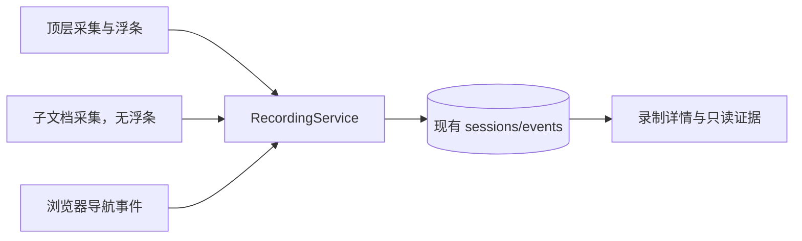

# 浏览器录制器：单层同源 iframe 开发设计

> 日期：2026-11-03。状态：Proposed，待审阅；仅设计，未实施、未运行验证。用户已确定继续自研录制器，执行层使用现有 PageController，本轮暂不写代码。
>
> 本次修订收敛原“多文档采集与可靠性”计划：以最小改动补齐单层同源 iframe，复用已有传输与存储机制。原计划中的通用生产者协议、独立回执库和覆盖时间轴不再作为开发要求。决策见 [ADR-0092](../adr/0092-browser-recorder-reliability.md)，验收见[专项计划](../poc/browser-recorder-reliability-validation.md)。

## 1. 目标与范围

在 Chrome 和 Edge 桌面扩展中，录下参与 Tab 的单层同源 iframe 操作，并准确提示未支持范围或保存缺口。执行层、BrowserRouter、Native 协议和重放能力保持现状。

首期只交付五件事：

1. 已有和动态加载的单层同源 iframe 按需启动采集，复用 DOMRecorder。
2. 文档身份、批次游标与控件引用隔离，避免不同文档串数据。
3. 导航、销毁及 BFCache 恢复时重新核对身份并清理监听。
4. 暂停和停止通知全部已登记文档，复用现有尾批次收尾。
5. 已支持的 iframe 不再触发通用警告；Chrome／Edge 分别完成验收。

同源按 scheme/host/port 精确比较。只接纳活动的 HTTP/HTTPS 文档；跨域、多层嵌套、opaque origin、about:blank、srcdoc、data/blob 文档暂不支持。sandbox 文档的 URL 同源不代表真实 origin 同源，身份无法证明时拒绝采集。

不扩展 DOM 事件种类、不重新设计输入/选择语义、不采集整页 DOM 或截图。无模型、无 Executor 或 Bridge 暂停时仍可录制。继续遵守[融合设计](browser-extension-recorder.md)的参与 Tab、站点授权、隐私与所有权规则；本文获准实施后只扩展其录制 frame 边界。

## 2. 复用优先

| 当前模块                                                                   | 保留                                        | 必要改动                                                       |
| -------------------------------------------------------------------------- | ------------------------------------------- | -------------------------------------------------------------- |
| `entrypoints/content.ts`                                                   | 顶层 ISOLATED 单例入口、Controller 生命周期 | 静态 `allFrames: false` 不变                                   |
| `recording-content.tsx`                                                    | 缓冲、批次发送、ACK、停止收尾               | 抽出顶层和子文档实际共用的采集/传输部分；只有顶层挂浮条        |
| `dom-recorder.ts`、`control-semantics.ts`                                  | 当前可信事件、输入合并、IME、选择及脱敏规则 | 适配无浮条的子文档；有复现缺陷才局部修复                       |
| `recording-service.ts`                                                     | 准入、串行提交、事务 ACK、录制状态机        | 每 Tab 一个文档/游标扩展为按 document 登记；限定子文档消息权限 |
| `recording-repository.ts`                                                  | sessions/events、事务、分页及保留策略       | 在现有会话中保存文档登记及游标，不新增回执 store               |
| `recording-evidence.ts`、`recording-actions.ts`、`recording-normalizer.ts` | 现有事实和只读投影                          | 按文档隔离目标、编辑及关联；不给模型暴露浏览器运行时 ID        |
| 录制详情与 `session.gaps`                                                  | 当前 Alert、缺口保存及展示                  | 调整新录制的提示分类，不重设计布局                             |

不以本轮任务为由拆分通用平台、引入录制框架或修改 PageController。共享提取只服务顶层与子文档两个真实使用方。

## 3. 最小架构与身份

每个文档一个采集实例，Worker 管理授权和登记。子文档按需注入固定 ISOLATED 脚本，只接 recorder 消息，不创建 PageController，也不通过父页面 postMessage 转交事实。

复用 `sessionId + epoch` 作为会话世代，以浏览器提供的 `tabId + frameId + documentId` 识别来源。每个 Tab 保留当前顶层身份，附属文档登记只需 frameId、documentId、所属顶层 documentId、lastBatch 和 sealed；不另设 producerId、frameRef 或采集状态机。

Worker 用受信 sender 与浏览器导航/枚举信息核对扩展 ID、窗口、参与 Tab、文档、父 frame 和真实 origin。首期子文档必须是当前顶层的直接子 frame 且精确同源。消息里的身份字段只用于匹配，不能授予权限；子文档只准入 hello、batch、depart、gap 等采集消息，禁止管理命令。

原始事实继续保存 tabRef 和 documentId，新增可选 frameId 由 Worker 写入。目标和编辑归并必须包含 documentId，不能把两个文档中的 control-1 视为同一控件。模型投影继续生成逻辑 documentRef，必要时标注顶层/子文档；这些只是录制上下文，不是执行引用。

## 4. 发现、注入与生命周期

1. 开始或显式恢复录制时枚举参与 Tab 的 frame；沿用 webNavigation 监听发现新文档。枚举结果与导航回调都要在注入和握手时重新核对当前身份。
2. 确认单层同源、浏览器权限及参与范围后，按 documentId 注入打包内固定脚本。注入目标失效则放弃该目标，不切换为新文档；不使用 allFrames 广播。
3. 子文档 hello 通过准入后才启动监听。同一文档重复发现不重复挂载；注入前发生的操作不追溯补录，不能宣称从页面出现时就已覆盖。
4. frame 导航生成新 documentId，建立新登记。旧消息不能覆盖新登记或作为新文档事实接受；已保存旧事实保留。当前顶层变化时重新核对全部附属文档。
5. pagehide 尽力提交尾批次；frame 删除结合内容失效通知和停止时的重新枚举核对。未确认尾部保留缺口，不为检测删除新增 MutationObserver 或轮询。
6. BFCache 恢复重新 hello。内容端使旧异步回调失效；同一 document/epoch 保留已提交批次游标，不因恢复把 batch 重置成 1。丢弃未确认内存前必须标记可能缺口。

沿用当前 Worker/浏览器异常恢复规则：录制标为 interrupted，不自动采集或补录。暂停 Bridge 不清理录制。所有监听和定时器由所属文档实例清理，旧回调不能恢复已停止实例。

## 5. 传输与收尾

将现有“每 Tab 文档的批次游标”改为“每 document 的批次游标”，其余尽量保留：

- 每文档一个在途批次。批次编号和事实 ID 在确认前固定，重试不能改号、换内容或合并新事件。
- 会话世代、文档身份和范围校验通过后，原始事实、相关计数/关联更新及 lastBatch 同一事务提交，完成后 ACK。
- 已提交批次的重复请求不新增事实、计数或关联；跳批、过期身份拒绝。不新增 sourceSeq、单调时钟或持久摘要回执体系。
- 会话 seq 仍表示提交顺序；每文档按批次及批内顺序保存。跨文档时间接近不能作为归因依据；现有导航关联至少排除其他文档的候选，歧义时保持未关联。
- 超时、传输错误和存储错误沿用当前暂停/缺口策略，不引入文档各自继续/失败的平行录制状态机，不无限重试。

暂停或停止复用当前 flush 流程：关闭新文档准入，固定登记集合，向每个文档定向发消息；源端停止监听并提交合并缓冲，Worker 确认批次事务完成后接受 flushed。并行等待沿用当前三秒超时，不按文档串行累积。

持久化收尾结果后再完成状态切换；未确认文档写入缺口。沿用当前 epoch 规则，显式恢复时同步切换所有登记的世代与批次基线，不能只重置收发一侧。收尾期间仅登记集合可提交当前 epoch 尾批次，结束后旧批次不得写入。

保留现有批次、缓冲、事件数、会话字节和保留限额。新增一个简单上限：整个会话同时最多 16 个采集文档（含顶层）；超出停止纳入并提示，不静默忽略。只保留当前及收尾中的文档登记，结束后清理，历史身份由原始事实承载，避免导航不断积累状态。实测存在压力再调整，不预先建设全局队列调度器。

## 6. 存储、隐私与提示

文档登记和游标保存在现有会话数据内。先检查是否需要 IndexedDB schema 变更：仅扩展会话字段无需强制升库；只有新增索引等实际需要才升级。旧记录按现有字段读取，缺失 frameId 不猜造 iframe 来源；旧 gaps 保留，不清库或重写事实。

复用当前源端敏感控件过滤、文本与 URL 脱敏，以及 Worker/证据投影校验。frame 新增元数据也必须经过同样处理，不读取字段值、剪贴板或整页正文。录制证据的字段变化若需要版本升级，只调整只读生产端与必要消费者解析，不修改 Skill 执行契约。

关联标签和按钮文字统一使用有界的安全文本提取：排除input/select/textarea、可编辑区域、script/style和显式敏感子树，防止预填textarea正文经label.textContent混入元数据。aria-label/placeholder的既有优先级保持不变；过滤后没有名称时使用通用动作说明。此规则用于新采集，不猜测清洗已保存标签字符串。

沿用 gaps 字符串和现有 Alert，用固定文案区别两类信息：

| 情况                         | 新录制的提示                         |
| ---------------------------- | ------------------------------------ |
| 受支持文档已完成握手         | 不因存在 iframe 报警                 |
| 跨域/嵌套/特殊文档或超过限额 | 说明录制范围限制，不断言实际漏了操作 |
| 注入失败/握手未完成          | 说明该文档未能开始录制               |
| 传输、存储或收尾未确认       | 说明部分操作可能未保存               |

删除原来“发现任意 iframe 即报告 frame gap”的触发条件，改由实际准入和启动结果生成提示。后续成功不删除已经保存的失败提示。历史通用 iframe 警告仍是历史范围提醒，不升级解释为实际丢失。首期不引入结构化覆盖区间、诊断 store 或覆盖时间轴。

## 7. 开发顺序与完成条件

| 顺序 | 交付内容                                                      |
| ---- | ------------------------------------------------------------- |
| 1    | 文档登记与游标隔离，复用现有事务；先保证顶层录制回归          |
| 2    | 提取共用采集/传输，增加固定子文档入口，接入同源准入和动态导航 |
| 3    | 将 flush、清理和提示扩展到登记文档，核对证据归并的文档边界    |
| 4    | Chrome／Edge 分别完成专项验收及相关既有录制回归               |

开发中确有必要时更新扩展 AGENTS 的 frame 范围说明。收发协议变更必须一起交付；热更新遇到不匹配旧页面时暂停并提示刷新，不能静默按新格式接收。

具体用例及验证记录只维护在[验收计划](../poc/browser-recorder-reliability-validation.md)。跨域、多层嵌套、表单因果模型、aria 名称解析增强、精确跨文档时间排序和独立回执库均为后续候选，有真实缺陷或新需求时再设计，不构成本轮完成条件。

## 8. 开源参考

沿用前次查阅的参考，不引入运行时依赖或复制源码：

| 来源                                                                                                                                                                                  | 本轮参考点                                       |
| ------------------------------------------------------------------------------------------------------------------------------------------------------------------------------------- | ------------------------------------------------ |
| [rrweb IframeManager](https://github.com/rrweb-io/rrweb/blob/main/packages/rrweb/src/record/iframe-manager.ts)                                                                        | 文档资源清理、重复挂载保护、frame 身份隔离       |
| [Playwright Test generator](https://playwright.dev/docs/codegen)                                                                                                                      | 语义操作与目标消歧的测试思路；不扩展本轮事件种类 |
| [Selenium IDE commands](https://www.selenium.dev/selenium-ide/docs/en/api/commands)                                                                                                   | 显式 frame 上下文，防止目标混淆                  |
| [Chrome webNavigation](https://developer.chrome.com/docs/extensions/reference/api/webNavigation) 与 [scripting](https://developer.chrome.com/docs/extensions/reference/api/scripting) | 浏览器文档身份、导航及定向固定脚本注入           |
| [Edge API 支持](https://learn.microsoft.com/en-us/microsoft-edge/extensions/developer-guide/api-support)                                                                              | 独立核对平台支持，仍需 Edge 实测                 |

开发时只为实际采纳的规则记录来源文件/版本及对应本地回归。确需复制代码才锁定 commit、核对许可证并保留 notices；不将上游完整功能列为本轮需求。参考资料不是运行验证证据。
