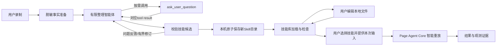

# 录制 → 有限整理智能体 → 本地 Skill → 智能重放：闭环方案

> **历史方案，2026-10-31 已被替代。** 当前权威设计是[统一 ToolLoopAgent 方案](browser-skill-unified-agent.md)与 [ADR-0089](../adr/0089-browser-skill-unified-agent.md)：整理和重放均可自主提问。本页以下正文保留此前决定和验证来源，所有“双引擎 / Core execute / 重放不提问”规则均不再指导新增开发；下方日期和状态是历史记录，不是当前状态。

> 状态：设计已接受，开发中，2026-10-31。用户明确“方案确定了，开始设计和开发”。重大UI仍按既有规则先审阅新视觉稿，后台开发与受控技术验证已获授权；真实提供商请求须另行申请。架构接受、视觉批准和运行验收分别记录，不表示完整Skill闭环已经实现。
>
> 相关决定：[ADR-0088](../adr/0088-browser-recording-skill-agent.md)。现有录制与运行边界：[融合设计](browser-extension-recorder.md)。旧引导问卷仅作为已实现系统的历史，不再指导新增功能。

## 1. 目标：让智能体整理成技能

用户演示一次网页流程，整理智能体自主理解操作、消除冗余、识别参数、归纳业务意图，产出可由浏览器智能执行引擎加载的技能包。

自主提问是智能体能力之一：模型在确实无法合理判断时调用ask_user_question，得到用户回答后继续推理。系统不预先安排“完成方式”等固定题目，也不把模型返回的问题数组当成完整Agent。

用户后续维护本地Skill文件；插件提供生成、技能目录与运行入口，不再要求维护复杂工作流、逐步审批或发布版本。内部JSON是运行契约，不要求配套一套JSON工作流编辑产品。

“可重放”指具备受限浏览器运行时可加载的说明与配置；静态检查通过不等于已经在真实网站验证成功。录制原始数据、生成任务历史和运行结果都不是技能定义的第二个权威来源。

## 2. 推荐产物：SKILL.md + 轻量workflow.json

首版推荐两文件技能包：

```text
<用户选择的技能库>/
└── order-query/
    ├── SKILL.md
    └── workflow.json
```

| 文件          | 权威内容                                                                | 用户维护方式                            |
| ------------- | ----------------------------------------------------------------------- | --------------------------------------- |
| SKILL.md      | 技能名称/描述、何时使用、业务目标、语义操作说明、例外处理、怎样理解完成 | 用系统编辑器直接修改自然语言            |
| workflow.json | 参数类型、允许站点/逻辑页面、运行上限及最小化录制依据                   | 必要时手改；插件校验并指出文件/字段问题 |

不再存一份与Markdown重复的步骤DAG，也不另存可独立编辑的workflow.md。原录制操作只是证据，不是必须逐事件机械执行的脚本。操作意图主要写在SKILL.md，workflow.json不重复存整段业务指令，避免双文件改写冲突。

SKILL.md使用标准技能目录/元数据约定，并引用workflow.json的运行要求；它可被其他支持该约定的智能体阅读，但浏览器重放仍需要相应浏览器工具和运行时，不能承诺任意Agent导入即可执行。

示意文件内容只说明契约方向，正式字段须在方案通过后定稿：

```markdown
---
name: order-query
description: 根据订单号查询订单并打开对应详情。
compatibility: 需要 Dr.Octopus 浏览器技能运行时
---

# 订单查询

读取同目录 workflow.json 的输入与站点范围。

使用 {{orderNo}} 在订单查询页面查询。
打开匹配订单的详情，核对订单号与本次输入一致。
未找到记录时说明结果，不进入新建、付款或删除流程。
不要将“打开详情”解释成“订单已处理完成”。
```

```json
{
  "schemaVersion": 1,
  "id": "45d9a671-3ce8-43b3-ab1d-145250de43bd",
  "inputs": [{ "name": "orderNo", "label": "订单号", "type": "string", "required": true }],
  "allowedOrigins": ["https://orders.example.com"],
  "pages": [{ "role": "search", "startUrl": "https://orders.example.com/search" }],
  "execution": { "engine": "page-agent", "maxModelCalls": 20 },
  "evidence": [{ "ref": "action-1", "kind": "fill", "page": "search", "targetHint": "订单号" }]
}
```

执行预算取文件配置与平台硬上限的较小值，文件不能关闭预算、权限或确认门禁。

这是语义技能加机器边界，不是确定性DOM脚本。实际执行计划可以在本次运行内临时形成，不要求用户维护其步骤索引、依赖图或元素ID。

选择理由：

- 纯SKILL.md最轻，但输入与站点约束全靠自然语言，不利于程序一致校验；
- 纯workflow.json可以严格表达，但容易再次演变为复杂编辑器；
- 两文件分工保留可读说明和必要硬边界，复用现有结构化校验经验，同时控制结构复杂度。

## 3. 全链路



正常路径：选择录制并开始整理 → 智能体自主工作 → 必要时回答一两个业务问题 → 校验通过并保存新技能 → 运行。首次配置技能库后，开始整理可明确授权在该库创建本次新技能；不再增加“编辑工作流→勾选所有条目→发布”的日常维护步骤。

第一次没有可写技能库时，先完成库位置配置；Executor暂时不可用时允许继续录制/分析，候选可暂存浏览器。保存失败时明确显示“已生成，尚未保存”，恢复后继续保存同一候选，不重新计费生成。

## 4. 两个受限运行时及框架边界

| 运行时               | 负责                                                          | 没有的能力                                                    |
| -------------------- | ------------------------------------------------------------- | ------------------------------------------------------------- |
| Organizer Agent      | 读取脱敏录制、归纳技能、按需问人、校验/提交候选               | 页面操作、任意脚本、Shell、任意本地文件读取、直接修改业务数据 |
| Browser Skill Runner | 读取已选技能、运行前准备输入、原生execute执行、记录及核对结果 | 任意本机命令、自动扩大站点/权限、自动改写技能文件             |

2026-10-31用户再次明确：重放使用 **@page-agent/core（Page Agent Core）**。整理与重放的业务能力贯穿全流程，但不因此合并成一套自建Agent Loop。

- Organizer Agent：当前候选采用AI SDK工具调用，负责整理录制与生成Skill。
- Browser Skill Runner：是Page Agent Core外侧的业务适配层，负责加载技能、装配本次输入、权限/页面所有权和结果处理。重放的模型推理与工具循环由Page Agent Core承担；不另建AI SDK浏览器执行循环。
- PageController：继续承担具体页面控制，与Page Agent Core的智能执行职责不同。
- 可共用模型配置、状态投影和日志基础设施；两种引擎各自适配，不共享原始SDK会话或隐式承接整理上下文。共用模型配置不等于共用provider实例。
- 2026-10-31用户明确收敛：重放只调用Page Agent Core原生execute，不设置onAskUser，不注入ask_user_question/request_user_input等替代提问工具。缺失参数在运行前补齐；运行中信息不足则结束为未完成/失败，不扩展为问答式续跑。

整理阶段即使模型提出想访问网站，也没有对应工具可调用。网页内容与录制标签按不可信数据处理；提问回答是当前任务的用户决策，不成为任意工具授权。

Executor建议仅承担技能文件和目录访问，不运行整理模型或第二个Agent Loop。模型设置仍在浏览器插件中。本轮方案不要求修改packages/agent。

## 5. Organizer工具清单

首版仅开放四个具名工具，模型自主选择调用顺序：

| 工具              | 输入与结果                                                    | 约束                                               |
| ----------------- | ------------------------------------------------------------- | -------------------------------------------------- |
| read_recording    | 按短引用/分页读取已选录制的脱敏操作和上下文                   | 不能选择其他录制或站点，不能读取被脱敏原值         |
| ask_user_question | 提出当前阻塞的不确定问题，结果是该问题的用户回答              | 一次最多一个待回答调用，不接受用户主动发起自由对话 |
| validate_skill    | 检查本任务候选SKILL.md与workflow.json，返回结构/引用/范围诊断 | 仅检查和反馈，不执行网页、不等于真实业务验证       |
| submit_skill      | 提交本任务最终候选，验证通过后进入受控保存流程                | 只创建本次新目录，不任意写文件，不替用户覆盖旧技能 |

模型上下文首先取得录制概览，详细证据可按需读取。无需为了问一个问题把全部原始事件反复发送给模型。

允许智能体归纳业务步骤、合并同一编辑过程的重复输入和忽略纯噪声；涉及实际业务动作的调整必须有录制依据或明确用户决策。未录制的付款、删除、发送、新站点访问不能伪装为已观察行为。用户明确提出扩展任务时也不得在整理阶段直接执行。

保留本地来源映射，候选中的录制引用必须能由程序解析；不要求生成后的语义段落与DOM事件一一对应，也不把每个观察事件都变成可执行点击。

## 6. ask_user_question是真实工具调用

输入契约示意：

```json
{
  "question": "这里点击的无文字图标，用于查看订单详情还是删除订单？",
  "reason": "录制只保留了图标控件，无法判断业务含义。",
  "options": [
    { "id": "details", "label": "查看详情" },
    { "id": "delete", "label": "删除订单" }
  ],
  "allowCustomAnswer": true,
  "evidenceRefs": ["action-3"]
}
```

工具参数由模型提出；运行时为会话和记录分配身份/版本，并将模型返回的toolCallId原样绑定到对应会话中验证，不另造一个与模型消息脱节的问卷ID。options可以省略；选择题建议2～5项，必要时允许用户对当前问题作短文本回答。回答文字不是新的聊天轮次，更不能被当成任意脚本/权限开关。

结果契约：

```json
{
  "status": "answered",
  "optionId": "details",
  "answerText": "查看订单详情"
}
```

还允许deferred与cancelled结果。deferred表示用户不知道或暂不回答，模型可继续采用不影响运行的合理假设并在技能中说明；关键事实无法确定时停止在待补充状态，不生成号称可运行的技能。

工具调用发生在同一个Agent Session中：

1. 会话记录任务入口、模型消息以及模型实际返回的可展示思考内容/摘要。
2. 模型调用ask_user_question，assistant消息中的tool-call part及参数保存到会话；当前问题直接由该调用投影，不能再维护一份独立问卷。
3. 会话进入等待该工具结果的状态；界面只接受对这次工具问题的回答，不开放自由聊天输入。
4. 用户回答以带原toolCallId的tool-result part追加到同一会话，保留回答人和提交身份。界面可按用户回答呈现，但发送模型时不再重复增加一条相同的user消息。
5. 智能体从该会话已有上下文继续推理，自主选择后续工具。
6. 关闭弹窗或回收Host只结束当前运行对象，不结束或丢弃会话；下次打开先读原会话，显示已发生的思考、工具结果和待回答问题。继续时使用会话记录重建上下文，不从录制开头重新生成一轮问卷。

### 6.1 会话是交互与上下文的主体

一个整理任务对应一个持久Agent Session，包含：

| 会话内容               | 语义                                                       |
| ---------------------- | ---------------------------------------------------------- |
| 初始任务及录制快照引用 | 用户通过任务入口发起的整理要求，不依赖自由输入框           |
| 模型消息和可展示思考   | 模型实际返回的文本、推理内容或摘要；模型没有返回时不伪造   |
| tool call              | 工具名称、调用ID、经过校验的参数                           |
| tool result            | 录制读取、用户回答、校验结果或文件提交回执                 |
| 产物引用               | 最终Skill的位置与内容摘要                                  |
| 执行元数据             | 引擎/模型配置引用、累计预算、完成/失败及中断记录；不含密钥 |

工具调用/结果属于会话消息内容，不复制到第二套可独立修改的questions/answers工作流中。当前待答工具、运行状态、历史列表只是会话的投影。消息流的增量合并到同一messageId；中途断开的部分输出可留作明确标记的历史，但不能作为完整工具调用执行。

“有限制”限制的是可用工具、预算、数据范围和用户输入入口，不限制智能体自主思考与工具选择。用户只通过发起任务、回答当前工具问题、继续或停止会话参与；工具调用先后顺序由模型决定。

### 6.2 会话继续规则

- 继续原任务沿用sessionId和已提交消息；新的运行attempt追加到该会话，不覆盖旧失败，不把每次回答变成新会话。
- 同一录制明确“重新生成”才创建新会话，原会话保留。
- 有未完成的ask调用时，重开直接显示原问题；回答落盘后才继续模型，不让模型再次猜测或重复询问。
- 恢复上下文使用SDK支持的完整消息及配对工具结果，显示历史不等于可把任意日志文本直接回灌模型。思考内容和提供商元数据按已验证适配器处理，不转成伪造的用户消息。
- 累计预算继续沿用，不因重建Host归零。已执行工具的结果复用；文件保存结果未知时先查回执，不能重新执行一遍全部工具。
- Skill是可复用产物，会话是本次整理的过程记录。以后重放读取当前Skill文件，创建由Page Agent Core驱动的运行会话，不直接复用整理Agent的内部消息。

这里不再设置“目标/参数/完成判断”的固定问题枚举来决定流程。只有模型选择ask_user_question才进入提问；程序只检查问题合法性、引用和预算。一般的“如何验证完成”可以由智能体根据业务目标写入Skill，不强制询问用户自动/人工模式。

### 6.3 ToolLoopAgent线性提问契约（拟定，待验证）

已核对当前安装AI SDK 7.0.155公开声明及官方说明：工具可省略execute，ToolLoopAgent遇到需要外部结果的调用会结束当前调用；应用取得真实结果后，可将匹配tool result附入会话继续。toolCallConcurrency=1只保证可自动执行工具的串行执行，不能单独保证模型每轮只返回一个调用，也不自动管理问题弹窗。

建议工具注册分工：read_recording、validate_skill提供只读execute；ask_user_question由会话层外部完成；submit_skill也作为外部提交请求，避免SDK自动落盘早于整轮准入检查。普通只读工具的执行循环仍归ToolLoopAgent，文件写入和用户交互由会话工具结果衔接。

单会话的线性规则：

1. 一个有效runId/执行世代，一次只接纳一个待回答tool call。多个Popup只是同一会话的视图，不各自启动Agent或分配新问题。
2. 流式工具参数还未结束时不打开问题；完整模型步骤和已完成只读工具结果先写入会话，再显示当前问题。
3. 显示问题后，会话等待该tool result，不发起下一次模型请求，不提交Skill文件。底层generate/stream调用可以结束，下一次仍是同一持久会话。
4. 如果模型同轮产生多个ask，只接纳第一个有效调用；其余调用得到明确的工具错误结果，不能悄悄丢弃或伪造用户答案。第一问被回答后，模型再依据新上下文决定是否提出下一问。
5. 同轮既有ask又有submit时，暂不执行submit，记录需要用户答案后重新提交的工具错误结果；用户回答不能追溯性授权旧候选落盘。
6. 回答以sessionId、runId、toolCallId和期望会话revision原子提交；重复请求幂等，同题冲突答案只有首次有效提交能进入上下文。
7. 当前assistant消息中的工具调用都有合法结果后，才以同一会话记录继续ToolLoopAgent；关闭再打开只展示原待答调用，不让模型重问。

这属于会话的工具调度语义，不新增用户维护的暂停/恢复流程。只有接纳的ask生成可回答卡片，其他调用的拒绝结果留在会话工具记录中；不叠加多个提问弹窗。全局若同时有多个会话，前台只呈现当前选中的会话，后台待答会话仅保留状态，不抢占弹窗。

R2的设计依据因此可细化，但还不能标为已验证：仍需测试双Popup继续、同轮双ask/ask+submit、答案提交失败重试、Host销毁重建和旧世代迟到结果。该机制只适用于整理Agent。重放已按用户决定取消运行中问答与原Core执行恢复，R1通过收窄范围解决；R3–R5的动作准入、结果核对与历史投影仍需验证。

## 7. 整理Agent的框架选择（不替换重放引擎）

2026-10-31用户明确倾向更轻量的ToolLoopAgent，本方案据此收敛为 **AI SDK ToolLoopAgent负责整理**。复用当前AI SDK和提供商传输，不新增LangChain/LangGraph依赖，不从generateText自行维护通用工具循环。比较依据保留在[框架成本收益评估](../poc/browser-skill-agent-framework-evaluation.md)。该选择已随完整方案确认，现进入开发；具体实现和运行验证仍需逐项完成。

ToolLoopAgent拥有模型自主选择工具及普通工具调用的循环；应用层只负责工具准入、任务预算、持久化、问题交互和文件提交，不预先指定业务问题或下一步工具。整理只注册read_recording、ask_user_question、validate_skill、submit_skill。

ask_user_question作为外部执行工具留在会话中等待真实结果。Agent Session保存assistant tool call；得到对应用户回答后，追加tool result并让ToolLoopAgent继续。底层Host可以释放和重建，这是会话运行的生命周期实现，不另设计一套面向用户的问卷暂停/恢复流程。不得以伪造的pending成功结果催促模型继续。

Agent Session是会话与上下文的权威领域对象；Worker中的Session Repository及IndexedDB只是其存储与生命周期实现。ToolLoopAgent执行当前会话，消息、工具结果和预算随会话保存；Host中的SDK对象可重建，不序列化类实例或密钥。继续会话的消息格式、流式思考记录及供应商元数据须用锁定SDK和受控模型小样验证。

模型请求额度跨Host累计，重建Agent不会重置计数；未知在途请求仍标记中断，不自动补发。HTTP重试、工具副作用幂等、字节限制与权限检查继续由对应应用边界执行。

**重放始终由Page Agent Core原生execute负责。** 整理专用ask_user_question不进入重放。共用模型配置和状态展示，不共享SDK实例或原始会话，不用ToolLoopAgent替换浏览器执行循环。现有JSON questions数组/固定补题路径仍须在后续实施中按范围替换。

## 8. 运行预算与停止条件

建议初始上限：

- 每个整理任务最多12次模型请求、24次工具调度、5次向用户提问；
- 同一会话同时只有一个待回答问题；普通只读工具串行执行，多ask或ask与submit同轮时按§6.3逐调用返回明确结果，不能产生并发提问或提前写入；
- 每次模型请求使用有限超时；用户等待不计入活跃推理超时；
- validate/submit失败后的候选修订最多2轮，并计入同一模型/工具总预算；
- 单个录制、候选、返回结果和会话上下文均有字节/事件限额，延续源端脱敏与有界传输；
- 任务只在成功提交、用户取消、无法补齐的关键事实、预算耗尽或明确失败时结束。

这些是待确认的工程默认值，用户无需在workflow.json维护整理预算。本次设计不包含任何真实请求额度授权。

HTTP错误、超时、连接中断不自动重试。工具输入不合法后的受控修订是Agent处理工具结果的一部分，不应被宣传为服务端请求重试。普通文字回复也不能被当作提交成功：最终产物必须经过submit_skill。

## 9. 本地技能库与打开文件夹

建议由Executor提供受限的Skill File Service：

- 用户在本机选择一个技能库根目录，扩展只持有libraryId和显示名称；
- 支持列出/读取技能包、创建本次新技能、校验已编辑文件、打开已注册技能目录；
- 文件读写归Executor Runtime；系统目录打开归Main的具名调用，不从Runtime导入Electron；
- Native Host继续作为桥接，不承载模型或任意文件命令；
- 请求使用libraryId、skillId及本次operationId，不接受模型提交任意绝对路径、Shell或可执行脚本；
- 只允许本方案的SKILL.md/workflow.json，做规范化、真实根目录/junction校验、容量与来源验证。

项目已存在Workspace Skills发现路径；是否把本机目录选为当前Workspace的同一路径，需要确认两端在同一主机/文件系统，不能将本机目录误认为远端Server已经同步。首版库和重放归本机浏览器侧，普通Pi Agent的自动发现只是可选互操作，不作为本方案前提。

现有Native v3只有有限Browser消息，不能只在Popup加一个“打开目录”按钮就完成文件访问。本方案建议后续明确升级为Native v4，新增独立skills命令域并同时更新Host/Runtime/扩展契约；保持Browser工具域与其页面所有权规则。旧端不兼容时明确要求配套升级，不发送未知命令试探，不建立长期双协议兼容层。此项是待批准的跨应用变更，当前未实施。

依赖代价必须明确：录制及分析仍可在Executor离线时进行；真实保存、打开目录、读取最新本地文件需要该本机组件可用。首版运行也先读取最新文件，因此依赖本机组件。若要求已安装Native Host在Executor完全离线时独立提供文件服务，需要另选所有者/进程方案，不能隐含承诺。

## 10. 保存与结果恢复

首次生成：在同一磁盘的临时目录写两文件，检查语法和内容摘要，通过后改名为新的技能目录。同名或已存在目录不默认覆盖；可保存新副本，不让重新生成覆盖用户手改。

用户开始本次整理时，授权范围只覆盖已选库中新建本次技能，不包含覆盖其他技能。没有库权限时先配置，不能由模型自由选目录。

保存流程：

1. Worker记录finalize intent、候选摘要与唯一operationId；
2. File Service执行有界校验和新目录提交，返回持久保存回执；
3. Worker保存文件回执后才显示技能已保存；
4. Worker/连接在回执前丢失时，恢复后按operationId查询结果，不重复写入，不再次请求模型；
5. 文件失败、模型失败、扩展历史写失败分别记录；已落盘但投影失败不得显示成“重新生成才能恢复”。

File Service的保存操作记录位于应用私有数据，不要求用户维护额外状态文件。原子落盘与扩展数据库不是同一事务，不能宣称跨进程原子；凭操作回执完成幂等恢复。

## 11. 手工编辑、刷新与再生成

本地两文件是技能定义的权威来源；浏览器IndexedDB只缓存目录投影和任务记录，不双写另一份可编辑工作流。

用户点打开文件夹，在系统编辑器修改；返回后可刷新，运行前一定重读。无需依赖常驻文件监控；缓存不得冒充最新磁盘状态。

读取先后计算两文件摘要，避免读到用户正在保存的一半内容。文件缺失、JSON无效、参数引用不存在、站点范围冲突时给出文件/字段级诊断，暂停运行，不静默修复或恢复旧缓存覆盖用户文件。

本次运行固定一份完整快照，运行中用户改文件只影响下次；不热替换正在执行的说明。再生成保存新副本；合并用户手工修改不在首版默认能力中。

Markdown语义与JSON硬边界冲突时，JSON不能扩大权限、Markdown也不能绕过硬门禁。结构化冲突可直接检查；业务语义冲突不可能由Schema完全判定，必要时由运行准备阶段提示用户或停止，不宣称所有冲突都能自动识别。

## 12. 重放闭环

运行入口接收skillId，一次用户发起的运行对应一次原生execute：

1. File Service读取当前Skill两文件，程序校验范围、输入引用及内容摘要；
2. 在调用execute前一次性准备必填参数及必要的站点/执行授权；未满足时不启动模型执行；
3. Browser Skill Runner将Skill说明和本次输入装配为任务，创建Page Agent Core实例；
4. 不设置onAskUser，不注册替代提问工具，调用原生execute(task)；Page Agent Core拥有推理、规划和浏览器工具循环；
5. 通过既有PageController/跨Tab适配及Worker准入执行，外层仅负责权限、取消、事件投影和结果处理，不增加阶段性问答或第二个执行循环；
6. 运行中遇到未提供的信息、需要人工登录/验证码或尚未获准的操作时，结束为未完成/失败并记录原因，不猜测业务值，也不临时开启模型提问；
7. 记录原生执行结果及必要观测；业务结果不足时标明未验证，不通过重放中的ask_user补齐结论。

已核对Page Agent Core v1.12.4源码：onAskUser默认是拒绝调用的占位函数；execute检测到未配置回调时，会从本次工具集中删除内建ask_user。因此该版本只需省略回调，无需修改上游或再包装一个提问工具。后续锁定版本时仍需验证这一原生行为。

重放记录可查看，但不承诺恢复被销毁的Core执行栈。关闭Popup不影响仍存活的Host；Host销毁、浏览器重启或原生执行中断后，该次run结束。用户补充输入/处理页面后若再次运行，明确创建新run，再调用一次execute；不得自动重新提交未知在途动作，也不得把历史日志回灌为断点续跑。

参数填写属于运行前准备，权限检查属于平台准入，不是重放Agent的对话工具。用户停止运行时调用原生stop能力；不因删除onAskUser而放宽站点、预算、敏感数据、任意脚本或现有操作授权边界。

业务完成仍需结合本次Skill、参数、页面身份和观测处理，不能把模型done.success直接宣传成独立业务验证。此项继续按审查R4收束，但不重新引入用户问答。

## 13. 数据与模型发送边界

生成：仅发送已选录制的脱敏内容、问题回答和本任务候选。不会给模型提供原始密码、验证码、密钥或任意本地文件读权限。

重放：实际业务输入和当前页面可能进入执行模型上下文，与脱敏录制不是同一发送范围，必须按用途分别说明并授权，不能沿用生成授权自动扩张。敏感输入在运行前人工完成或按受限直填策略处理；运行中遇到必须人工介入的情况结束本次run，密钥只在可信Host请求期间使用，不写入Skill或Content Script。

会话记录按sessionId、messageId、toolCallId及提交版本关联。保存任务消息、模型实际提供的可展示思考内容/摘要、工具参数与结果、必要状态及产物引用；不承诺取得模型未公开的内部推理，不保存认证头/密钥或整个原始HTTP响应。不同供应商的reasoning parts与恢复元数据须经适配验证；显示用记录与下一轮可发送的有效上下文由同一会话派生，不能将任意思考日志作为用户指令重新发送。

skill文件中的指令不能改变这些程序约束。真正有效的Browser站点权限、连接身份、Tab/文档绑定与预算均由运行时检查。

## 14. 整理会话状态与下次继续

以下状态与继续规则仅适用于ToolLoopAgent整理会话。Page Agent Core重放按§12使用单次execute及终态运行记录，不接入waiting_user或跨Host原执行恢复。

| 状态                         | 会话中的依据                       | 恢复规则                               |
| ---------------------------- | ---------------------------------- | -------------------------------------- |
| analyzing/tool_running       | 已提交消息、工具意图、模型请求账本 | 未知在途模型请求标记中断，不自动补发   |
| waiting_user                 | assistant tool call与已提交问题    | 从原toolCallId继续，无需模型重新提问   |
| validating                   | 候选/诊断摘要                      | 本地校验可幂等重做，不执行网站         |
| saving                       | operationId、候选摘要              | 查询文件回执，不重生成/覆盖            |
| completed                    | skillId、内容摘要、真实文件回执    | 展示已落盘结果，后续以文件为准         |
| failed/cancelled/interrupted | 有限诊断与可恢复点                 | 明确继续或重新生成，旧结果不串到新任务 |

继续同一任务保留会话ID并追加attempt记录；明确重新生成才建立新会话。用户回答提交失败仍对应原tool call，未提交文字不宣称已保存。等待不占用页面执行锁，不干扰Executor连接页或其他录制能力。

## 15. 实施拆解与验证门槛

本节已迁至 [概念验证与验收记录](../poc/browser-recording-skill-agent-validation.md#15-实施拆解与验证门槛)。

## 16. 已明确与待确认的选择

1. 采用SKILL.md为语义说明、轻量workflow.json为输入/站点/运行契约的技能包；用户维护文件，不维护复杂工作流界面。
2. 已明确：整理Agent采用ToolLoopAgent，重放采用Page Agent Core；模型自主调用四个受限工具，按当前问题允许自定义回答，保留无自由聊天边界。会话记录与下次继续的SDK适配仍需后续技术小样验证。
3. 本地文件和打开目录由Executor承载，首版读取/保存/运行依赖本机组件；后续涉及Native协议升级，不能隐含为现成功能。

本方案已接受并进入设计/开发；实现授权已具备，新UI仍需先审阅视觉稿。默认预算及接口契约通过开发验证收束，尚未交付的能力不能宣称可用。

## 来源与核对范围

- 当前扩展依赖/SDK公开类型：apps/browser-extension/package.json及已安装ai的dist/index.d.ts；现有编译器是一次结构化输出，尚非本方案工具Agent。
- 当前项目Workspace Skills发现：packages/agent/src/extensions/workspace/extension/events.ts（只读核对，未修改通用Agent）。
- 现有Native边界：[executor-browser.md](executor-browser.md)；文件/目录服务尚未实现。
- [Agent Skills规范](https://agentskills.io/specification)与[AI SDK工具调用说明](https://ai-sdk.dev/docs/ai-sdk-core/tools-and-tool-calling)是后续实现核对入口。方案引用格式/能力不代表本仓库已完成提供商或重放验证。

## 2026-10-31审查状态

完整审查见[方案审查报告](../poc/browser-recording-skill-agent-review.md)。初次发现5项P1和2项P2设计缺口；用户取消重放onAskUser及原Core执行恢复后，R1已按范围收敛解决（设计层面），其余4项P1和2项P2继续审查。当前仍为Proposed，未进入新界面设计或代码实施。

## 开发进度：ToolLoopAgent工具适配层

本节已迁至 [概念验证与验收记录](../poc/browser-recording-skill-agent-validation.md#开发进度toolloopagent工具适配层)。
