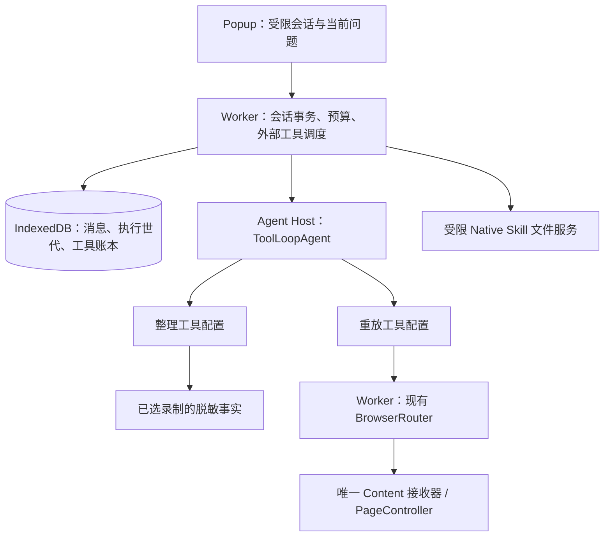

# 浏览器 Skill：统一 ToolLoopAgent 设计开发方案

> 2026-11-02 运行循环按 [ADR-0091](../adr/0091-browser-builtin-agent-native-loop.md) 改为 SDK 原生多步，通用模块为 builtin-agent。2026-10-31，架构方向已获用户确认。2026-11-01 已接入正式整理/重放路径和已批准 UI；隔离双浏览器受控闭环通过，真实模型与本轮人工体验仍待验收。[ADR-0089](../adr/0089-browser-skill-unified-agent.md) 取代前序双引擎决定；[前序方案](browser-recording-skill-agent.md)仅保留历史依据。交互与视觉状态以 [DESIGN.md](../../apps/browser-extension/DESIGN.md) 为准，运行验证以[验证矩阵](../poc/executor-validation.md#统一-skill-agent-可行性验证)为准。

模型配置、凭据与授权、模型发现及调用适配统一归属 `apps/browser-extension/src/lib/model-settings/`；录制动作归一化与脱敏证据投影归属 `apps/browser-extension/src/lib/recording/`，由整理 Agent 的 `read_recording` 工具消费。原 `lib/workflow/` 已移除，不保留旧路径转导出；现有 `workflow*` 存储键及技能包 `workflow.json` 契约保持不变。

## 1. 产品闭环

录制 → 整理 Agent 读取脱敏事实、自主分析、必要时问人 → 生成并保存本地 Skill → 用户运行 Skill → 重放 Agent 观察页面、自主操作、必要时问人 → 展示实际结果。用户在本地技能文件夹维护文件，不维护步骤 DAG，不逐条审批模型步骤，没有自由聊天输入框。

整理和重放均使用 ToolLoopAgent，分别建立会话、分别配置工具。PageController 继续负责页面控制，ToolLoopAgent 负责模型与工具循环。应用完成任务准入、外部工具结果与会话持久化，不自行实现模型推理循环，不引入 Page Agent Core 或 LangChain。

现有 Executor → Browser Bridge 仍是有限工具桥，不加入 Agent Loop。连接仍为插件第一/default Tab；整理/重放模型配置仍在扩展。

## 2. 架构与模块所有权



| 模块                       | 负责                                                   | 不负责                               |
| ------------ | ----------------------- | ------------------------------ |
| src/lib/builtin-agent        | 两阶段实际共用的 SDK 配置、问答契约、Session/预算/账本 | 通用插件平台、业务步骤规划           |
| src/lib/skill-organization | 录制分析、候选校验、提交工具                           | 页面操作                             |
| builtin-agent/builtin-service.ts | 编排本次技能快照、有限浏览器工具和运行结果；复用 BrowserRouter | 第二套 DOM 引擎 |
| src/lib/skill-library      | 文件库投影、快照与 Native 文件桥接                     | 任意文件系统访问                     |
| Popup features             | 时间线、问题表单、导航、提交反馈                       | Agent 实例、数据库唯一副本、动作执行 |
| Agent Host                 | 当前 SDK 请求与工具循环、模型传输                      | 永久持有页面执行权、权威会话存储     |
| Worker                     | 会话事务、单执行者、预算、动作准入与派发               | 预先决定业务问题和工具顺序           |
| Executor 文件服务          | 指定技能库读写、路径校验、打开目录                     | 整理/重放模型                        |

先按实际复用提取公共层，不为目录整齐增加转发层，不修改 packages/agent。每次整理和重放各有 sessionId；继续同一任务更换 epoch，新的运行建立新会话，不继承整理的内部上下文或权限。

## 3. 工具清单与执行方式

| 工具                                    | 整理 | 重放 | 调度                                            |
| --- | --- | --- | --- |
| read_recording                          | 是   | 否   | 受限只读 execute，固定已选录制                  |
| validate_skill                          | 是   | 否   | 受限只读 execute，不等于业务验证                |
| submit_skill                            | 是   | 否   | execute 经 Worker 准入后受控保存                    |
| read_skill                              | 否   | 是   | 只读本次 definitionHash 快照                    |
| ask_user_question                       | 是   | 是   | 无 execute；等待真实用户结果                    |
| browser_tabs / browser_read_snapshot    | 否   | 是   | 受限只读，可自动执行                            |
| browser_snapshot                        | 否   | 是   | execute 经 Worker，可能激活页面/遮罩 |
| browser_click / fill / select / scroll  | 否   | 是   | execute 经现有 Worker / Controller                |
| browser_open_tab / close_tab / navigate | 否   | 是   | execute 经现有 Worker / BrowserRouter                  |
| finish_run                              | 否   | 是   | execute 核对本次结果依据与持久完成回执                      |

上述工具已经接入；路由分别校验 Native connectionId 与真实 localRunId 所有者。不能伪造 Native 身份、直接绕过 Worker 调用 Controller，或暴露任意 JS/Shell。

观察和操作均检查允许站点、浏览器权限、tab/document/controller 身份和快照有效性。录制与重放互斥，同目标及焦点冲突不抢占；旧释放不能清除新所有者。技能不能覆盖这些硬边界。

## 4. 整轮准入与副作用

2026-11-02 按 [ADR-0091](../adr/0091-browser-builtin-agent-native-loop.md) 改为 SDK 原生多步循环。toolCallConcurrency=1 只保证串行，不能阻止同轮 ask 旁边的动作。通过 SDK onLanguageModelCallEnd 在任何 execute 之前提交整轮准入；execute 仅派发 Worker 已准入的有限操作。Worker 不在工具返回后重建 Host 或选择下一工具。

1. 完整步骤提交后再准入；流式参数未结束不能派发。累计上下文用 responseMessages，不使用只有末步的 result.response.messages。
2. toolCalls 可能包含此次 SDK 调用此前已完成的观察；按 session/attempt/toolCallId 与已有结果账本筛选未结调用，不能循环整个列表重新执行。
3. 同轮有 ask：接纳第一个有效问题；其他 ask 返回 QUESTION_ALREADY_PENDING；同轮页面副作用/提交/结束返回 USER_ANSWER_REQUIRED。调用都保留配对结果，不能静默丢弃或把 pending 当成功。
4. 无 ask：一轮最多执行一个页面副作用；额外动作返回重新观察/规划错误，不能使用同一快照批量操作。模型自主决定后续工具。
5. 派发前原子保存工具意图并预留预算；落盘回执后才结束该调用。重复投递返回原回执。结果未知不等于未执行；不能自动重试。
6. execute 将实际结果交还 SDK，SDK 决定是否继续调用模型；onStepEnd 保存规范 response messages（含提供商元数据与配对工具结果）。prepareStep 首步注入历史，后续步骤的消息由 SDK 管理；应用不维护第二套业务规划循环。

Host 丢失：未提交工具不执行，已提交待答问题可重建；已派发无回执动作进入 outcome_unknown，阻止后续业务副作用。用户明确继续后先观察/核对未知效果；新的 toolCallId 也不能绕过未知结果门禁。浏览器业务动作没有通用 exactly-once 保证，不能宣称去重调用 ID 就能消除语义重复。

## 5. ask_user_question 与多类型表单

工具表达当前阻塞问题；允许一次携带最多 4 个相关字段，例如邮箱与邮件主题。它仍是一个待回答调用，不是模型提前生成的整套问卷。初始上限：每会话 5 次提问、单次结果 8 KiB、标签与描述有界。

```json
{
  "question": "这次查询哪个订单？",
  "reason": "需要本次订单编号才能查询。",
  "fields": [{ "id": "orderNo", "label": "订单编号", "type": "text", "required": true, "maxLength": 100 }],
  "allowDefer": true
}
```

| 字段类型     | Questionnaire 组合      | 程序校验                       |
| ------------ | ----------------------- | ------------------------------ |
| single       | Item + Choices + Choice | 枚举中的一个值                 |
| multiple     | Item multiple + Choice  | 去重枚举、最小/最大选择数      |
| text         | Input type=text         | 长度；编号保留前导零           |
| email        | Input type=email        | 邮箱格式与长度                 |
| number       | Input type=number       | 有限数、min/max，拒绝 NaN      |
| date         | Input type=date         | 有效日期及范围，不暗中转换时区 |
| confirmation | single 的确认/取消选项  | 当前问题答案，不是平台权限批准 |

不接受模型指定任意组件、代码、HTML、文件上传或 password 字段。网页登录、密码/验证码由用户在目标网页处理，不收进普通问答或模型历史。问题内容与网页内容不能扩大授权。

allowDefer是提问UI策略，省略时默认false；显式错误类型仍拒绝，不为该非业务字段遗漏消耗一轮纠正请求。问题字段、数量、范围与答案校验保持不变。SDK输入校验失败仅从有界cause链提取代码与白名单字段路径，随invalid调用保存在账本；不解析SDK错误长文本或复制收到的字段值。规范SDK会话消息继续完整保存用于续接，UI/复制诊断从对应账本投影稳定错误码。仅当后续有效问题已接纳或真正回答，原提问参数错误才显示已纠正，不改变当前会话状态。

fields 使用 strict discriminated schema：字段 ID 唯一，选择题 options 的 ID 唯一且有界，默认值必须属于同类型，答案不得包含未声明字段或枚举值；required、min/max、maxLength 等只接受程序白名单。无效问题返回工具诊断供模型修订，不渲染无法提交的问题。

当前已使用 fields 契约并替换旧固定问卷运行入口。Questionnaire 只负责呈现，不决定下一题，不显示全任务预设题数或允许回改已经影响执行的历史答案。

表单字段归 TanStack Form：受控 checked/onChange、value/onChange/onBlur；Questionnaire 仅管理题项呈现。Root 本身是 form，不嵌套第二个 form。提交按钮通过 form 属性关联当前问卷；Worker 依据原始字段定义再次校验。

同次调用的最多四个相关字段在同一个 Questionnaire 内展示，提交前可修改本次字段，已提交的历史问题保持只读；同一次调用只发送一个完整 tool result。

答案提交包含 id、epoch、toolCallId、revision、submissionId。事务 ACK 后才显示已回答并继续模型；重复同 submissionId 返回原回执，冲突答案拒绝并刷新。tool result 示例：`{status: "answered", values: {orderNo: "000123"}}`。

“稍后处理”只保留待答并离开，不向模型提交 deferred；显式“暂不提供”才产生 deferred，关键输入仍缺失时不能执行。“停止任务”单独取消，不假装问题已回答。

## 6. 持久会话与继续

会话保存 mode、来源/Skill 快照、revision、epoch、模型配置引用、累计预算、SDK 消息、工具账本、待答引用、产物/保存回执和结果。不保存密钥、认证头、原始 HTTP 包。

消息保存真实 call/result；UI 时间线是安全投影。用户答案显示为回答条目，发模型仍为原 toolCallId 的 tool-result，不重复添加相同 user 消息。只展示模型实际返回且可展示的思考摘要，不伪造内部推理。

| 状态                           | 处理                                 |
| ------------------------------ | ------------------------------------ |
| running                        | 唯一执行者按预算调用模型和工具       |
| waiting_user                   | 原问题等待事务提交的真实答案         |
| saving                         | 查询/完成 operationId，不重新生成    |
| interrupted                    | 用户明确继续，重检所有者/授权/页面   |
| outcome_unknown                | 阻止后续业务副作用，先核对未知结果   |
| completed / failed / cancelled | 展示历史；按错误性质决定继续或新任务 |

Worker 事务保证单执行世代，拒绝旧 Host/迟到结果。等待用户时不发模型请求，Host 可回收；无未结动作才可释放页面资源。回答后重新取得所有权，忙碌时保留答案而不抢占。

回答后的执行必须先新观察，不能使用提问前的元素索引，即使 TTL 未到。浏览器重启不自动恢复模型/页面动作。默认整理 50 次模型请求、重放 100 次；用户在全局设置的“执行限制”中分别配置 1–500 轮，新任务保存配置快照。工具调度上限为该快照的两倍。Skill 中模型生成的 maxModelCalls 不降低用户配置预算；maxRetries=0，预算跨 Host 累计。达到模型或工具预算的已结束任务可经确认追加 20 轮（总计最多 500），保留消息、已用次数及已完成工具账本；旧世代、重复追加、未决副作用拒绝继续。重放继续前重新观察。设置修改不自动续跑旧任务。上下文达到上限停止并保留会话，不裁掉未配对 call/result，不在首版建设复杂压缩器。

## 7. Skill 与文件闭环

2026-11-02更新：当前保存/重放来源规则以[离线闭环方案](browser-skill-offline.md)为准。默认浏览器持久化完成整理，Executor文件目录是可选目标。

`~/.dr-octopus/executor/skills/browser-recordings/<installationId>/<skillId>/SKILL.md` 是名称、目标、操作说明、例外与完成依据；同目录 `workflow.json` 保存 schemaVersion、输入定义、允许站点、逻辑页面、执行预算和最小化录制依据，不重复存步骤 DAG，也不配置另一种运行引擎。

读取稳定的两文件快照并计算 definitionHash，校验结构和跨文件引用。摘要稳定不能证明用户已经完成整批编辑或自然语言一致；本次运行固定快照，修改影响下次。输入以结构化数据传入，不拼接成系统指令。

文件服务只接受当前已认证安装身份和受限 skillId；不接受调用者提供的路径或文件名，拒绝越界与 junction/symlink 逃逸。保存绑定 operationId/候选摘要，同名保护、临时目录、原子发布；丢回执先查询，不重新计费生成。跨进程与浏览器数据库不是同一事务。重新生成创建新目录，不覆盖手改文件。

Native 已协调升级至 v4，提供独立 skills.create/read/receipt/open-directory 命令域，不借 Browser 执行 Shell。Runtime 负责文件与回执；Main 只打开重新校验的指定目录。测试根目录跟随隔离 projectRoot。录制、分析、浏览器保存及浏览器副本重放均不依赖本机服务；显式保存到目录、打开目录和读取手改文件才依赖Executor。浏览器保存、磁盘关联和缓存来源分别展示。

## 8. 数据授权与结果

整理发送脱敏录制、问题答案和候选；重放发送技能、业务输入和必要页面观察。按用途绑定 endpoint 与发送契约，不能以整理授权覆盖重放新增范围。凭据仅用于受信 Host 请求，不进入 Skill、工具结果或 Content。

提供邮箱不隐含额外发送授权；已明确授权的任务内不重复询问。finish_run 接受 summary、outcome（completed/incomplete）及 evidenceCallId；完成声明必须引用本会话最新有效观察，关闭标签页可引用最新成功关闭回执。会话绑定本次 definitionHash、输入答案和工具观测。结果统一保留 verification=unverified，界面显示“已结束”，不声称独立验证业务成功。未知副作用进入 outcome_unknown 并阻止后续操作；用户核对页面后通过“核实并结束任务”确认，程序探测原文档已空闲、落盘人工结束记录后才解除占用，不重复原动作、不转为成功。

## 9. Questionnaire + MessageScroller 交互

用户最新导航要求：只保留「连接状态」「录制重放」两个 Tab，前者第一/default；不设置独立工作台/工作流/技能 Tab。设置模块内容不变，入口统一在 Dr.Octopus 标题右侧。录制详情提供开始整理/重新整理、删除录制、查看 SKILLS、重放、整理历史；后者进入原历史列表并查看所选任务的 Agent 会话。查看 SKILLS 打开本地目录，不引入复杂工作流编辑/发布主路径。按钮排布以已批准 recording-replay-context-actions-v1 为准。

品牌/Tab/NavigationBar 固定，只有正文滚动；ScrollArea 与 MessageScroller 共用一个视口节点，前者提供主题滚动条，后者负责锚定及跟随，不嵌套两个滚动区。其他页面继续 ScrollArea。消息绑定稳定 ID，工具行可折叠，问题在对应上下文里。上翻查看历史不抢滚动，接近底部才跟随，新增内容提供回到最新入口。

当前 ask 渲染 Questionnaire，历史答案只读；无常驻自由输入框、发送按钮或快捷 prompt。字段在正文，固定 footer 仅保留当前状态操作；提交按钮关联问卷。顶部必要状态，错误就近使用 Alert，提交失败保留输入草稿。

短窗、中文输入法、键盘/焦点、流式跟随、重开待答、多 Popup 冲突必须验收。黑白灰、实心提交按钮、Separator、Box、图标 title 规则不变。补充状态 v2 已于 2026-11-01 获用户批准，v1 已替代；状态登记见 DESIGN.md。

## 10. 开发顺序与验收

本节已迁至 [概念验证与验收记录](../poc/browser-skill-unified-agent-validation.md#10-开发顺序与验收)。

## 11. 核对来源

- 本地 ai@7.0.155、PageController@1.12.4、@shadcn/react@0.3.1 声明与受控测试。
- [ToolLoopAgent](https://ai-sdk.dev/docs/reference/ai-sdk-core/tool-loop-agent)；锁定版本行为以实际测试为准。
- [Questionnaire](https://ui.shadcn.com/docs/components/base/questionnaire) 与官方 CLI base-nova registry；CLI docs 未提供 MessageScroller 链接，不猜测 URL。
- `pnpm dlx shadcn@latest view @shadcn/questionnaire @shadcn/message-scroller -c packages/ui` 已只读核对；组件已经存在，未安装/修改共享组件。
- 官网参考截图未补拍；已通过隔离 Chrome/Edge 的真实扩展问答、短窗与完整受控链路验证，物理输入与人工滚动体验仍待验。

## 未发布数据清理决定

2026-11-01 用户明确取消旧测试数据兼容：删除历史导入、旧任务类型与诊断 Schema、旧记录展示及只读兼容分支。扩展更新/重新加载时直接删除旧工作流 IndexedDB 和旧历史缓存；Skill 会话库版本3升级时删除已导入历史摘要及 migrations store。此过程不转换旧格式，不双读/双写，也不清空模型配置、录制或新版技能会话。删除被旧页面连接阻塞时记录清理失败，关闭旧页面后重新加载扩展完成删除。

## 技能名称与校验反馈

技能name是显示名称，支持中文、英文、空格和标点，非空单行、最多120字符；description为非空文本、最多2000字符，支持YAML引号及多行文本。文件目录继续使用安装实例与随机skillId，不使用模型名称作为路径。frontmatter使用共享yaml解析器，重复键、未知标签和别名拒绝；错误只返回固定错误码与解释，不输出解析器原始内容。

整理的validate_skill与submit_skill共享Markdown字段说明。校验工具返回具体code、path和安全message，区分缺少元信息、YAML格式、name、description、未声明输入引用及范围/重复项；修正下一轮保留这些工具结果，不只返回SKILL_SCHEMA_CUSTOM。读取/保存均使用同一共享规则。该修复不提高模型调用上限，不自动重试旧失败任务。


## 窗口级侧边栏宿主（2026-11-02，已决定）

替代此前普通Tab宿主：Popup继续作为管理入口，窗口级全局sidePanel承载整理/重放会话以及当前SDK调用，Worker仍拥有持久状态和外部工具执行权。打开操作必须在用户点击同步调用sidePanel.open；导航请求同时交给Worker，不依赖Popup继续存活。未注册面板的导航只短暂等待就绪，超时后仅恢复查看，不自动开始。历史列表与详情统一位于window-panel，详情绑定明确任务ID。

Chrome/Edge实测SIDE_PANEL上下文windowId为-1，扩展面板Port.sender没有documentId。面板先导航至唯一instance查询参数URL，Worker按完整URL查询runtime.getContexts验证真实SIDE_PANEL文档，再将Port、documentId及面板通过windows.getCurrent得到的窗口关联；正常Tab及不一致documentId拒绝，不凭页面传入sessionId授权。每个窗口仅一个活跃模型执行任务，模型请求通过已注册Port通知，返回消息校验窗口、文档及epoch。停止、旧响应、重复答案沿用事务校验。

SDK运行独立于React业务页面切换；设置/历史导航不卸载宿主。仅有模型请求在途时每20秒通过Port发活跃消息，防止短请求期间Worker空闲失活；SDK每个完整步骤有60秒超时，结束停止活跃消息。关闭面板取消请求，Worker将运行中任务中断，保留待答；已派发副作用按未知结果处理，不自动重试。浏览器/Worker重启后恢复持久状态但不自动执行。侧边栏重开从storage.session恢复导航，任务结果仍由IndexedDB读取。

重放通过现有BrowserRouter/PageController，并将窗口ID加入本地所有者约束：列表隐藏其他窗口、目标准入拒绝跨窗口、打开业务Tab显式指定所属窗口。另一个窗口可读同一会话，但原面板仍拥有运行/待答/未知结果时不能接管。关闭原面板后用户显式操作才移交新文档身份。模型预算、已完成调用与问题答案不重置。

代价：关闭面板不会持续后台运行；浏览器原生侧栏宽度和外观由浏览器控制。收益：不再生成智能体Tab，保留Popup快速管理，业务网页与问答并排显示。


### 会话列表查询与导航

window-panel统一查询整理/重放历史，Popup移除历史列表路由。skill.history支持可选mode/recordingId筛选，按updatedAt倒序与ID排序返回20条元数据、总数、绑定筛选条件的游标及活跃会话摘要；不返回消息正文、候选技能或凭据。游标跨筛选使用拒绝；刷新重新读取已加载范围，加载更多按ID去重。录制详情“查看整理”按createdAt选择最新整理，查看不恢复执行；重放创建新任务，现有活跃任务仍由Worker合并到原会话，终态重放不复用。

本地列表/详情选择通过skill.panel.view保存导航，不改变任务状态、不启动模型。列表保持挂载以保留筛选和滚动，运行宿主仍位于面板根层；后台普通回复只更新当前对应的详情，不将用户从历史列表或其他会话强制切回。需要开始/停止/回答/继续时仍走原事务与世代检查。


### 会话UI职责命名（2026-11-02）

`features/agent-session`承载整理/重放共用的AgentSessionPage、AgentConversation、AgentQuestionForm、AgentDatePicker及session-status状态映射；`features/skill-library/SkillFiles`承载技能文件导出/保存操作；`features/window-panel`继续负责面板宿主、会话列表和导航。移除原features/skills混合目录和旧名转导出，不为整理和重放复制两套会话UI。底层lib/builtin-agent与lib/skill-library仍按各自领域职责保留，不在本次UI命名调整中改变协议、存储键、工具或执行语义。


### 自行说明答案与配置同步

SkillAnswer.values在既有字符串/数字/选项ID数组之外支持`{kind:"explanation",text:string}`。只接受当前问题声明的字段，说明trim后1–2000字符，总答案仍限8192字节；说明可代替该字段原必填/类型要求，其他字段仍独立校验。不混合原值和说明、不把说明当作数字/日期/网页填写值。Worker持久化为原ask_user_question的工具结果，重复提交仍按submissionId/epoch/revision处理。整理/重放提示明确识别用户对问题前提的修正，结合录制事实调整计划；这不是用户自由发起聊天的入口，也不扩展工具权限。

设置UI仅window-panel可见，仍共用Worker所有者。公共settings-snapshot返回模型元数据、hasKey/canSend和revision，不包含密钥；预算使用独立snapshot/revision。订阅storage.onChanged后，干净表单重置为最新值，草稿出现冲突提示并等待明确选择。模型配置保存/密钥清除在Repository串行队列内比较expectedRevision，与新revision一起提交；预算在Service专属队列做同样检查。过期保存返回SETTINGS_CONFLICT，不能覆盖更新配置。显式保留草稿只接受最新revision作为下一次保存基线，不立即写入。历史任务快照不受设置同步影响。

### 统一保存设置（2026-11-02，替代独立预算保存）

设置快照包含模型元数据、limits、凭据存在状态、发送授权和统一revision。唯一settings-save请求携带模型/授权/可选新密钥及必填limits；Repository在原串行队列中校验revision，并用一次storage.local.set写入模型、凭据、授权、limits及新revision。执行限制保留skillExecutionLimits存储键供新任务取快照，但删除独立预算读写协议、保存队列及ExecutionLimits组件。任一校验/写入失败不产生分步保存。修改任一设置都进入整表草稿和同一冲突处理流程。


### 无工具响应与结束契约（2026-11-02修复）

Host通过skill.host.step提交标准化finishReason（原单步skill.host.result已删除）。Worker先在独立会话事务中保存assistant消息及responses摘要（modelCall、epoch、结束原因、工具数、正文/推理长度、分类、是否纠正轮），随后才进行工具准入或失败处理，消除无工具分支先抛错导致最后回复丢失的问题。纯文本仅是内容，不代表保存或业务执行完成。整理必须submit_skill并收到保存回执；重放必须finish_run或ask_user_question接回用户，提示明确待支付和历史成功订单不能证明本次支付完成。

停止原因length/content-filter/error/other分别标记截断、过滤、模型错误或未知结束原因，不派发该轮工具；可解析的工具意图配对未执行回执，避免后续上下文留下无结果调用。没有可见正文或只有reasoning时作为空输出失败。传输失败不进入纯文本纠正路径，maxRetries仍为0。

原生 SDK 遇到纯文本自然结束当前调用，不由 Worker 自动重启。未取得完成回执时记录失败，用户明确继续后进入有界协议纠正：每会话累计最多2次纠正模型请求，在reserveSkillModelCall中持久化计数，仍受用户原模型预算约束，不因重建Host或预算追加重置。整理恢复合法工具调用后退出纠正模式并继续原保存流程；重放通过SDK activeTools及Worker双重白名单仅准入read_skill、browser_tabs、browser_snapshot、browser_read_snapshot、ask_user_question、finish_run，连新调用ID也不能派发点击/填写/导航等页面副作用。真实用户回答之后退出纠正模式，并保持必须重新观察的门槛；累计纠正次数仍保留。已派发/未知效果阻止新模型轮，不通过纠正接管。

SKILL_NO_TOOL失败会话仅在用户明确继续后进入上述受限流程；原有消息及已完成账本不重置，累计模型预算不清零。旧版未保存的最终回复不能重建。无额外真实模型验收授权，本次仅运行确定性模型和本机模拟服务验证。

### SDK 能力核验与技能执行

本节已迁至 [概念验证与验收记录](../poc/browser-skill-unified-agent-validation.md#sdk-能力核验与技能执行)。

### 录制选择意图的修订契约（2026-11-03，验证中，未接入生产）

目标是保留录制的操作语义，而不是恢复步骤 DAG 或承诺任意网页业务事务。前置验证和真实模型小样见[验证矩阵](../poc/executor-validation.md)。当前源端不含所需选择状态；以下字段及工具契约属于待接入设计，不代表已有 API。

- 事实层区分可编辑输入与选择控件，保存控件角色、所属组、选项名称及有依据的选择结果。名称与说明只在 DOM/ARIA 提供边界时分开；无边界保留原标签，不凭日期/价格关键词拆分。原始值、跨页面身份及秘密信息继续不发送。选择状态为已选、未选、未知三类，异步或被取消的点击不能直接当作已完成选择。
- 选择事实产生稳定来源 ID。技能中的结构化选择要求由 Host 从这些事实生成，模型不能直接重写 group/option/state，也不能通过不引用就删除。整理 Agent 可以提出保留、参数化、澄清或省略的决策；模型文字仍负责组织步骤与说明，选择要求无需用户维护 DAG。
- 省略或改写要求必须关联真实、已持久化且版本匹配的问答。问题绑定来源 ID 和单一决策种类；答案由 Worker 验证后应用。针对日期参数的否定不授予删除其他选择的权限；自由补充答案保留为解释，在明确结构化决策前不能自动作为授权。用户新增参数也须有相应问答依据，不能仅靠模型声明“此字段是参数”。
- 未知结果必须澄清，不允许模型把 unknown 改成 true/false 后发布。来源明确的文本输入可成为输入参数；选择标签或说明本身不属于可填写来源。参数化一个选择需要单独的受控决策，不能伪装成文本填写。
- SKILL.md 与结构化要求一同传给重放智能体，运行协议明确后者的来源及优先级。来源覆盖检查不等于自由 Markdown 语义一致性证明；本设计不声称能静态判定任意自然语言矛盾。矛盾或缺失应触发澄清，而非允许另一种业务结果。
- 重放遵循观察、操作、再观察，使用真实 PageController。原生 radio/checkbox 与 ARIA 开关可使用快照中实际 checked/aria-checked 作为观察依据。缺失状态不是 false；同名跨组无法定位、控件不可用、页面已变化时不静默选择替代项。
- 当前 1.12.4 默认快照和公开 includeAttributes 配置不能在已测原生下拉样本中反映动态 selected 属性；连续 selectOption 会替换多选，而非累计选中。这些场景不能标记为“程序已验证”，不能靠重复调用掩盖不支持；应明确未知、通过受支持的页面反馈继续判断或请求用户处理。没有批准新增上游补丁或任意脚本工具。
- 普通 click/Enter 也可能提交业务，不承诺通过按钮文案或 HTML type 自动识别全部提交边界。要求智能体依据技能在提交前核对条件是行为指导；不把它描述为确定性拦截。若后续需要程序强制阻止全部业务提交，必须先建立不可绕过的有限操作契约并验证，不能在现有 browser_click 旁添加一个可绕过的 submit 工具后宣称完成。

实施门禁：先完成源端脱敏事实到持久技能的真实数据链、带来源与版本的问答应用、历史技能保留和重新生成行为，再验证同一产物经实际 Worker/Router/Controller 重放（含不可用、未知和取消路径）。本次规则原型不包含参数化选择、跨导航/重复操作阶段、完整表单或生产持久化，因此不能替代这些检查。未经观测的默认选中项不补造；旧录制缺少语义时需要澄清。真实模型对比仅证明新表示的改善方向，不能作为整个闭环已通过的依据。
