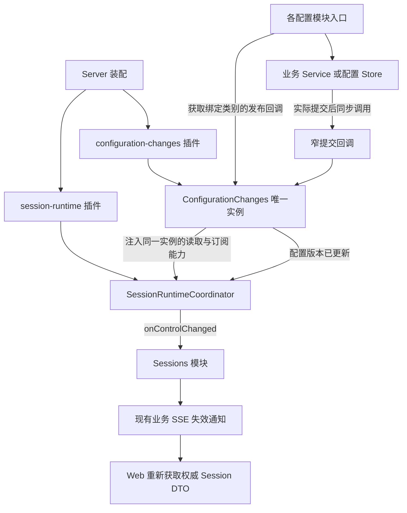

# 独立配置变更服务设计

日期：2026-11-04。作者：Codex。

状态：已实施（2026-11-04）。用户已确认具体方案；实现与验证范围见 [PoC](../poc/configuration-change-service-validation-plan.md)，决策见 [ADR-0093](../adr/0093-independent-configuration-change-service.md)。

## 1. 目标与范围

将配置版本记录、作用域索引、订阅、类别目录和生命周期从 SessionRuntimeCoordinator 的所有权中独立出来，成为每个 Server 实例共享的进程内资源。配置业务与会话运行时分别依赖它，配置保存不再经由 sessionRuntime 获取通知能力。

产品行为保持：旧实例显示“智能体配置已变更”，用户主动重启应用配置；不自动重启、不自动中断任务，已有用户主动选择的 whenIdle 保留。

首期只迁移已接入的模型服务/认证、MCP、Agent 环境（含 Jev 凭据）和全局/工作区技能。不新增 HTTP 端点、前端状态、持久化表、进程或消息队列，不扩展外部文件监听。权限、生图、语音、普通 Jev 模型、Server 服务配置及浏览器偏好的生效边界见[现状检查](../poc/agent-configuration-notification-review.md)。

这里的服务只登记“会影响已加载 Agent 配置的提交事实”，不是通用通知中心。业务模块仍负责判断提交是否改变有效配置；Registry 不解释模型、MCP 或文件内容，也不执行重启策略。

## 2. 当前问题与保留部分

- [RuntimeConfigChanges](../../apps/server/src/infrastructure/runtime-config/configuration-changes.ts) 已集中版本和订阅，复用其算法，不重新建立第二份状态。
- Coordinator 当前创建通知实例并在 close 中关闭；[配置模块](../../apps/server/src/modules/mcp-settings/index.ts)通过 `server.sessionRuntime.configChanges` 发布，配置保存因而依赖会话运行时。
- 各模块的 `onCommitted` 是实际提交边界，不属于应消除的重复。MCP 原子写入、技能保存、环境 revision、Jev 提交后响应失败和异步认证有不同契约。
- [ModelConfigMonitor](../../apps/server/src/modules/model-settings/model-settings.service.ts)同时处理已提交写入和原有文件事件；其实际变化判断与确认读取不能被简单的“方法返回成功”替代。
- [Sessions 模块](../../apps/server/src/modules/sessions/index.ts)已经把 Runtime 控制状态变化投影为业务 SSE；保留这一条桥接，避免重复广播。

## 3. 所有权与依赖



| 职责                                     | 唯一所有者                               |
| ---------------------------------------- | ---------------------------------------- |
| 是否真的 changed/committed、幂等与写锁   | 拥有实际写入的业务模块/Store             |
| 类别绑定与可信作用域注入                 | 对应模块入口；Workspace 身份仍由业务解析 |
| 单调版本、类别索引、订阅隔离             | ConfigurationChanges                     |
| 创建、共享、启动失败清理与关闭服务       | configuration-changes 插件               |
| 已加载版本基线、旧实例判断、重启生命周期 | SessionRuntimeCoordinator                |
| Session 查询失效与浏览器提示             | 现有 Sessions/SSE/Web 链路               |

服务继续位于 Server infrastructure：它是技术性的进程内变更登记资源，不承接业务写入、权限或重启决策。目录不下沉到 packages/agent，不创建跨业务万能 Service 或全局服务定位器。

## 4. 文件布局

实施时复用现有目录，不新增业务自动加载模块：

```text
apps/server/src/infrastructure/runtime-config/
  configuration-catalog.ts   # 类别、合法作用域、现有 DTO 路由标识映射
  configuration-changes.ts   # 唯一版本/订阅实现及其公共契约
  index.ts                   # 显式导出
apps/server/src/plugins/
  configuration-changes.plugin.ts
```

`runtime-config-changes.ts`、`config-routes.ts` 已分别由前两项替换，调用方迁移后已删除，不保留旧路径重导出、旧类别名或双版本记录器。旧入口已删除，不保留转发兼容。

独立插件只组装资源及其生命周期；app.ts 只增加该基础设施插件注册，不收集各业务 Service，不手工注册业务 Controller。

## 5. 配置类别与作用域

| 内部类别          | 允许作用域         | 保持的 changedConfigRoutes 标识 | 提交所有者                           |
| ----------------- | ------------------ | ------------------------------- | ------------------------------------ |
| model-providers   | global             | /settings/model-providers       | ModelConfigMonitor 确认变化后        |
| mcp-servers       | global             | /settings/mcp-servers           | MCP Store 原子写入后                 |
| agent-environment | global             | /settings/environment/agent     | 环境 Service；Jev 凭据按同一类别上报 |
| skills            | global / workspace | /skills                         | SkillsService 提交后                 |

作用域使用已有语义：`{ kind: 'global' }` 或 `{ kind: 'workspace', workspaceId }`。Workspace ID 必须来自已解析的业务目标；不能接受浏览器传来的任意目录。其他三类不能发布 Workspace 事件。

category 是内部稳定标识；路由字符串只用于现有 Session DTO 投影。发布者不传 HTTP method、请求 URL、Session ID、配置值、密钥、技能正文或源文件内容。

类别目录统一维护合法作用域、固定排序和 DTO 标识。是否存在一次需要通知的提交仍由写入边界决定；不会因为注册某个 PUT/PATCH 路由就自动发事件。新增类别需同时明确写入所有者和消费方式，不预置未接入的类别。

## 6. 公共契约

以下为实现契约。

| 能力                                                             | 约定                                                                                                                                                                                 |
| ---------------------------------------------------------------- | ------------------------------------------------------------------------------------------------------------------------------------------------------------------------------------ |
| `publisher(category)`                                            | 在模块装配阶段绑定类别，返回提交回调；全局类别返回 `() => void`，skills 返回 `(scope: ConfigurationScope) => void`。使用明确的 TypeScript 重载限制作用域，不用装饰器或运行时方法扫描 |
| `current(): number`                                              | 返回当前单调版本；纯内存读取，不读取文件、不创建 runtime                                                                                                                             |
| `since(baseline, workspaceId): readonly ConfigurationCategory[]` | 返回该基线之后的全局变化与匹配工作区变化，按目录固定顺序去重；返回不可变视图或拷贝                                                                                                   |
| `subscribe(listener): () => void`                                | 订阅已记录的版本变化；listener 不获得配置值。取消订阅幂等                                                                                                                            |
| `close(): void`                                                  | 仅由资源插件调用，幂等清理订阅；关闭后不再接收有效提交或改变版本                                                                                                                     |

提交回调是窄能力，不暴露 service 给业务方法。MCP/环境/Jev/技能的既有 `onCommitted` 风格保留；入口通过 publisher 直接提供回调，Service 不导入配置类别目录、Runtime 或 Fastify。

例如装配含义是 `onCommitted: server.configurationChanges.publisher('mcp-servers')`；Skills 接收对应的作用域回调。模型监视器新增 `onCommitted` 回调依赖，移除对 RuntimeConfigChanges 类和路由常量的依赖。

Runtime 只依赖 `Pick<ConfigurationChanges, 'current' | 'since' | 'subscribe'>` 这一窄读取契约，不获得发布或关闭能力。不新增只复制整个 Class 的接口。Coordinator 对外不再公开 `.configChanges`。

`subscribe` 的回调允许直接无参数失效通知，延续现有广播粒度；本期不增加事件历史、sourceRevision 去重表或通用事件总线。无副作用的类别到 DTO 标识转换放在 catalog 中，只由 Runtime 的控制状态投影使用。

## 7. 版本与通知时序

1. 写入者完成校验、并发控制和 changed 判断。
2. 持久化确认成功后，同步调用绑定的提交回调。
3. 服务先增加单调版本，写入 global/category 或 workspace/category 的最后变更版本，再调用订阅者。
4. 单个订阅者异常被隔离，并以不含配置值的诊断记录；不能回滚提交、阻断后续订阅者或把已保存操作改判为失败。
5. Runtime 发布既有控制状态失效；Sessions 继续通过现有 SSE 通知查询刷新。提交不等待浏览器、SSE 写出或用户重启。

进程启动基线必须在启动 Agent 之前采集。启动中再次变化时，新 runtime 的基线仍是旧版本，ready 后保持应有的过期提示；不能在 ready 时无条件认证为最新。重启成功只更新新进程的基线，不能清除其他会话的过期事实。

服务只保存当前全局序号与各类别最后变更版本；没有可重放事件队列。SSE 丢失或重连后通过已有 HTTP 权威查询恢复状态，不新增前端版本协议。

幂等由实际执行层保证：重复 HTTP 响应、OAuth 结果查询和模型监视器重复读取不能再次发布。Registry 不按请求 ID 或参数猜测重复提交；重复主动调用 publisher 会产生新版本，是调用者违约。

## 8. 特殊提交路径

| 路径       | 设计要求                                                                                                                                                                                   |
| ---------- | ------------------------------------------------------------------------------------------------------------------------------------------------------------------------------------------ |
| MCP        | 保留串行写入与 revision 校验；原子 rename 后、响应 snapshot 前回调。无变化不回调，提交后投影失败仍回调                                                                                     |
| Agent 环境 | 使用原有已提交 snapshot revision 区分变化；只在 agent scope 发回调，server scope 走独立服务重启流程                                                                                        |
| Jev 凭据   | 仍通过已有 SDK 写入。返回成功时检查 environmentRevision；响应读取失败时保留现有前后 revision 核对及通知。版本变化可能包含并发提交，错误路径允许保守提醒，但不能宣称准确辨认了单次 SDK 提交 |
| 模型/认证  | Save/OAuth 只使现有 ModelConfigMonitor 失效；由 monitor 完成一致性读取后发布一次。不能在入口再直接调用 publisher，否则与 monitor 重复                                                      |
| 默认模型   | 保留模型意图/catalog 刷新，不发布 model-providers 过期事件，不覆盖已有会话模型                                                                                                             |
| 技能       | 创建、编辑、删除、上传在实际提交后、响应读取前回调；普通无变化保存不回调。Workspace 事件只作用于该 Workspace；上传替换按一次提交处理                                                       |

Jev SDK 缺少直接的已提交结果，是现有端口的限制。本次隔离服务不伪造成功/失败语义，不为消除此限制修改受保护的 Agent 核心；如以后调整 SDK 提交契约，另行提出具体 Agent 变更。

提交与内存通知之间不是跨存储原子事务；Server 进程在两者之间退出时不承诺持久事件投递。资源重启与旧进程治理仍遵循现有 Host 契约；本方案不解决跨 Server、CLI 或孤儿进程同步。

## 9. Fastify 装配与生命周期

app.ts 的资源顺序：

```text
configuration-changes（根作用域共享）
  -> session-runtime（注入同一对象）
  -> database 等原有基础设施
  -> business-modules 自动加载
```

新插件以 fastify-plugin 发布 `server.configurationChanges`；session-runtime 插件声明对 `configuration-changes` 的依赖和 decorator 要求。发布配置的业务模块入口声明配置资源依赖，移除仅因通知而产生的 sessionRuntime decorator 要求；其他真实业务依赖保留。

不能在自动加载的业务子作用域创建该服务再向祖先注入，不能依赖目录字母排序。该资源不放入 modules 自动加载目录，避免与 app.ts 显式注册重复。

Coordinator 的配置读取依赖改为构造参数必需项；删除内部 `new RuntimeConfigChanges()` 默认值。关闭 Coordinator 只释放自身订阅，不关闭共享资源。现有插件的 runtime 注入仍可使用，但必须校验其绑定的配置读取实例与插件共享实例相同，不能保留两个互不通知的版本源。

测试/嵌入入口规则：

- CreateServerOptions 增加可注入的 `configurationChanges`。
- 只注入 runtime 时，调用者也必须显式提供构造它所用的配置实例；缺失或不一致在启动阶段报错。
- Coordinator 提供仅用于该真实装配校验的身份判断方法，不重新暴露可写配置服务。
- 传入 Fastify 的配置实例生命周期移交本 Server 插件；每个 Server 独占一个实例，禁止跨两个 Server 共享。
- 纯 Coordinator 测试自行创建配置实例，先关闭 Coordinator，最后由 fixture 关闭实例。

关闭顺序要求：先停止业务写入、后台认证和模型 watcher，再释放 Runtime/Sessions 订阅，最后关闭配置服务。注册到 Fastify 的资源关闭必须有集成测试证明顺序，不能仅凭 register 调用排列假定完成。晚到回调在服务关闭后不更新版本、不产生浏览器通知，并记录有界诊断；这是关闭兜底，不代替取消后台工作。

Sessions 仍是 `onControlChanged -> dataEvents.publish({ resource: 'sessions' })` 的唯一桥接。新服务不直接发 SSE，也不增加另一条 data-events 订阅；重启成功/失败等非配置事件继续通过同一控制状态通道。

## 10. AOP 边界

不引入装饰器库、Proxy、HTTP onResponse/onError 自动通知、通用 save-and-notify 包装器或 fs.writeFile 全局拦截。它们不能统一表达 changed、已提交但响应失败、幂等重放、异步认证和 Workspace 作用域。

可集中维护的是 publisher 的公共行为：更新版本、作用域索引、异常隔离和诊断。提交触发点依然显式保留。未来只有多个写入端已具有一致的已提交结果契约，且出现实际重复编排时，才单独评估显式包装函数；不为消除几行回调提前加入 AOP 框架。

## 11. 迁移步骤与删除清单

1. 在现有 runtime-config 目录提取 ConfigurationChanges 与 catalog，保持版本算法和 DTO 标识；先建立服务及 publisher 的测试。
2. 新增资源插件，调整 app.ts、session-runtime 插件和 Coordinator 注入/关闭；迁移所有直接 new Coordinator 的测试 fixture，先验证唯一实例和关闭顺序。
3. MCP、Agent 环境、Jev、Skills 模块入口切换至类别绑定回调；保留各自写入语义和失败兜底。
4. ModelConfigMonitor 改为接收提交回调；模型和 ProviderAuth 继续只 invalidate monitor，保留默认模型独立处理。
5. 保留 Runtime 控制状态到 Sessions/SSE 的单一桥接，确认 changedConfigRoutes、restartRequired、whenIdle 和重启流程无行为差异。
6. 删除旧类/文件、旧路由常量导入、Coordinator 的可写属性及关闭所有权；更新测试和当前架构文档，不留兼容转发文件。

阶段划分用于审查和验证，不要求生产环境同时支持两套通知后端。任何可运行的中间状态都只能有一个版本源。

| 预计涉及文件                                                         | 改动目的                                       |
| -------------------------------------------------------------------- | ---------------------------------------------- |
| runtime-config 下原有实现和目录入口                                  | 类别绑定、统一公开契约、保留算法               |
| app.ts；新插件；session-runtime.plugin.ts                            | 唯一实例、注入、关闭所有权                     |
| runtime/coordinator.ts、相关 ManagedRuntime 类型                     | 使用读取端口、保存启动基线、移除发布与关闭职责 |
| mcp-settings、environment-settings、jev-settings、skills 的 index.ts | 从独立资源获取 publisher                       |
| model-settings 的 index/service；provider-auth 的装配                | monitor 确认提交、避免双发                     |
| Server 相关测试及嵌入调用方                                          | 显式资源注入与行为回归                         |

原则上不修改 Web、packages/shared、packages/agent 或 packages/ui。若实施发现必须改外部协议或受保护边界，应作为独立变更说明，不能以此次服务提取默认授权。

验收标准及风险推演统一维护在 [PoC 计划](../poc/configuration-change-service-validation-plan.md)。
