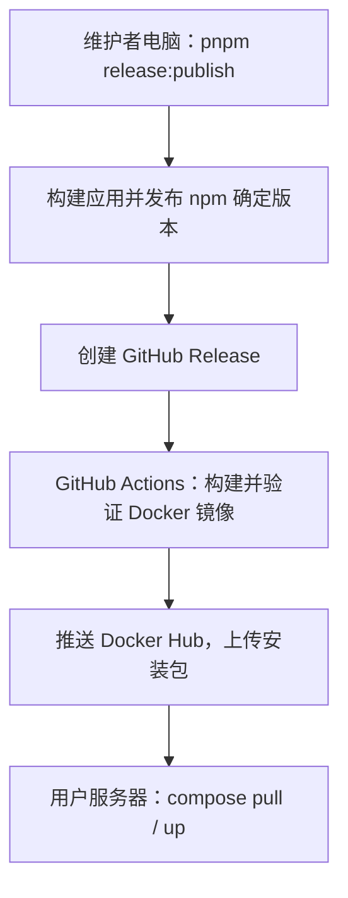

# Docker 成品镜像发布与安装

## 一句话说明

**npm 包在维护者电脑上构建发布，Docker 镜像在 GitHub Actions 上构建发布，用户服务器只拉取和运行镜像。** 维护者电脑不需要 Docker。`pnpm release:publish` 成功结束不代表远程镜像任务已经完成，镜像进度和错误在 GitHub Actions 中查看。

## 每一步在哪里执行

| 步骤                            | 执行位置       | 做什么                                                                |
| ------------------------------- | -------------- | --------------------------------------------------------------------- |
| ① 执行 `pnpm release:publish`   | 维护者电脑     | 构建应用，发布 npm 包，然后创建 GitHub Release                        |
| ② 自动触发 `docker-release.yml` | GitHub Actions | 收到 GitHub Release 发布事件，启动远程任务                            |
| ③ 等待并构建 Docker 镜像        | GitHub Actions | 等待 npm 公开可下载，由 Docker 官方组件按 Dockerfile 构建精确版本镜像 |
| ④ 验证并推送镜像                | GitHub Actions | 检查版本、启动、Web 和持久化，官方组件复用构建缓存推送 Docker Hub     |
| ⑤ 安装应用                      | 用户服务器     | 下载 Compose 安装包，拉取成品镜像并启动容器                           |



例如发布 `0.0.10`：本地发布 `dr-octopus@0.0.10` 并创建 `v0.0.10` Release；GitHub 安装这个 npm 包构建 `nebulaedata01/dr-octopus:0.0.10`；用户使用该镜像。Docker 构建不会编译仓库中尚未发布到 npm 的修改。

## 文件与职责

公开 `deploy/docker/` 中的 Dockerfile、Compose、配置示例、双语安装说明及测试；工作流位于 `.github/workflows/docker-release.yml`，发布辅助脚本位于 `deploy/docker/`。真实 `.env` 和凭据不提交。官方发布只维护 Docker Hub；内部 Harbor 通过独立的 `sync-harbor.mjs` 手动同步，不参与公开 Release 的成功条件。同步固定源摘要并校验目标摘要；部署使用可选 `IMAGE_REPOSITORY` 切换仓库，默认仍为 Docker Hub。操作步骤见 [Harbor 同步说明](../../deploy/docker/HARBOR.md)。

Docker 官方 `setup-buildx-action`、`build-push-action`、`login-action` 分别负责构建器、构建及版本镜像推送、登录。`npm-ready.mjs` 只等待 npm 可用，`smoke.mjs` 只验证容器，`release.mjs` 只保留项目规则与安装文件准备，不执行注册表写入。`latest` 的标签和推送命令直接写在工作流中，仍受稳定版本比较结果约束。

采用 Docker 官方“先测试后推送”流程：首次调用构建组件加载本地镜像供 smoke 使用；测试通过后再次调用同一组件，复用同一构建器和缓存进行推送。两次构建使用同一基础镜像摘要及构建参数，推送步骤不刷新基础镜像；推送后匿名拉取并核对镜像 ID，确认配置和文件层与测试镜像一致，才继续发布安装包。首期保持单平台镜像，并显式关闭 provenance/SBOM 附加证明，不声称提供供应链证明。

Compose 不包含 `build`。项目名继续为 `dr-octopus`，保留 `server-data`、`agent-data`、`workspaces` 三个卷，便于旧部署切换。容器使用非 root 的 `node` 用户，运行依赖留在镜像中，业务数据进入卷。

## 版本、触发与失败恢复

- 唯一镜像仓库是公开的 `docker.io/nebulaedata01/dr-octopus`；GitHub 仓库仍为 `nebulaedata/dr-octopus`。首期只支持 `linux/amd64`。
- 精确标签如 `0.0.10` 对应同版本 npm 包，不覆盖已有镜像。仅镜像修复使用 `0.0.10-r1` 等明确标签。
- 稳定版本通过验证后可以更新 `latest`；旧版本补发、较旧镜像修订和预发布不能让 `latest` 回退。
- `release.published` 自动触发。不能用 tag push 触发，因为现有脚本先推送 tag、后发布 npm。
- `workflow_dispatch` 用于手动补发，指定已发布的 Release tag 和镜像修订号。对应 tag 必须已包含 Docker 发布文件。
- 镜像修订仍使用该 Release tag 中的 Dockerfile，可用于更新基础镜像和系统依赖；若要修改 Dockerfile 或发布脚本本身，先提交修改并发布新的版本，不移动已有 Release tag。
- 固定标签已存在时复用该镜像并重新验证，不重建覆盖；网络错误、认证错误不能当作“镜像不存在”。
- 一个仓库的镜像发布串行执行；GitHub 的并发队列可能替换尚未运行的旧任务，被跳过的版本可手动补发。
- npm 成功但镜像失败时，保留 npm 与 Release，修复后只重试 Actions。安装包仅在镜像发布成功后上传；以安装包是否存在确认 Docker 安装是否就绪。
- npm 精确版本和 tarball 尚未公开可下载时，每分钟重试，最多等待 30 分钟；短暂网络、限流及服务端故障同样重试，认证错误或元数据不匹配立即失败。等待超时后由维护者在上架后重跑任务，不能把 registry 暂时查不到版本当作需要重新发布 npm。
- 历史 Release 重试使用原运行记录，避免新版工作流调用旧 tag 中不存在的辅助脚本；新流程随包含全部变更的新 Release tag 生效。
- 精确镜像和安装包成功后再更新 `latest`。升级不自动回滚数据库；需要降级时先确认兼容性，否则恢复配套备份。

## 维护者首次配置

账号、令牌创建入口及逐步操作见 [GitHub Actions 发布配置说明](../../.github/workflows/README.md)。

1. 确认 Docker Hub 仓库 `nebulaedata01/dr-octopus` 为公开仓库，账号具有推送权限。
2. GitHub 仓库 Actions Secrets 中将 `DOCKERHUB_USERNAME` 设置为 `nebulaedata01`，`DOCKERHUB_TOKEN` 设置为该账号的 Docker Hub 访问令牌。这些凭据仅用于远程工作流。
3. 允许 Actions 运行；工作流需要 `contents: write` 上传 Release 安装包。
4. 本地 `.env.publish` 中的 `GITHUB_TOKEN` 使用具备该仓库权限的个人访问令牌或 GitHub App 令牌。它与 Actions 自带的同名短期令牌不同：由 Actions 默认令牌创建的 Release 通常不会再触发其他工作流，此时需要手动触发。
5. 先提交代码与工作流，使新 Release tag 包含发布文件。工作流也应存在于默认分支，便于手动触发。
6. 正常运行现有 `pnpm release:publish`，随后在 Actions → Docker release 中确认成功。

## 安装与运维契约

源码仓库部署模板默认 `IMAGE_TAG=latest`，用户可固定精确标签；使用 `latest` 更新时仍需先 `docker compose pull` 再 `up`。每个版本提供 `dr-octopus-docker-<镜像标签>.zip`，包含 Compose、已固定该版本的 `.env.example` 和双语说明。用户不需要源码、Dockerfile、Node.js 或 pnpm：

```bash
cp .env.example .env
docker compose pull
docker compose up -d --wait --wait-timeout 660
```

默认宿主机绑定 `0.0.0.0:3000`，容器内监听 `0.0.0.0:3000`。服务器防火墙及云安全组放行 TCP 3000 后，其他人可通过 `http://服务器IP:3000` 直接访问 Web 智能体，无需反向代理。安装配置不包含反向代理或证书；需要 HTTPS 域名和认证时另行配置。CORS 不是登录认证，应用当前没有多用户登录与账户隔离。使用宿主机反向代理的部署可显式改为 `BIND_ADDRESS=127.0.0.1`。

镜像预装应用、系统工具和运行依赖；首次启动仍可能联网安装扩展，不承诺离线启动。保留现有 Agent 核心，不为容器发布修改其接口。

项目统一使用 npm 官方环境变量 `NPM_CONFIG_REGISTRY`：根目录 `.env` 配置源码开发，Dockerfile 的同名 build arg 配置应用及运行依赖安装，部署 `.env` 配置容器内运行依赖和 Pi 扩展下载。官方镜像构建和部署示例默认 `https://registry.npmjs.org`；国内可显式选择 `https://registry.npmmirror.com`。直接使用 npm 标准变量，不保留自定义别名或转换逻辑。构建和运行是不同阶段，部署配置不改变已有镜像或 Docker Hub 地址。旧安装包需要先补上 Compose 环境变量映射，仅添加 `.env` 项不会生效。

更新前停止服务并备份三个卷，记录镜像标签和 `.env`；修改 `IMAGE_TAG` 后执行 `pull`、`up`。只有成功拉取后才进行容器替换。单实例更新会短暂中断，`down -v` 会删除数据，不能用于普通升级。

## 验收

本节已迁至 [概念验证与验收记录](../poc/docker-distribution-validation.md#验收)。

## 相关资料

- [ADR-0071](../adr/0071-docker-hub-distribution.md)
- [Docker 安装说明](../../deploy/docker/README.zh-CN.md)
- [Docker：推送前测试](https://docs.docker.com/build/ci/github-actions/test-before-push/)
- [GitHub：发布 Docker 镜像](https://docs.github.com/en/actions/tutorials/publish-packages/publish-docker-images)
