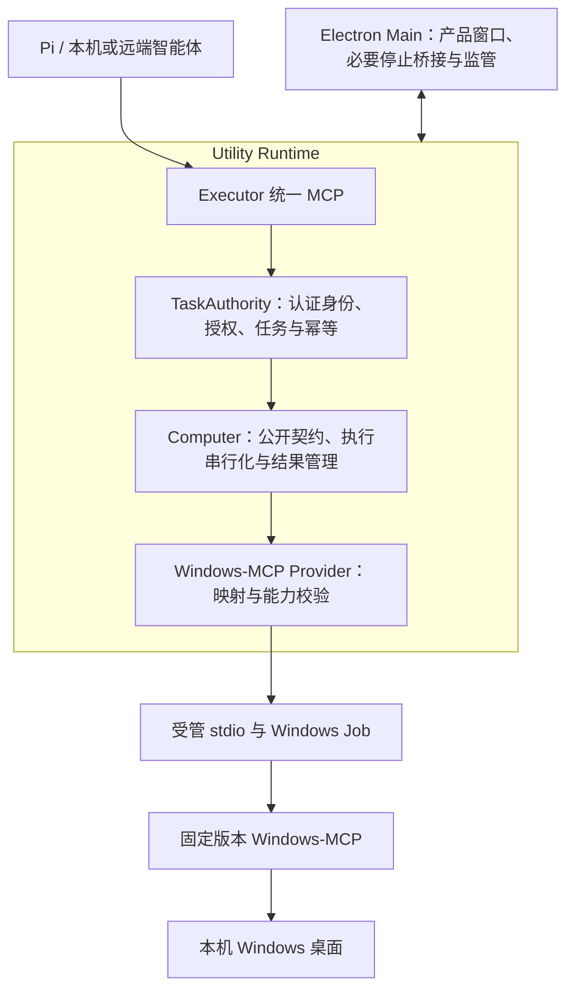

# Dr.Octopus Windows Computer Use MCP 架构与实施规范

状态：已获准实施；当前采用未修改上游，撤销本地 UIA 补丁，维护性优化的本机验证已完成；未宣称发行验收完成。

修订日期：2026-10-17。

用户已于 2026-10-16 授权开始实施。本文中的目标约束不代表对应代码已经存在或正式发行已经通过；实际进展与实验限制记录于文末。

## 1. 目标、范围与决策

采用统一 Executor MCP 入口，内部通过受管 stdio 调用真正的 Windows-MCP 服务。Pi / Dr.Octopus 负责推理和规划；Executor 负责认证、授权、任务、结果、可见反馈和进程生命周期；Windows-MCP 负责桌面截图、UIA 与输入执行。

首期限定 Windows x64、本机桌面。智能体可以位于远端，通过现有 Executor 认证入口连接；不允许借内部 Provider 选择另一台 Windows 主机。

项目尚未发布。用户于 2026-10-16 明确决定：现有 Computer Use 可以完整推翻和删除，无需兼容旧实现、API、参数、状态、数据格式或测试假设。新设计以产品需求和固定上游能力为依据，不以旧八工具的行为为约束。当前已获准实施，旧实现清理随新后端接入推进。

关键决定：

- 继续使用 apps/executor 和现有 Utility Runtime，不新建 apps/local-executor，不把执行逻辑移入 Electron Main。
- Windows-MCP 是内部受管执行引擎，Pi 不直接连接它，不增加第二套 Agent Loop。
- 内部仅 stdio、固定私有入口及工具白名单；Executor 外部 HTTP/stdio 入口维持各自的认证与连接职责。
- 接入 Executor 统一任务、设备和授权边界；Computer 专属的权限、状态、幂等和错误契约可重设计，不建设平行任务系统。
- 按新方案需要复用 Windows Job、私有 Python 和离线装配基础设施；Computer 专属彩带、Esc 监听和控制状态实现可替换，优先复用上游机制。
- 公共工具提供产品语义，Provider 隔离上游差异；不能用改名或声明版本代替实际接入证据。
- Native Provider 是可选的未来方向，不是本次交付目标；不提前建设多 Provider 路由或静默回退。

## 2. 当前事实与文档关系

重构前源码启动自有 product.server，通过 Pillow/Win32 实现桌面；仅附带 Windows-MCP 0.8.6 依赖。当前已切换为固定 Windows-MCP 0.8.8 的真实入口并删除自有引擎；历史事实不代表当前调用路径。

以下是清理和接线索引，不是必须保留的实现清单。Computer 专属文件可以删除或整体重写；涉及共享文件时只替换 Computer 分支，保留其他能力的职责。

源码核对入口：

| 职责           | 当前位置                                                                                                                                                                           | 迁移处理                                       |
| -------------- | ---------------------------------------------------------------------------------------------------------------------------------------------------------------------------------- | ---------------------------------------------- |
| Runtime 装配   | [runtime/index.ts](../../apps/executor/src/runtime/index.ts)                                                                                                                       | 保留 Utility Process 所有权                    |
| 后端生命周期   | [computer-runtime.ts](../../apps/executor/src/runtime/computer/computer-runtime.ts)、[computer-backend.ts](../../apps/executor/src/runtime/computer/computer-backend.ts)           | 按新 Provider 生命周期重写或替换               |
| MCP 连接       | [windows-mcp-connection.ts](../../apps/executor/src/runtime/computer/windows-mcp-connection.ts)                                                                                    | 替换自定义 Executor 扩展握手与结果契约         |
| 工具适配       | [computer-tools.ts](../../apps/executor/src/runtime/computer/computer-tools.ts)、[computer-inputs.ts](../../apps/executor/src/runtime/computer/computer-inputs.ts)                 | 重构公开语义和上游映射                         |
| 任务与结果     | [task-authority.ts](../../apps/executor/src/runtime/mcp/task-authority.ts)、[control-store.ts](../../apps/executor/src/runtime/mcp/control-store.ts)                               | 接入统一准入；重设 Computer 专属记录和恢复语义 |
| 传输与监管     | [computer-stdio-transport.ts](../../apps/executor/src/runtime/computer/computer-stdio-transport.ts)、[computer-supervisor.cpp](../../apps/executor/native/computer-supervisor.cpp) | 按需复用有界 stdio 与 Job；不要求保留原接口    |
| 可见反馈与停止 | [computer-use-indicator.ts](../../apps/executor/src/main/computer-use-indicator.ts)、[computer-use-escape.ts](../../apps/executor/src/main/computer-use-escape.ts)                 | 优先上游实现，删除重复反馈与停止机制           |
| 旧桌面引擎     | 旧 vendor/computer/server.py、desktop.py（已删除）                                                                                                                                 | 重构时删除自研引擎，不保留兼容或回退路径       |
| 固定资源       | [windows-mcp.json](../../apps/executor/vendor/windows-mcp.json)、[assemble-computer.mjs](../../apps/executor/scripts/resources/assemble-computer.mjs)                              | 更新版本、依赖、摘要与许可证                   |

[ADR-0082](../adr/0082-executor-upstream-computer-and-connection-experience.md)记录了上游迁移提议及独立连接体验优化；本规范依据最新用户决定替代其中要求兼容旧 Computer 行为或保留旧实现的迁移约束，不把此前体验优化的完成视为后端迁移完成。

[现行 Computer 架构](executor-computer.md)、[ADR-0073](../adr/0073-windows-mcp-local-and-remote.md)和[验证记录](executor-validation.md)保留历史事实。方案获准实施时更新决定状态；切换后再同步现行架构、项目约束及安装说明。不得提前把目标行为写成已实现行为。

### 2.1 当前集成基线

本规范已按 2026-10-16 工作区重新评估：Basic 使用固定系统 Windows PowerShell 5.1，见 [ADR-0084](../adr/0084-executor-system-shell.md)；独立 executor-client 已移除，文件流通过统一 MCP 的 file_upload_prepare/file_download_prepare/file_transfer_status/file_transfer_cancel 与 HTTP 字节通道完成，见 [ADR-0079](../adr/0079-executor-file-transfer.md)。Computer 不恢复 PortableGit、独立传输客户端或上游 PowerShell 入口。

现有 PowerShell、文件传输和安装包验证只证明各自范围，不作为新 Computer 已验证的证据。共享 Runtime、任务与构建体系继续复用；Computer 专属代码可重写。新规范替代旧 Computer 的固定超时、彩带绘制确认、专属 Esc 钩子及必须整应用重启等实现约束，不改变其他模块的规则。项目规范明确区分旧实现维护和新重构目标，不能要求新实现同时满足两套互斥行为。

## 3. 进程与职责边界

Main 不持有第二套工具状态或 Agent 会话。Renderer 只消费安全状态投影和有限设置接口，不取得通用命令、Provider 参数或明文凭据。Runtime 是产品任务状态的唯一来源；上游控制权是派发桌面动作的必要条件，不能代替产品授权。

内部 stdio 不开放监听端口。该约束不删除现有外部 MCP HTTP 入口，也不影响 Agent 使用已有本地工具传输文件的职责。

## 4. 模块组织与内部契约

实现继续内聚在 apps/executor/src/runtime/computer。现有 Computer 文件可整体删除重建，文件名和类名不构成约束。只有独立职责确有需要时才拆分 Provider 映射或控制协调文件。遵守仓库代码规范，不按概念层级强制生成 application/domain/infrastructure 目录、空壳接口或通用进程管理框架。

职责分配：

- TaskAuthority：验证客户端、设备、当前授权、唯一任务、能力、幂等键与持久结果；取消从这里进入既有任务流程。
- Computer：验证公开请求，维护观察/元素有效性，协调串行派发、可见确认、错误和未知结果。
- Provider：固定上游能力发现、Schema 兼容检查、参数与结果转换、上游控制状态；不拥有另一套产品任务或许可。
- Transport / Job：有界协议帧、背压、stderr 排空、固定进程启动与退出证据，不决定业务重试。

内部接口必须表达以下契约，而不是只返回 unknown 或一个 ready 布尔值：

| 操作    | 必须表达的内容                                                         |
| ------- | ---------------------------------------------------------------------- |
| start   | 实际引擎身份、固定版本、适配契约版本、后端世代、协商结果               |
| status  | 生命周期、连接、可用能力、控制权、是否存在未收束执行；脱敏错误         |
| execute | 类型化动作、可信任务上下文、截止时间、取消信号及派发状态               |
| result  | 已完成/已拒绝/效果未知、结构化结果和有限 MCP 图像内容                  |
| stop    | 是否确认拥有的进程树退出、是否收束在途动作；不能以传输关闭冒充执行停止 |

请求上下文包含由认证和任务系统取得的 clientId/taskId，必要的 requestId/traceId，以及动作幂等键。客户端自填的 sessionId 或 traceId 不授予权限。泛型返回类型不能代替对上游真实响应的运行时校验。

## 5. 固定上游版本与可行性证据

本规范不指定未经验证的新版本。旧方案的 0.8.7/Python 3.13+、现有资源清单及 ADR 中候选版本不能混合作为基线，也不得以 latest 构建。

实施第一阶段必须产出一份固定版本能力矩阵，包含：

1. 上游精确版本、提交、Python 要求、启动入口和实际 argv。
2. 全部传递依赖、摘要、许可证和私有环境装配方式。
3. 实际 initialize、listTools、输入 Schema、结果内容及错误样例。
4. 工具过滤、遥测关闭、控制权获取/释放、用户接管及提示窗口接口。
5. 每个公开能力的映射分类：直接适配、最小扩展、需调整产品契约、暂不支持。
6. 冷启动、截图、Snapshot、真实有限输入、退出的原始结果与耗时。

普通 build/start 不下载依赖、不借用系统 Python/uv/pip。开发实验也优先使用同一固定私有环境；临时在线实验必须锁定版本，不能作为发行验证证据。打包与资源装配执行完整校验；不恢复已明确删除的 Computer 启动资源清单遍历和摘要预检。

优先运行原版上游服务。确需扩展时记录缺失能力、补丁必要性、范围、上游提交计划和回归。不为旧契约添加任何兼容补丁。若新的必需能力需要重写大块截图/输入逻辑，重新评估该能力范围，不能重新构建自有引擎并冠以上游名称。

## 6. 新公共工具契约

旧八工具及其参数全部允许删除，不提供别名、兼容版本或旧行为模拟。新公开 API 按本设计的 computer.* 语义命名；最终工具名须通过现有 MCP 客户端适配链的发现与调用验证，不为保留旧名字牺牲清晰度。

截图和 Snapshot 的图像完全由上游 Windows-MCP 生成。Executor 只负责授权、有限参数映射、结果校验与必要的反馈协调，不继续使用旧 Pillow 截图路径，也不自行实现替代截图引擎。

| 目标工具                              | 新契约需明确的内容                                                                        |
| ------------------------------------- | ----------------------------------------------------------------------------------------- |
| computer.screenshot                   | 上游支持的整屏/显示器/区域范围，图像尺寸、原点、缩放与坐标空间；不保留旧窗口 observe 语义 |
| computer.snapshot                     | 上游 UIA 信息、输出限额、截断与元素引用有效范围，不自建 UIA 遍历引擎                      |
| computer.click / computer.scroll      | 坐标或上游元素引用、按钮、次数、方向与单位                                                |
| computer.type                         | 采用并明确上游文本、clear、回车及剪贴板行为，不要求模拟旧 Literal 输入及精确插入计数      |
| computer.shortcut                     | 上游支持的按键及修饰键语义、释放与中断行为                                                |
| computer.move / computer.drag         | 上游真实支持的移动/拖动参数、取消及按钮释放；按能力验证后开放                             |
| computer.app.launch / switch / resize | 启动、切换及调整分离；限定应用标识和参数，不透传任意脚本                                  |
| computer.display.list                 | 上游显示器信息及可用于定位的元数据                                                        |
| computer.control.status               | 有界控制状态，不提供任意后端方法透传                                                      |
| computer.wait / computer.waitFor      | 如开放，定义有限截止时间、可取消性和条件语言；不支持任意脚本条件                          |

首期必需能力为 screenshot、snapshot、click、type、scroll、shortcut、窗口切换、显示器信息和控制状态；其余能力按上游实测开放。不能为补齐清单另写输入或截图引擎。

taskId、动作请求标识及认证上下文与统一 Executor 接线；Computer 专属 windowId、observationId、目标对象和结果 Schema 重新设计。优先使用上游原生目标和坐标语义，只加入产品实际需要的校验，不强制为每次调用复制旧窗口绑定和十秒观察机制。

如果支持元素或观察引用，必须明确其生命周期及后端重启后的失效行为；无法验证有效性的引用不得宣称稳定。对直接坐标动作明确其依赖当前桌面状态，不伪装为目标窗口隔离。

公开结果使用 MCP image content；结构化结果不重复 base64。接受固定上游支持并经验证的图像格式，按新产品预算设置尺寸与总响应上限，不要求兼容旧 PNG 专属校验。UIA 文本作为不可信应用内容返回，不拼接成系统指令，不记录完整树。

旧 Computer 测试和调用示例按新 API 重写。无需提供旧参数处理和数据迁移；通用 MCP 接入链及非 Computer 功能仍须回归验证。

### 6.1 统一 MCP 接线要求

实施必须同步更新 [mcp-server.ts](../../apps/executor/src/runtime/mcp/mcp-server.ts) 和 TaskAuthority 的 Computer 分支，不能只替换 runtime/computer：

- 新 Computer 工具定义集中提供名称、Schema、描述、所需权限、只读/副作用提示和结果类型；仅为消除实际重复建立内聚定义，不建设全应用插件注册框架。
- 注册、工具目录和动态发现依据该定义及当前能力判断，不继续依赖 computer_ 前缀。验证 computer.* 名称在真实 MCP 发现、描述和调用链中的行为。
- 移除只有 computer_observe 才输出图像的特判。Screenshot、带图像 Snapshot 及实际开放的自动附图均经过有限 Computer 结果转换，输出合法 MCP image content 和脱敏元数据，不将图像编码塞入普通 JSON 文本。
- 不直接透传任意上游 content/resource；明确支持的内容类型、图像数量、格式和总字节预算。继续满足统一 outputSchema，不重复 base64。
- 动态不可用、授权撤销和任务失效既影响发现，也阻止真实派发。结果返回前沿用统一权限检查，不因 Provider 执行成功就绕过撤销。
- 同步更新状态页、授权展示、连接说明和调用方夹具，删除旧名称判断。Browser 的图像返回和既有文件传输返回契约保持有效。

验收必须走外部 MCP 实际调用，确认图片以 image content 返回、发现与权限一致；单独 Provider 测试通过不等于接线完成。

## 7. 授权与能力发现

用户已明确选择首期统一 computer.control 授权，截图、Snapshot、显示器和状态均要求该权限。不提供独立 computer.observe 权限，因为固定上游除 ControlStatus 外均进入控制权流程。权限与取消是首期必需功能。

不开放上游 PowerShell、Registry、Process、FileSystem、Clipboard、Scrape 或任意 callTool。工具过滤和适配层白名单同时限制；内部控制协议方法明确列明，不能自动公开。发现与派发均检查当前授权、任务和后端状态。

普通用户权限运行，不自动提权。旧 Computer 授权记录无需兼容，不映射为更大权限；本地数据按共享日志处置规则保留，不删除其他能力的授权和结果。

## 8. 唯一任务、队列与并发

沿用 TaskAuthority 的全局唯一任务准入，不允许多会话轮流操作同一桌面。单 Provider、单后端进程；不按会话启动独立桌面 Runtime。

Computer 在当前获准任务内串行处理观察和动作。选择有界串行队列或明确并发拒绝均可，不要求复刻旧实现。采用队列时必须有长度上限、入队截止时间、取消清理和逐项重新校验。

从入队到派发之间，授权撤销、任务取消、窗口/快照失效或用户接管都必须阻止动作。health/status 只在不读取变化中状态、不夺取控制权且不干扰动作时允许并行；截图、Snapshot 与输入默认同序列。

## 9. 生命周期、停止、超时与恢复

生命周期由新 Computer 所有者持有：stopped → starting → ready；失败进入 degraded；停止进入 stopping，确认清理后进入 stopped。状态名称及 DTO 按新设计统一替换。控制权状态单独表达，不以 ready 推断已经获准输入。

ready 必须同时满足：拥有的进程存活、MCP 初始化成功、固定版本与必需 Schema 兼容、所需能力存在、没有未收束执行或隔离。启动失败只影响 Computer，不阻止 Basic/Browser/Transfer。缺少可选工具仅不开放该能力；缺少必需工具阻止 ready。

超时必须分别约束启动、排队、上游调用和清理。启动与各工具的执行期限依据固定上游实测和产品需求确定，旧 30/45 秒预算仅作为历史参考，不要求兼容；WaitFor 的用户期限必须受硬上限约束。不为让失败测试通过而无记录地扩大期限。

Promise 超时只意味着停止等待，不证明桌面执行结束。已派发操作未确认结束时，不释放串行执行屏障，不接着执行下一项。

| 事件                        | 必须执行的处理                                                    |
| --------------------------- | ----------------------------------------------------------------- |
| 排队/派发前取消             | 移除请求，报告未执行，禁止迟到回调重新派发                        |
| 已派发后取消或超时          | 尝试受支持的取消；不能确认效果则记录 unknown，阻止后续桌面动作    |
| 后端失联/崩溃               | 保留在途未知结果、废弃引用，收束拥有的进程树；不重放              |
| 本机停止入口 / 上游用户接管 | 收敛到产品停止流程，关闭新派发，取消桌面任务并确认后台退出        |
| 应用退出                    | 停止准入，有界收束调用，关闭 MCP，并通过 Job 确认拥有的进程树清理 |
| 清理未确认                  | 保持失败/未知状态和可见提示，不报告已安全停止                     |

现有 Job Object 是正式基础设施，不能降级为仅 taskkill/PID 检查。上游新增子进程必须验证处于受管树中；传输断开不等于进程树退出。

用户停止后保持停止，不自动重新取得控制权。允许用户通过明确的重新启用操作创建新会话，无需沿用旧实现的整应用重启要求；前提是旧执行已收束、进程树状态已确认且旧任务已终止。空闲崩溃的有限自动恢复可按实测设计预算、退避与熔断；恢复不得重放动作、复活旧引用或清除未知结果。

## 10. 幂等、错误与未知结果

新 Computer 契约接入统一结果存储，记录格式、查询方式和隔离范围可重新设计。新的幂等语义须保证同一键不同输入拒绝，已派发或未知动作不因网络重试而重新发送；无需读取或迁移旧 Computer 记录。

错误模型至少区分：参数/权限拒绝、后端不可用、能力不支持、派发前取消、执行失败、超时以及执行效果未知。错误需要携带有限阶段/派发证据；上游异常保留在受限诊断中，不把任意原始文本泄漏给客户端。

不自动重试 Click、Type、Shortcut、App launch 等动作。health/listTools 仅在有限预算内允许诊断重试。Screenshot/Snapshot 不能因名称像读取就默认重试，须先证明固定版本无控制权获取等副作用，且不会与未收束动作交错。

未知结果可以通过显式只读诊断协助人工或智能体了解桌面，但一次新截图不能证明旧动作没有发生，也不能将未知结果改写为成功或未执行。新设计允许在执行已收束后进行只读诊断；用户可明确结束受影响任务并开始新任务，未知结果仍如实保留。具体恢复流程按新状态机实现，不继承旧隔离机制。

### 10.1 共享任务记录与开发数据处置

当前 [control-store.ts](../../apps/executor/src/runtime/mcp/control-store.ts) 在共享日志中枚举各类工具，并由同一 TaskRecord 保存操作和隔离状态。删除旧 Computer 名称可能影响整个日志加载。无需旧 Computer 兼容，不等于可以删除 tasks 目录或其他能力的记录。

实施和验收默认使用全新独立数据目录。旧开发数据保留原件，不自动清空或悄悄跳过无法识别的日志。需要在原开发目录启用新实现时，提供明确的离线重置流程：停止该实例、保存原件、只识别并处理 Computer 专属状态、验证其他记录完整后发布；不把这一流程做成运行期旧 API 兼容层。

混合任务可能同时包含 Computer、文件、Shell、Browser 或 Transfer 操作，不得仅因任务包含 computer 权限就删除整条任务。无法安全分离时保留原日志并使用独立新目录验证；不重放、改写或丢弃其他能力的结果。设备凭据、连接、设置和非 Computer 授权不在清理范围。

### 10.2 恢复与全局任务占用

[task-authority.ts](../../apps/executor/src/runtime/mcp/task-authority.ts) 当前通过 active 与 quarantined 管理全局准入。新 Computer 的停止、诊断及重新启用必须与这里共同实现，不能只在 Provider 内重建连接。

新设计至少区分“Computer 仍可能执行”“Computer 已停止但历史效果未知”和“其他能力存在未解决提交/执行”。可使用原因集合或明确检查实现，不要求保留旧布尔字段，也不建立第二个任务管理器。

允许结束受影响任务并释放全局占用的条件：Computer 已停止且后台清理确认、该任务无在途执行、没有其他能力的未解决阻断，并且用户明确结束该任务。保留未知操作记录及终止原因，不把释放占用等同于操作成功或撤销效果。重新启用创建新任务/后端世代，不能复活旧任务。

文件发布、Shell 或 Transfer 的阻断继续由对应能力判断；Computer 恢复不得清除它们。验收覆盖 Computer-only 未知、混合任务、清理未确认、重复停止和迟到响应，确认既能按新规则恢复，也不会误放行其他能力。

## 11. 上游控制权、可见反馈与停止

控制反馈与停止按新方案重新设计，优先采用上游受支持的控制提示、用户接管及输入保护，不要求保留旧彩带、绘制确认协议、实体 Esc 原生模块或相关状态机。

- Executor 持有产品任务与授权，上游负责其桌面控制权和输入保护。二者通过有限适配协调，不重复实现上游桌面控制系统。
- 每次控制期间需要明确的可见反馈和本机停止入口。优先让上游提供；只有存在已验证的产品缺口时，才补充最小 Executor UI 或停止桥接。
- 用户接管或停止后终止后续派发，不能由下一次调用自动夺回控制。上游事件映射到统一任务终止；进程清理由受管所有者确认。
- 实体 Esc 的具体支持方式以固定上游验证为准；若产品选择 Esc 为本机停止键，必须验证与注入 Escape 的区别。不得因旧实现使用 Esc 而预先保留第二套钩子。

截图实际调用上游 Screenshot/Snapshot。先验证上游是否已排除自身提示、是否包含 Executor 窗口以及动作是否自动附图。所有公开图像路径都要验证，不假定每条路径行为相同。

若提示会污染图像，只优先尝试上游已有捕获排除能力或窗口平台提供的简单排除接口。不入镜是可选优化，不是首期完成条件；不为此新增跨进程隐藏/恢复协议、修改上游输入保护或另写截图引擎。上游自身已有的隐藏与恢复时序由上游负责，不在 Executor 重复编排。

任何隐藏时段均有硬期限，停止能力始终有效；失败、超时和取消必须恢复正确反馈，迟到回调不能复活已停止任务。若上游没有满足产品需求的接口，直接采用下述降级策略，不为截图不入镜制作专项补丁。

### 11.1 截图不入镜的可行性评估与降级决定

2026-10-16 源码评估结论：存在可复用的实现，尚未完成固定发行版本和真实多屏环境验证，不承诺所有捕获路径均无彩带。

本次读取上游 main 后固定核对提交 c9a307cd8077b7dec07dbe57df1e18ca135ebde7；该提交仅是评估证据，不是已选定产品版本：

- [control_overlay.py](https://github.com/CursorTouch/Windows-MCP/blob/c9a307cd8077b7dec07dbe57df1e18ca135ebde7/src/windows_mcp/desktop/control_overlay.py)对自身提示设置 WDA_EXCLUDEFROMCAPTURE，并提供 suspend_for_capture。源码同时说明显示亲和性受合成器影响，自身截图仍通过暂停提示保护。
- [desktop/service.py](https://github.com/CursorTouch/Windows-MCP/blob/c9a307cd8077b7dec07dbe57df1e18ca135ebde7/src/windows_mcp/desktop/service.py)的截图路径调用 pause_for_capture、suspend_for_capture、cancel_active_flash，捕获后通过 finally 执行 resume_after_capture。这是上游已有完整行为，不需要 Executor 另写同类时序；它不会自动隐藏 Executor 的其他窗口。
- [Electron BrowserWindow 文档](https://www.electronjs.org/docs/latest/api/browser-window#winsetcontentprotectionenable-macos-windows)提供 setContentProtection(true)，Windows 下使用捕获排除标志。文档说明 Windows 10 2004 之前可能得到黑块，且设置需要下一次桌面合成才生效。现有 ComputerUseIndicator 未设置此属性；不能据此宣称现有彩带已经不入镜。

后续只做有限验证：选定版本的 Screenshot、带图像 Snapshot、实际开放的自动附图路径；检查连续捕获、多屏/DPI、失败或停止后的提示状态，同时排除整屏黑块或缺失桌面内容。优先复用上游现成行为；若仍使用 Executor 彩带，可验证一次简单窗口捕获排除方案。出现不可靠结果即停止该优化，不展开多轮专项攻关。

用户已接受的降级：Executor 彩带在桌面任务期间持续显示，截图时不额外隐藏，允许彩带进入图像。不裁剪、涂抹或修复彩带像素，不因此更换截图引擎。上游自身已有的控制保护及截图行为继续遵循其原生契约；不为强制上游提示逐帧常亮而改造上游。持续可见是任务反馈要求，不等于禁止上游内部短暂捕获协调。

无彩带图像不作为首期门禁。验收只要求截图可用、提示/停止行为可靠，并如实记录是否入镜；彩带应尽量贴边、透明且不遮挡主要操作区域。

## 12. 坐标、窗口和 UIA 数据

公开契约明确区分截图像素、物理桌面坐标、显示器原点、裁剪区域和缩放比例。禁止用 Electron devicePixelRatio 猜测上游坐标。

优先使用上游返回的可信元数据转换。若上游缺少必要元数据，调整截图输出或公开契约，不能承诺精确定位。多屏负原点、混合 DPI、窗口移动、显示器增减后旧引用必须失效。

采用上游真实支持的窗口和元素身份，不复刻旧 HWND/PID/进程创建时间契约。可行性阶段记录身份有效范围、执行时校验及焦点行为；公开描述只承诺已验证的保证。

## 13. 可观测性与健康状态

状态投影包含实际后端类型、上游版本、适配版本、生命周期、可用能力和脱敏原因。上游自报 name/version 只是一项证据，必须结合固定启动入口、装配来源及真实调用测试。

日志记录 traceId、taskId、工具、阶段、耗时、派发状态、效果状态及错误码。默认不持久化截图、完整 UIA 树、输入全文、密码或剪贴板内容。输入只记录长度等必要元数据。

保留轻量请求/失败/耗时及后端退出统计即可，不为首期引入独立指标平台。健康检查应有界，不能频繁执行重型 Snapshot 或控制权获取；发现能力不等于当前桌面可交互。

## 14. 实施阶段与交付门槛

本节定义已获准执行的实施顺序；产品接入前先完成固定上游实验和涉及授权语义的决定。

| 阶段                   | 内容                                                       | 完成条件                                                                         |
| ---------------------- | ---------------------------------------------------------- | -------------------------------------------------------------------------------- |
| A：方案定稿            | 本规范、新公开能力及清理范围                               | 用户审阅后再进入实施；不能把方案修订当作已授权生产切换                           |
| B：固定上游实验        | 固定版本真实启动、发现、截图、专属窗口有限输入、控制与退出 | 逐工具矩阵、Schema/返回证据、耗时、差异及最小补丁清单；与新规范的差异明确记录    |
| C：Provider 与契约适配 | 接入统一 Runtime/授权，重建 Computer 适配与资源            | 必需工具真实调用上游；权限、幂等、错误、未知结果和引用失效通过                   |
| D：反馈与停止闭环      | 上游反馈、用户接管、本机停止、全部截图路径                 | 成功/失败/超时/停止均正确收束，无迟到复活；允许彩带入镜，C 和 D 共同满足切换条件 |
| E：清理与发行验证      | 删除旧实现、旧契约及过时测试，同步文档/许可/产物           | 离线装配和安装验收、真实硬件矩阵分别完成                                         |

重构时可直接删除旧 Computer 实现、旧工具 Schema、旧自定义 MCP 扩展、专属 Python 引擎、无用依赖及只验证旧行为的测试。无需双轨运行、兼容适配、旧包回退或旧数据迁移。历史证据通过版本控制和验证文档保留即可，不保留可执行旧引擎。

清理所有 Computer 注册、UI 状态、授权描述、工程脚本、打包清单和文档引用，新增测试只验证新契约。开发状态如需重置，仅清理 Computer 专属数据，不删除设备凭据、Basic/Browser/Transfer 数据或其他工作区改动。

### 14.1 构建与产物清理范围

- [build.mjs](../../apps/executor/scripts/compile/build.mjs)不再调用旧 publishComputerProduct 或复制旧 product 后端；同步移除只服务旧后端的编译入口和验证 Schema 生成逻辑。
- [package-runtime-manifest.mjs](../../apps/executor/scripts/lib/package/package-runtime-manifest.mjs)及资源清单、许可证、验收探针同步指向真实上游入口，不再声明 product/server.py、product/desktop.py、product/schemas.json 为运行组件。
- 构建采用新装配目录或精确清理本次拥有的陈旧 Computer 输出，防止增量构建把旧文件带入新包。不删除已有发行包、用户数据或无关构建输出。
- process-supervisor 已供 PowerShell 与 fd/rg 搜索使用，属于共享基础设施；不能随旧 Computer 删除。computer-supervisor 和 computer-escape 等专属组件按新方案实际依赖保留或删除，不能仅按名称批量清理。
- 验收同时检查源码引用、全新构建及最终解包内容：真实上游入口存在，旧自研 product 引擎和仅服务它的 Schema/依赖不在产物中，清单与实际字节一致。
- 回归系统 PowerShell、搜索、Browser、外部 MCP HTTP/stdio 和现行四项文件传输工具；不恢复已删除的 Bash/PortableGit/executor-client。

新安装包必须有自己的身份和验证结果，不沿用此前 PowerShell 或跨机文件流验收宣称新 Computer 通过。

## 15. 验证矩阵

| 层次         | 必须覆盖                                                                                                          |
| ------------ | ----------------------------------------------------------------------------------------------------------------- |
| 单元/契约    | 参数与结果转换、能力缺失、Schema 不兼容、图像/UIA 限额、权限撤销、引用失效、超时与取消阶段                        |
| 协议故障     | initialize/listTools 失败、半途断连、响应丢失、迟到回复、同键不同输入、退出未确认；断言不重复输入、不释放未知屏障 |
| 真实上游     | 固定入口、真实工具发现、图像内容、Snapshot 元素、有限键鼠及窗口切换；证明未进入旧 product.server                  |
| 控制闭环     | 用户接管、本机停止、选用 Esc 时的注入区别、连续截图、截图中停止、必要提示协调、上游附图路径                       |
| Windows 硬件 | 多屏负原点、混合 DPI、焦点竞争、锁屏/UAC、输入中进程退出、用户按键状态、真实部分输入                              |
| 非桌面回归   | Basic、Browser、外部 HTTP/stdio、设备与授权、Agent 本地工具文件流、设置持久化及重启                               |
| 交付         | 固定依赖和许可证、无系统 Python/Node/Git 的断网首启、升级/卸载、最终安装包与恢复                                  |

测试只使用拥有的专属窗口和数据，GUI 与加载原生组件的构建按项目要求串行。替身通过不代表真实输入或硬件验收通过。保留首次失败和原条件复验；环境缺失明确写未验证，不放宽断言或时限掩盖失败。

代码阶段按变更范围完成构建、test、lint、typecheck；文档阶段只检查格式、链接和决定一致性。独立电脑与正式发行门禁遵循现有交付规范，不以新后端握手成功替代。

## 16. Provider 正式接入前必须关闭的决策项

以下是获准实施后的可行性阶段产物，应在 Provider 正式接入前明确；不要求在启动可行性实验前就已有实验结论：

- 固定上游版本、Python 和实际工具集合，以及对应启动/过滤参数。
- 新工具名称、输入输出、权限和调用方接线方案；不设计旧八工具兼容层。
- 上游只读调用是否取得控制权，用户接管和提示窗口的受支持集成方式。
- 坐标元数据、元素引用有效期、窗口精确选择及中途输入保护能否成立。
- 简单捕获排除是否可靠；不可靠时采用持续彩带、允许入镜的降级，不追加专项补丁。
- 新工具的硬期限、输出限额及可选能力开放范围。
- 共享 MCP 的发现、权限和图像响应接线，以及旧 Computer 记录的独立测试/离线重置方式。
- Computer 恢复释放全局任务占用的条件，以及共享监管、构建和产物清理清单。

当新的必需能力只能通过大规模重写上游实现时，提交具体差异及取舍，不因旧实现具备该能力而扩大范围。涉及 packages/agent 的任何修改仍需明确授权；本次桌面引擎重构本身不要求修改 Agent Core。

## 17. 固定上游实验记录（2026-10-16）

阶段 B 进行中，尚未修改产品入口、资源清单或公开 Computer 工具。实验使用 build/upstream-computer-0.8.8 下的独立私有 Python 环境，不覆盖 dist/resources/computer。

| 项目      | 实际证据                                                                                                                                    |
| --------- | ------------------------------------------------------------------------------------------------------------------------------------------- |
| 候选包    | windows-mcp 0.8.8；官方标签提交 b74c507d9e709223a0904cf08019edf55f2a75bb                                                                    |
| Wheel     | windows_mcp-0.8.8-py3-none-any.whl；SHA-256 597ef720e1902ba76510a4d2b946949f8a48f281dd210c183de5ded60ea3b873                                |
| Python    | 3.14.0 私有解释器；候选包要求 >=3.14                                                                                                        |
| 依赖      | 使用现有固定依赖归档重新装配，仅候选 windows-mcp wheel 替换为 0.8.8；完整依赖和行为兼容尚待进一步验证                                       |
| 启动      | 原版 windows_mcp serve --transport stdio，显式独立空 TOML、关闭遥测、固定工具白名单，使用现有 Job supervisor                                |
| 握手/发现 | 沙箱外同一 45 秒期限内约 5852 ms 完成；发现 ControlStatus、App、DisplayInventory、Snapshot、Screenshot、Click、Type、Scroll、Move、Shortcut |
| 控制状态  | ControlStatus 实际返回 state=ready、generation=1、wait_seconds=0                                                                            |
| 关闭      | 实验 client 和受管 transport 正常关闭，探针退出码 0；只涉及自有实验后端                                                                     |
| 版本陷阱  | initialize serverInfo 为 windows-mcp / 4.0.5，对应所装 FastMCP 版本，不能作为 Windows-MCP 包版本；产品应区分固定包版本和协议自报版本        |

首次受限环境 initialize 超过 45 秒，随后带 stderr 的同预算复验亦超时。诊断栈停在 Python asyncio selector 的 socket._fallback_socketpair/accept；经允许在沙箱外按原预算复验成功。原始失败保留，不将其抹为首次通过。日志和完整实际 Schema 位于本地忽略目录 build/upstream-computer-0.8.8 的 probe.log、diagnostic.log、stack.log、unrestricted-probe.log 和 discovery.json。首次源码抓取中的 control_policy.py 在此标签不存在（404）；实际控制门控文件为 tools/control_notifications.py。

### 17.1 公开授权决定（已确认）

v0.8.8 的 ControlToolGate 仅对 ControlStatus 免除控制权获取，其余所有工具（包括 Screenshot、Snapshot、DisplayInventory）调用 begin_call，进入 AI 控制状态及提示/输入保护流程。该事实来自固定 wheel 源码；本轮未执行截图或键鼠调用，尚未把实际 UI 行为记为通过。

用户已选择统一 computer.control，不提供独立只读截图授权；现已据此更新公开工具及界面。

后续还需验证专属窗口输入、截图/图像返回、用户接管与停止、包内路径及依赖兼容。此次握手成功不代表这些验证完成，也不代表最终发行通过。

### 17.2 UIA 恢复为首期目标与根因验证

用户明确 UIA 是采用 Windows-MCP 的核心价值，已撤销临时纯视觉降级，Snapshot 继续作为首期必要能力。

原版私有环境和官方标准 Python 3.14.3 虚拟环境均在 20 秒内 Snapshot 超时。按 HWND/进程的诊断确认开销集中在上游自身控制提示窗口；无提示的独立上游窗口枚举约 0.24 秒完成。仅在 UIA 前排除本进程专属装饰窗口后，同预算实验 Snapshot 约 3.87 秒完成。

补丁已按精确源/目标摘要装配；不改截图引擎、不关闭提示、不排除其他应用。测试验证外部同名前缀和本进程普通窗口仍被保留。专属 Electron 窗口显式开启系统无障碍后，真实 Snapshot 包含输入框名称，截图、中文坐标输入及快捷键均通过。早期测试插入错误、未启用无障碍时控件断言失败和原版超时均保留，不能用最终成功抹去。

该本地补丁已于 2026-10-17 撤销；原失败和归因修正保留在验证记录中。本地日志为 uia-private-mcp.log、uia-standard-mcp.log、uia-private-filtered.log 和 uia-fixed-accessibility.log；完整回归及发行范围见 executor-validation.md。

## 18. 2026-10-17 维护性优化决定

撤销 UIA JSON 替换补丁及其专属测试，资源从官方固定 wheel 重新装配。普通构建不修改第三方实现，清单来源于归档、私有配置及固定的原版初始化产物。comtypes 首次导入生成的包标记由构建期正常导入提前完成，按固定摘要入清单，运行期包装器仍在内存生成。UIA Snapshot 仍为首期能力；与截图不入镜的可选优化无关。

调用预算、方法映射、权限/副作用和输出要求归 Computer 策略；连接层只执行调用方给定的有界超时。Snapshot 与冷态窗口切换共用 UIA 上限 60 秒、最低可执行预算 30 秒，其余工具上限 10 秒；从授权/任务最短期限预留 10 秒收束，预检和调用共用绝对截止时间。最终采用依据、耗时样本和环境限制由验证记录维护，不以调大期限抹去旧预算下的失败。

明确分开派发前拒绝、上游完成但报告失败、输入效果未知，以及观察未完成/控制需收束。不会把截图超时描述为发生了未知输入。停止与重连共享退休流程，晚到连接不能重新发布 ready；GUI 数量改为支持数并单独显示真实状态。
