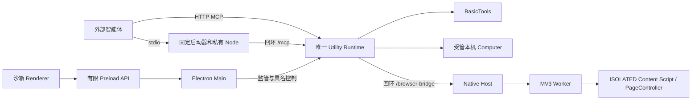

# Executor 架构与维护入口

本文汇总 Executor 与浏览器扩展的当前设计和已确认边界。更新日期：2026-10-14。实现状态与发布验收分开记录；Computer 已按用户决定启用，正式发行与独立电脑验收仍单独记录。

2026-10-16 按 [ADR-0084：系统 Shell](../adr/0084-executor-system-shell.md) 将 Windows 命令工具改为系统 PowerShell 5.1；Linux/macOS 仅 if-else、注释与未实现错误，不宣称跨平台支持。既有安装包不随源码更新，实际构建/回归及新包身份见验证记录。

## 阅读入口

| 文档                                                            | 唯一职责                                       |
| --------------------------------------------------------------- | ---------------------------------------------- |
| [开发指南](../../README.dev.zh-CN.md#executor-与浏览器插件构建) | 构建快速命令、开发入口与相关操作文档           |
| 本文                                                            | 产品范围、进程边界、授权、任务、MCP 与管理界面 |
| [Basic 工具](executor-basic-tools.md)                           | 文件、提交恢复、PowerShell、输出历史与搜索     |
| [Browser](executor-browser.md)                                  | Native Host、扩展、页面身份、工具、恢复与反馈  |
| [Computer](executor-computer.md)                                | 本机后端、观察与输入防护、彩屏、独立电脑矩阵   |
| [交付与离线验收](executor-delivery.md)                          | 固定资源、构建打包、验收工具、升级与发布门禁   |
| [验证状态与证据](executor-validation.md)                        | 当前覆盖、未完成项、历史失败与原始材料         |
| [Executor 发布 SOP](../../apps/executor/RELEASE.md)             | Windows 证书、签名接入、发行与回退             |
| [插件发布 SOP](../../apps/browser-extension/RELEASE.md)         | 商店账号、扩展身份、ZIP、审核与更新            |

用户操作分别以 [Executor 安装说明](../../apps/executor/INSTALLATION.md) 和 [扩展安装说明](../../apps/browser-extension/INSTALLATION.md) 为入口。项目规则留在各应用的 AGENTS.md；实现文件中的 Schema 是参数和容量的权威定义，文档不复制完整接口。

## 产品范围

Dr.Octopus Executor 0.0.1 是 Windows x64 本地工具执行器，由外部智能体负责规划、选择工具、动作顺序和是否继续。执行器负责校验、授权、执行、结果关联及资源生命周期，不运行模型或第二套 Agent Loop。

- Basic 的 read、write、edit、powershell、grep、find、ls 自行实现。Pi 只供语义和实现参考，不是 Executor 的运行或发行依赖。
- Browser 通过自有 WXT/MV3 扩展和固定 PageController 提供有限网页工具。
- Computer 只控制本机桌面；智能体可以在远端。唯一 Runtime 自动启动固定受管 owner；真实握手就绪后可显式授权查看或控制桌面，状态随健康探针更新。启用不代表独立电脑和正式发行验收通过。
- apps/desktop 留作未来 Web 智能体客户端，不承载本执行器。
- 私有 Node/Python、搜索等产品运行资源随包提供。普通构建和启动不下载、不现场编译、不回退系统 Node/Python；Shell 明确使用系统 PowerShell，不内置 PortableGit。任务明确要求联网安装项目依赖是另一类已授权业务操作。

## 进程与依赖边界

| 目录                              | 职责                                                      |
| --------------------------------- | --------------------------------------------------------- |
| apps/executor/src/main            | 单实例、窗口/托盘、安全、IPC、凭据和 Runtime 监管         |
| src/preload                       | 有限具名操作和可取消订阅，不暴露通用 IPC、文件或 Shell    |
| src/renderer                      | 状态、连接、设置的安全投影，不持有执行资源或凭据          |
| src/runtime                       | 唯一 TaskAuthority、工具服务、授权、持久结果与资源回收    |
| src/bridge                        | stdio 和 Native Messaging 转换，不能另起 Runtime          |
| src/contracts                     | 桌面跨进程 DTO/Schema，内部类型留在所属实现               |
| native、vendor                    | 有限 Windows 原语、固定后端与资源基线                     |
| scripts（含 lib）                 | JavaScript 工程入口与编译、装配、交付辅助，不承载业务规则 |
| src/maintenance、src/installation | 产品维护能力与平台安装实现                                |
| apps/browser-extension            | 独立构建的 Worker、页面适配和连接弹窗                     |
| packages/shared/src/protocol      | 两个应用共享的纯 Browser 协议                             |

扩展不反向导入 Executor 实现；PageController 不进入 Main/Runtime。Host 专属能力留在 Host，不为目录统一创建共享 Runtime 包。Agent Core 与共享 shadcn 源组件的保护规则继续适用。

## 设备授权与凭据

授权绑定本设备的客户端身份与明确能力，不绑定工作区，也不由工具参数授予权限。

| 能力             | 允许范围                                                 |
| ---------------- | -------------------------------------------------------- |
| files.read       | read、grep、find、ls                                     |
| files.write      | write、edit，包含 files.read                             |
| shell.execute    | PowerShell 及该身份拥有的 Shell 输出，不附带文件工具权限 |
| browser          | 有限 Browser 工具                                        |
| computer.observe | 显示器、窗口与观察；生产暂不可授权                       |
| computer.control | 有限桌面输入，包含 observe；生产暂不可授权               |

Main 以 Windows 用户密钥加密保存凭据，Runtime 保存认证摘要；Renderer 仅取得安全列表和占位符配置预览。创建授权、复制配置、可选下载、撤销分别完成，不强制导出文件。私有配置检查当前 SID ACL、普通路径、单链接及容量，已有配置文件不覆盖。

“复制给智能体”通过独立具名 IPC 由 Main 复用实时配置生成 Markdown 并写入剪贴板，只返回操作结果。文档包含目标设备、稳定连接键、授权能力、所选连接方式、配置合并与身份核对步骤，以及 Agent 本地工具发送/接收文件的能力前提及临时 HTTP 传输说明。Renderer 不能提交任意剪贴板文字或取得文档中的凭据。

安装目录或监听地址变化后，同一授权可以重新生成正确路径/地址的配置，无需重建授权。旧私有文件保持原样；客户端需重新复制配置。撤销即时阻止后续调用，设置网络关闭不等于撤销令牌。

未发布的工作区授权、旧 task_start 参数和旧 stdio 格式不兼容；不自动迁移、删除或重置旧数据。损坏或未知的控制记录应拒绝启动并保留原件。

## 设备身份与操作对象

Main 独立持久化实例 UUID 和设备显示名，首次名称取系统计算机名。身份目录沿用私有 ACL、有界顺序记录及 Basic 恢复目录排除；身份已初始化标记写入既有设置历史。先保存身份再保存标记，两步成功后才能开放 MCP；中断后沿用已写 ID，标记存在但身份缺失时拒绝启动并保留原件。

Runtime 在启动时取得经校验的身份快照。三个入口、不同授权均返回同一 `runtime_status.device`；初始化 instructions 与每个工具描述也暴露目标名称和完整 ID。截图工具说明提供中英文动作词并明确窗口区域范围。设备名称是数据，重名时必须核对完整 ID；不能把中文描述当成客户端已支持中文搜索的证明。改名保存后完整重启生效，既有任务不会因保存而停止；设置页分别展示当前与待生效名称。客户端需重新连接或重新发现。

对外配置使用 `octo` 加去连字符的完整 UUID，改名不改变键。前缀无分隔符，避免 adapter 字符转义扩大工具名称。旧外部键继续可用；私有 stdio 配置保留原固定产品键与严格校验。多个授权仍是同一设备，可由客户端显式设置别名。

设备身份不是认证凭据或硬件指纹，不改变能力授权。数据目录整体复制会复制身份，另一设备需独立初始化。持久化、生命周期与验收契约见 [ADR-0080](../adr/0080-executor-device-identity.md)。

## 统一任务与结果

task_start、task_status、task_stop、task_end 是产品工具，不等同于 MCP 原生 task 扩展。任务身份来自认证；任务能力必须是当前授权的子集。cwd 在创建时固定，省略时以用户主目录为基础，它是执行上下文，不是文件沙箱；纯 Browser/Computer 任务不要求文件目录存在。

一个 Runtime 只有一套全局执行准入、任务服务和持久历史。Browser 任务固定 connectionId，多实例必须明确选择。任务创建和副作用调用使用稳定幂等键；相同身份、工具和参数返回已保留结果，键被其他输入复用时拒绝。

接受调用、执行收束、业务成功分别判断。quiescent 只表示执行与必要清理已确认，不证明业务成功或无副作用。参数拒绝、已知失败、未知结果与清理未确认不能合并为一种成功。

- 停止和撤销先关闭新接单，并独立解除正在等待的操作，不能排在目标任务队列末尾。
- 文件提交已开始时等待其事实收束；PowerShell/本地 Computer 根据拥有的 Job/后端确认清理。未确认的执行或提交保留恢复屏障。
- Browser 已派发动作允许完成；取消、断线或 task_end 不保证撤回，不建立浏览器强停止或许可世代。不自动重放未知动作。
- 重启只恢复持久结果和恢复门禁，不恢复旧任务执行。已完成 write/edit 可按原键取得保留摘要，不重新打开文件、不重复发布，也不重建全文 diff。
- 文件、页面、桌面各自管理观察版本；跨能力调用按所属契约使观察失效，不使用一个通用时间戳。

具体 TTL、空闲与总寿命、队列、日志和输出配额以所属模块为准；不要把旧设计建议值写成当前性能承诺。

## MCP 接入与等待

三个外部入口共享同一授权、任务和预算：

| 入口          | 行为                                                                 |
| ------------- | -------------------------------------------------------------------- |
| 本机 HTTP     | 默认仅数字回环 127.0.0.1 的 /mcp                                     |
| stdio         | 固定 mcp-launcher.exe 和私有 Node 转换 JSON-RPC，内部仍使用回环 /mcp |
| 内网/VPN HTTP | 显式选择本机私有 IPv4，同一端口增加监听，开放 /mcp 与认证传输路由    |

网络地址只接受 RFC1918 或 100.64.0.0/10，不接受 wildcard、DNS、公网或 IPv6。保存后完整退出再启动；任一监听失败都清理本次监听并报告失败，不自动换端口、换地址或静默退回回环。

文件传输按 [ADR-0079](../adr/0079-executor-file-transfer.md)：Agent 直接调用 MCP 准备上传/下载、查询和取消，使用已有本地 HTTP 工具在同端口 `/transfers/:transferId/content` PUT/GET 完整文件流。仅就绪传输返回绑定任务和方向的临时凭证，字节通道不使用长期设备 Bearer。无需独立客户端；不支持本地文件发送/接收的 Agent 不应调用。默认单文件 2 GiB，目标存在即拒绝，任务 30 分钟期限不变；下载完成仅表示 Executor 完成发送，Agent 本地落盘由其工具确认。实际验证见[验证记录](executor-validation.md)。

每个入口精确校验 Host、Origin、协议版本、角色、凭据和会话。网络入口不路由 /browser-bridge，Browser 凭据不认证 MCP；会话绑定身份和入口，不能跨入口复用。HTTP 不宣称可验证对端 Windows 登录令牌，也不隔离已控制当前账号的程序。明文 HTTP 只用于已选择的可信网络，不自动配置防火墙、转发或 TLS。

HTTP 使用已锁定 SDK 的标准 SSE 回复和 15 秒 keep-alive 评论帧。评论帧不表示执行进度或成功；断线不恢复事件流或重放动作。客户端请求超时、授权 waitBudgetMs、任务寿命、PowerShell 命令期限分别生效。600 秒等待预算保留停止和结果封装时间，当前 PowerShell 有效期限为 590 秒。

stdio 的 stdout 只承载协议。单帧 24 MiB、待写 48 MiB，最多 8 个未完成请求、12 个在途发送；拒绝重定向和超限响应。离线、撤销或断线结束适配器，不启动 Runtime。EOF 尝试有界 HTTP DELETE；五秒退出后备仅结束当前适配器，不代表共享 Runtime 的动作已停止。随包 stdio-exit.node 是阻塞输出下的必要资源，不用客户端强杀替代正常退出验证。

## 管理界面与生命周期

界面为状态、连接、设置三页。状态页显示真实 Runtime 健康、已接入客户端和可用能力；连接页管理授权、客户端配置和默认收起的安装说明；设置页保存主题、监听与关闭行为。客户端接入面板集中展示接入说明、客户端名称和管理授权入口，不展示协议会话计数；健康探测不代替工具验收。

状态页通过受信 Host 的 access-list 读取 toolCatalog，名称从 MCP 注册 Schema 生成，计数取返回数组长度，不在 Renderer 写死。按基础、文件传输、任务管理、浏览器、桌面分组展示；“已注册”不表示逐工具执行探测或客户端已获授权。文件传输只展示 Executor 实际注册的四个文件传输工具，并注明需要 Agent 已有的本地 HTTP 文件传输能力。连接名称列最多 160px，名称和权限溢出都用 title 保留全文。

工具概览顺序为基础、文件传输、任务管理、桌面、浏览器。列表仅显示功能文案，四类工具统一通过“注册数量＋箭头”打开 Dialog 查看工具清单与限制；桌面实际就绪状态在弹窗说明中保留。浏览器继续通过状态＋箭头进入桥接管理页，其完整工具清单放在管理页折叠项中。

服务详情默认折叠，内含连接地址和“客户端会话”。此处 connections 统计已初始化且未回收的 MCP 会话，不表示实时网络在线；每两秒刷新只更新会话列表。空列表显示“暂无有效 MCP 会话”，非空显示“以下客户端持有有效 MCP 会话”，并注明连接关闭后会话可能暂时保留。同一授权的多个会话仍按一个授权名称展示，不新增未经验证的在线徽章。

连接页的浏览器工具与安装说明复用同一 Collapsible/Button 箭头样式。配置摘要只在设备名称行显示名称，完整设备 ID 和连接标识分别显示，改名/重名说明归在名称下。设置分区标题与说明使用 gap-2，分区头与表单使用 gap-5；简短字段说明优先精简，不用强制不换行导致窄屏溢出。

标题栏使用原生 Window Controls Overlay，原生按钮尺寸由系统管理。界面主题默认跟随系统，也可在设置页选择明亮或暗黑；保存后立即同步页面、窗口背景和原生标题栏，并在重启后恢复。跟随系统时，系统主题变化即时生效。关闭窗口默认留在系统托盘；可选任务栏或关闭窗口和服务，已保存偏好保留。隐藏/重建界面保持同一 Runtime、连接和任务；完整退出复用 Main 的有界清理流程。

使用共享 shadcn 原语、Lucide 和应用包装，保留默认控件尺寸。无演示连接、假健康、占位操作或废弃最小化 IPC。设置提示只描述实际生效时机，复制反馈短暂展示，失败可见；浅深色、减少动态效果、窄窗口与滚动区域需验证。

## 设置重启提示与完整重启

正式业务数据统一放在 `~/.dr-octopus/executor`：settings.json 与 device、connections、tasks、browser、file-operations、shell、transfers、settings-recovery。AppData 仅留 Electron 缓存；可丢弃搜索快照使用 os.tmpdir() 中每次 Runtime 独立的私有目录，设置和传输恢复证据不放临时目录。同卷提交暂存仍在目标旁。独立实例和测试使用 userData/project，不自动导入或回退旧路径。Basic 文件/搜索按完整路径排除内部存储，PowerShell 不宣称同等隔离。完整契约见 [ADR-0083](../adr/0083-executor-project-storage.md)。

文件传输设置按上传/下载方向分别限制单文件大小，另配置执行体临时额度及磁盘余量；默认 2048/2048/8192/512 MiB。Runtime 使用启动时快照，`runtime_status.transferLimits` 返回生效值；智能体侧磁盘额度独立。降低额度不删除残留材料，新准入仍计入未清理占用。

已保存的设备名称、监听端口、内网设置或文件传输限制与运行快照不同时，所有管理页顶部显示悬浮 warning 提示，滚动时保持可见。“立即重启”仅应用已保存设置；存在未保存草稿或保存仍在进行时，按钮禁用。

Renderer 通过具名 `restartApplication` Preload API 请求重启，Main 校验注册窗口、主 frame、origin、空输入及已保存待生效状态。重启被接受后拒绝新的设置写入，重复请求合并；不暴露命令、程序路径或启动参数。

Main 复用有界退出流程，确认唯一 Runtime 退出并释放资源后才重开应用；退出未获确认时不重新启动。开发版通过应用契约中的退出码通知现有 dev 启动器，保留 Vite 并串行启动下一代 Electron；停止启动器后不自动重启。

## 决策索引

[ADR-0072](../adr/0072-executor-layout-and-frontend.md) 固定应用归属与进程/前端边界；
[ADR-0073](../adr/0073-windows-mcp-local-and-remote.md) 固定 Computer 本机目标；
[ADR-0074](../adr/0074-browser-bridge-loopback-http.md) 固定 Browser 专用回环协议；
[ADR-0075](../adr/0075-executor-stdio-loopback-http.md) 固定 stdio 复用 MCP HTTP；
[ADR-0076](../adr/0076-executor-private-network-http.md) 固定可信网络入口；
[ADR-0077](../adr/0077-executor-device-authorization.md) 固定设备能力授权。

维护时将当前契约改到所属文档，将新验证结果更新到验证矩阵。不要再按开发日期新增重复的实施、修复、收尾或下一阶段文档。
